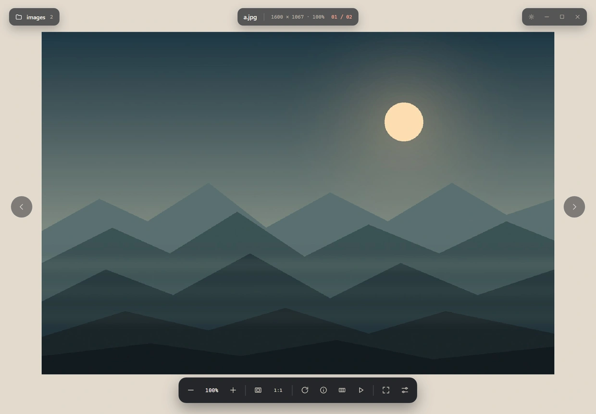
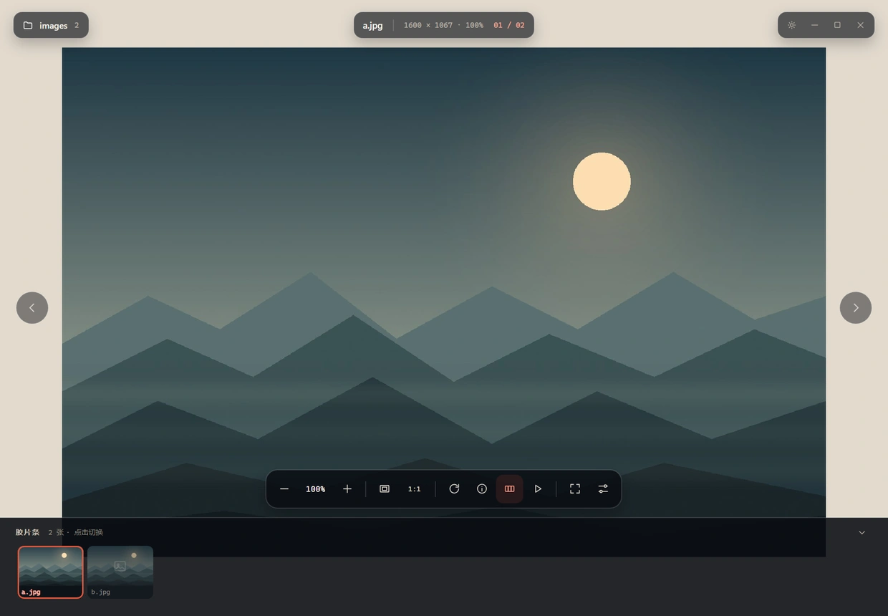
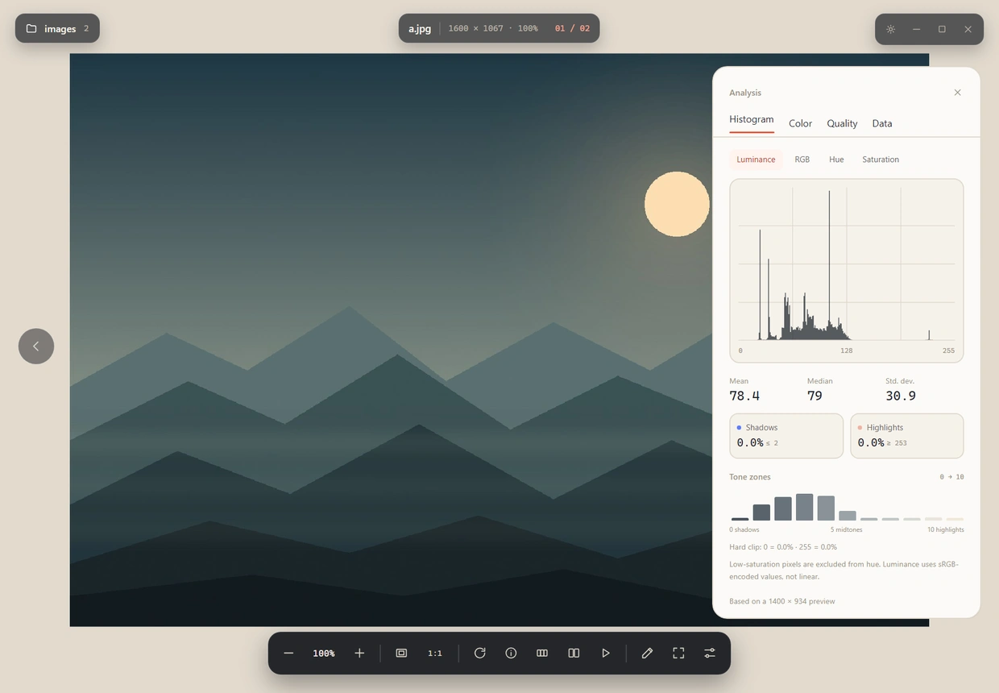
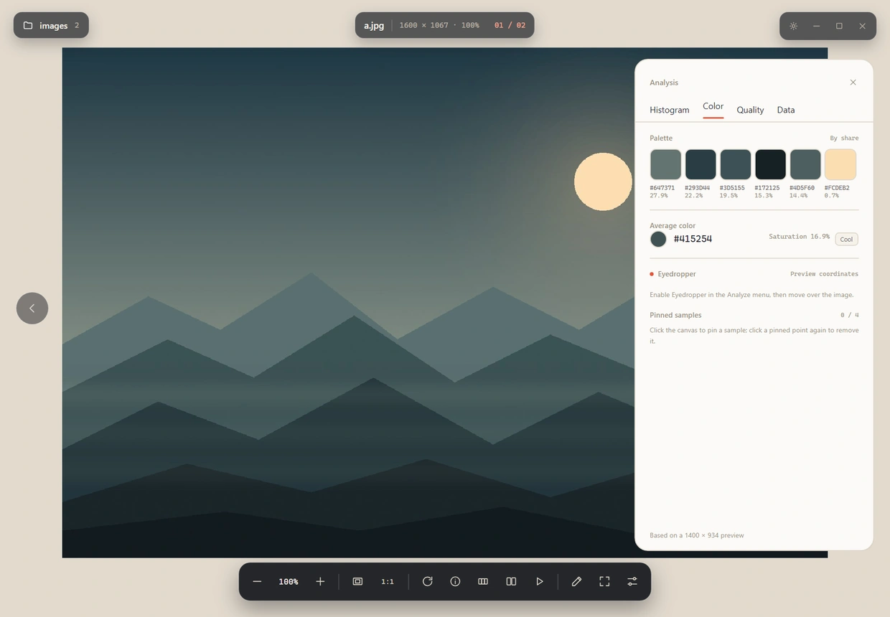
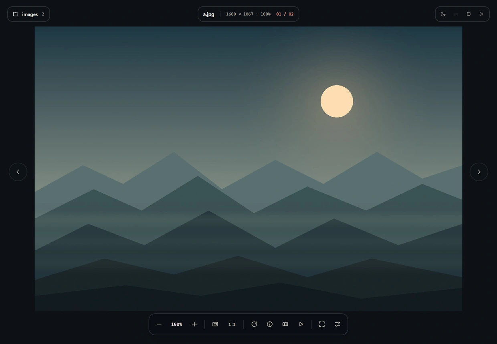
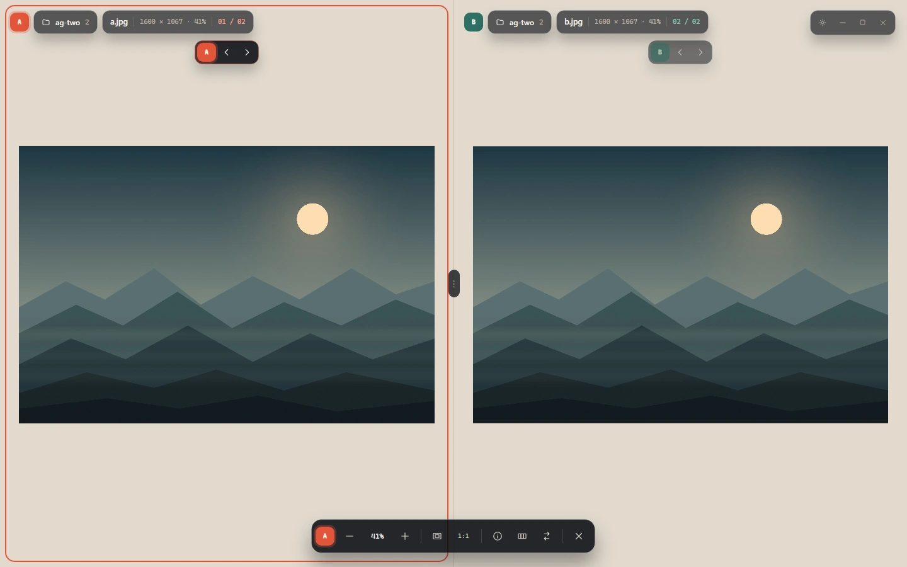

<p align="center">
  <strong>English</strong> &nbsp;·&nbsp; <a href="README.zh-CN.md">简体中文</a>
</p>

<h1 align="center">AirGlance</h1>

<p align="center">
  <strong>Whole folders, one glance.</strong>
</p>

<p align="center">
  <a href="https://apps.microsoft.com/detail/9p30h2pjg0f6"><strong>Microsoft Store</strong></a>
  &nbsp;·&nbsp;
  <a href="https://github.com/RyzenWang/AirGlance/releases/latest">Latest releases</a>
</p>

AirGlance is a desktop image viewer for Windows, macOS and Linux. It opens a folder, shows one image, and lets you step through the rest without tabs, libraries or a workspace. Version 0.7.2 is the current build and the latest public binary release. It is deliberately small.

> **Windows:** the [Microsoft Store](https://apps.microsoft.com/detail/9p30h2pjg0f6) build is the recommended install and updates through the Store. The Store listing can trail the GitHub release; portable archives for Windows, macOS and Linux remain on [GitHub Releases](https://github.com/RyzenWang/AirGlance/releases/latest).

- [Download](#install) · [Image formats](#image-formats) · [Keyboard](#keyboard) · [Performance](#performance) · [Known limitations](#known-limitations) · [Build from source](#build-from-source)

## What it does

- Opens from the command line, a drag-and-drop, or the open dialog. The window appears first; the image follows as soon as it is decoded.
- Browses one folder in natural name order (`img2` before `img10`), or by modification date, file size or file type, ascending or descending; the 160 px filmstrip and wrap-around previous / next work the same either way.
- Opens a second canvas with `D` or the split-view button in the dock. The two canvases can show adjacent images from one folder or independent A/B folders; click a canvas or press `Tab` to choose the active one. The active canvas is marked by a 2 px identity border and badge ring; the other image is not dimmed. Right-click either canvas for a pane-specific menu, including Open folder… and Swap A/B.
- The right pane header reserves the window-control area and a fixed page-counter slot. Folder names are capped at 12 characters; file names are capped at 8 characters at the default width (14 wide), keep the extension, and show the full name on hover. The file chip is capped at 340 px, and nothing draws under the Maximize button.
- Each canvas has its own previous/next capsule above the image. It targets only that canvas; the inactive pair is at 60% opacity but still clickable, and the pair is hidden when that canvas is empty or has one image.
- The dual filmstrip is split 50/50: A's folder list on the left, B's folder list on the right, each scrolling and selecting independently. An empty half shows only its A/B badge, with no text or button; if both sides are empty the filmstrip is disabled. The information drawer has A/B tabs.
- Fit window, fit width, fit height and 100% views with animated zoom transitions; the wheel zooms around the pointer, Shift + wheel pans sideways, dragging pans, double-click toggles 100% and fit. An optional lock keeps the zoom you chose when you step to the next image instead of refitting it.
- Applies the EXIF orientation before the first pixel is shown, and converts embedded ICC profiles (Display P3, Adobe RGB) to sRGB for display.
- Rotates, flips and crops non-destructively in the Edit drawer (`Ctrl+E`); Cancel restores the previous view and the original file is never written. Export a copy as JPEG, PNG or WebP with quality and resize options, or copy the image to the clipboard.
- Fullscreen, a 3 / 5 / 10 second slideshow, and an information panel with file, image, ICC and EXIF fields.
- Right-click → Analyze opens a read-only drawer with luminance/RGB/hue/saturation histograms, clipping and tone zones, a palette and eyedropper samples, sharpness/noise/JPEG estimates and image data. Single images only; nothing is exported.
- Jump to a file by typing its name (`Ctrl+F`) instead of scrolling a long filmstrip, and reopen one of the last ten folders from the context menu. The recent list is a short path list in the settings file, not a library.
- English and Chinese switch at runtime. Light, dark and follow-system themes.
- Settings and thumbnails stay on your machine. There is no account, no telemetry, and no network code.

## Screenshots

| Viewer | Filmstrip |
| --- | --- |
|  |  |

| Info panel | Empty state |
| --- | --- |
|  |  |

| Analysis | Analysis — colour |
| --- | --- |
|  |  |

| Dark theme | Fullscreen |
| --- | --- |
|  |  |

| Dual canvas |
| --- |
|  |

## Image formats

A file is recognised by its extension. Ordinary raster formats decode with SkiaSharp; TIFF decodes with LibTiff, SVG is parsed and rasterized with Svg.Skia, and AVIF uses a bundled libavif + dav1d decoder on Windows x64/arm64, macOS and Linux. The supported formats are:

| Format | Extensions | Notes |
| --- | --- | --- |
| JPEG | `.jpg`, `.jpeg`, `.jfif` | EXIF orientation and embedded ICC to sRGB. JPEG copies flatten transparency onto white. |
| PNG | `.png` | Alpha and embedded ICC are preserved. A 16-bit PNG is reported as 16-bit but displayed and saved at 8-bit. |
| WebP | `.webp` | Still images with alpha; embedded ICC to sRGB. Animated WebP plays and loops like GIF. |
| AVIF | `.avif` | Windows x64/arm64, macOS x64/arm64 and Linux x64/arm64. First frame, alpha, 10/12-bit sources, `irot`/`imir`, clean aperture, ICC/EXIF metadata. AVIF export is not supported. The Windows arm64 build uses a cross-compiled arm64 decoder without x86 SIMD. |
| BMP | `.bmp` | Decoded through SkiaSharp. |
| GIF | `.gif` | Animated GIFs play and loop automatically; static GIFs show one frame. |
| ICO | `.ico` | One image is selected from the icon by the codec. |
| TIFF | `.tif`, `.tiff` | First page only. Common LZW, Deflate and JPEG-compressed TIFFs; orientation, alpha and 16-bit sources are handled. |
| SVG | `.svg` | Static vector graphics, rasterized at the display size with Svg.Skia. CSS is rendered; JavaScript is not executed. |

Not supported:

- HEIC / HEIF
- RAW camera formats such as CR2, CR3, NEF, ARW, DNG, RAF, ORF and RW2
- Video files such as MP4, MOV, WebM and MKV

Why these are absent:

- **HEIC / HEIF** need a native HEVC decoder. AirGlance does not bundle one, so these formats are outside the current package. AVIF uses AV1 instead of HEVC and is supported by the Windows x64/arm64, macOS and Linux builds.
- **RAW** files are not display-ready pixels. Opening one requires demosaicing, white balance, a camera colour matrix, tone mapping and often lens corrections. That is a separate LibRaw-class engine, not a decoder switch.
- **Video** needs demuxing, a video decoder, audio/video synchronisation and a media stack such as FFmpeg or the OS media APIs. That is outside a still-image viewer, and the codec licensing and package size are significant.

AirGlance uses SkiaSharp for ordinary raster formats, LibTiff for TIFF, Svg.Skia for SVG, and a bundled libavif + dav1d decoder for AVIF on Windows x64/arm64, macOS and Linux. There is no libvips native payload and no platform-codec fallback. A build that does not contain the AVIF decoder hides `.avif` from the file picker and folder scan instead of advertising a format it cannot open.

## Install

Windows users should install from the [Microsoft Store](https://apps.microsoft.com/detail/9p30h2pjg0f6); portable archives for all platforms are on the [v0.7.2 GitHub release](https://github.com/RyzenWang/AirGlance/releases/tag/v0.7.2). The Store listing can trail the GitHub release.

### Microsoft Store (Windows)

1. Open [AirGlance on the Microsoft Store](https://apps.microsoft.com/detail/9p30h2pjg0f6).
2. Choose **Get** or **Install**. Updates arrive through the Store.

### Windows portable

1. Download `AirGlance-0.7.2-win-x64.zip` (or `win-arm64`).
2. Unzip it anywhere and run `AirGlance.exe`.

The Windows portable build is not code-signed, so SmartScreen warns the first time. Choose **More info → Run anyway**. The executable is a NativeAOT build; it does not need a .NET runtime installed.

### macOS

1. Download `AirGlance-0.7.2-osx-arm64.zip` or `-osx-x64.zip`.
2. Unzip `AirGlance.app`, then right-click the app and choose **Open** the first time. Gatekeeper will keep blocking a normal double-click until the app is notarised, which 0.7.2 is not.

### Linux

```bash
tar -xzf AirGlance-0.7.2-linux-x64.tar.gz
./AirGlance
```

The archive also contains `airglance.desktop` and PNG icons. Copy them into `~/.local/share/applications/` and `~/.local/share/icons/hicolor/` for a menu entry. The portable build registers no default handler.

### Platform status

The release publishes six archives. Runtime verification is narrower than that:

| Platform | Archive | NativeAOT binary actually run |
| --- | --- | --- |
| Windows x64 | `win-x64.zip` | **Verified** — the 0.7.2 local AOT build launched and displayed an image |
| Linux x64 | `linux-x64.tar.gz` | **Verified** by the maintainer against 0.1.1 |
| Windows arm64 | `win-arm64.zip` | Unverified |
| macOS arm64 | `osx-arm64.zip` | Unverified |
| macOS x64 | `osx-x64.zip` | Unverified |
| Linux arm64 | `linux-arm64.tar.gz` | Unverified |

"Verified" means the AOT binary was launched and displayed an image. The Windows x64 entry refers to the 0.7.2 local AOT build; the previously published 0.5.0 archive was smoke-tested with JPEG, TIFF, SVG and GIF files; the Linux x64 entry was verified against 0.1.1 by the maintainer. The other archives are produced by CI but have not been run on their platform. Clipboard image copy was verified on Windows x64 with PNG and JPEG files; copy-path and Windows display scaling above 100% are still unverified. See [shipping](docs/shipping.md).

The Windows x64 build is also distributed through the [Microsoft Store](https://apps.microsoft.com/detail/9p30h2pjg0f6); the Store listing can trail the GitHub release, and Store updates are handled by Windows.

## Keyboard

Mouse and trackpad:

| Action | Behavior |
| --- | --- |
| Wheel | Zoom at the pointer |
| Shift + wheel | Pan sideways |
| Drag | Pan when the image is larger than the viewport |
| Double-click | Toggle fit window and 100% |
| Left/right edge buttons | Previous / next image |
| Click a canvas | Make it the active A/B canvas |
| Drag the divider | Change the dual-canvas split (25%–75%); double-click resets 50/50 |

| Key | Action |
| --- | --- |
| `Ctrl+O` / `Ctrl+Shift+O` | Open an image / a folder |
| `←` `→` | Previous / next image |
| `PgUp` `PgDn` | Previous / next image, always |
| `Space` / `Backspace` | Next / previous image |
| `+` `-` | Zoom in / out around the pointer |
| `0` `1` `2` `3` | Fit window / 100% / fit width / fit height |
| `R` / `Shift+R` | Rotate clockwise / counter-clockwise (single view; deferred in dual view) |
| `H` / `V` | Flip horizontally / vertically (single view; deferred in dual view) |
| `F` / `F11` / `Esc` | Fullscreen; exit fullscreen or close overlays |
| `S` | Start or stop the slideshow; any key stops it (disabled in dual view) |
| `I` / `C` | Information panel / split filmstrip |
| `D` | Enter or leave dual view |
| `Tab` / `Shift+Tab` | Switch the active A/B canvas |
| `X` | Swap the two dual-view canvases |
| `Shift+F10` / right-click | Open the active pane menu in dual view |
| `Ctrl+C` | Copy the image (active preview in dual view) |
| `Ctrl+Shift+C` | Copy the active image path (single view) |
| `Ctrl+Shift+S` | Save a copy (single view; deferred in dual view) |
| `Ctrl+E` | Open or close the Edit drawer |
| `Ctrl+F` | Jump to a file by typing its name (Esc cancels) |
| `Ctrl+Shift+L` | Switch English / Chinese |
| `F1` | The full shortcut list |

Right-click the image for open, sort by, recent folders, copy, show-in-folder, open-with and settings. In dual view, right-clicking a canvas opens that pane’s menu first and targets only that pane.

## Performance

Measured on Windows 10 Pro 22H2 (19045), 2 × Intel Xeon E5-2697 v4 (16 cores), 32 GB RAM, .NET 10.0.14, NativeAOT `win-x64`. The runs used an empty settings directory so they opened at the default fit window. Ten fresh processes for the 24 MP rows and five for the 100 MP row; median from `tools/bench.ps1`. The 0.7.0 column is an **older series**: commit `e25739d` moved the first-frame mark into the render pass that draws the pixels, where it used to wait behind the filmstrip and panel construction, and the peak working set is read when that mark is reported, so 0.7.0 and the later columns measure different points and must not be compared row by row. 0.7.1 was measured on its published binary; 0.7.2 on the NativeAOT build of its release commit, because the dependency bump only changes which native SkiaSharp library is linked. The full method and raw values are in [docs/performance.md](docs/performance.md).

| Metric | Target | 0.7.0 (old mark) | 0.7.1 | 0.7.2 |
| --- | --- | --- | --- | --- |
| Cold start to first window | ≤ 500 ms | 250.5 ms | 250.7 ms | 256.4 ms |
| 24 MP JPEG first frame | ≤ 500 ms | 415.7 ms | 265.9 ms | 272.9 ms |
| 100 MP JPEG first frame (fit window) | ≤ 2.0 s | 341.4 ms | 309.9 ms | 323.3 ms |
| 24 MP fit-window peak working set | ≤ 250 MB | 88.1 MB | 63.6 MB | 63.6 MB |
| Windows x64 portable zip | ≤ 30 MB | 21.84 MiB | 21.79 MiB | 22.19 MiB |

0.7.2 meets every target on the reference machine: the window is up in about 256 ms, a 24 MP image is on screen in about 273 ms and a 100 MP one in about 323 ms, with a peak working set of about 64 MB. The 0.7.2 medians sit 2–4 % above 0.7.1 and its p95 is wider (600 ms first window), which is the machine's spread rather than a regression: the same commit measured 249.3 ms and 265.1 ms on the first run of the dependency bump, and the decode time did not move at all. The portable archive grew by 0.39 MiB over 0.7.1 (22.19 MiB against 21.79 MiB), which is the larger SkiaSharp native library and well inside the 30 MB budget. A cold first run can be slower while the operating system scans the executable, so the median is the number to compare with the budget. The numbers are measured, not projections. See [docs/performance.md](docs/performance.md) for the raw runs.

## Known limitations

These are limitations, not a promise list.

- HEIC/HEIF and camera RAW are not supported, and they are named rather than hidden: opening a folder reports how many such files it skipped, and dropping one says which decoder is missing. AVIF is supported by the Windows x64/arm64, macOS x64/arm64 and Linux x64/arm64 builds; the Windows arm64 decoder is cross-compiled without x86 SIMD.
- AVIF shows the first frame only; animated AVIF is not played. AVIF cannot be written by Save copy.
- Animated GIFs and animated WebP play; APNG remains a still image. Video is not supported.
- TIFF shows the first page only. BigTIFF is supported and fixture-tested; some exotic compression variants remain outside the support contract; the managed LibTiff path covers stripped, tiled, pyramidal and planar files, including 8/16-bit RGB, CMYK, RGBA, float and palette data.
- No gallery, database, tags, ratings, search, batch conversion or rename, filters, layers, text, stitching, cloud sync or accounts.
- No tabs. Dual view is one window with two explicit A/B canvases, not a tab strip. No tray icon. A second launch forwards its path to the running window instead of opening another process, scoped to the same settings directory.
- Dual view loads bounded previews on both sides; per-canvas rotate/flip, save-copy and slideshow are deferred. Two 100 MP images at 100% simultaneously are not supported, and pair stepping (left N / right N+1) is not included.
- Crop, rotate and flip are session edits. There is no lossless JPEG rotation, and the original file is never rewritten. Editing is disabled in dual view and for proxy-only or tiled images.
- 16-bit PNGs are reported as 16-bit but displayed and re-saved as 8-bit.
- 100 MP images use a file-backed tile cache at 100%. The tile writer streams a JPEG's scanlines straight into the tile file, so a 10000 × 10000 JPEG peaks at about **128 MB** — down from the **478 MB** that 0.7.1 needed, measured with the same script on the same machine (three runs, working set sampled every 100 ms). The temporary tile file is still about 400 MB while the image is open. PNG cannot be streamed this way because Skia exposes no scanline decode for it, so a 48 MP PNG can still peak near 300 MB; smaller machines should keep very large PNGs to fit view.
- The Windows portable build is unsigned and the macOS build is not notarised. The Microsoft Store build is available through the Store listing; the portable build remains the offline/arm64 option.

## Build from source

You need the .NET 10 SDK. The solution targets `net10.0` and pins the SDK to 10.0.100 with `rollForward: latestFeature`.

AVIF decoding also needs the bundled native decoder. Windows x64 uses Visual Studio C++ tools, CMake/Ninja, Python + Meson and NASM:

```powershell
powershell -ExecutionPolicy Bypass -File native/avif/build.ps1
```

macOS and Linux use CMake, Ninja, Meson and (on x64) NASM:

```bash
bash native/avif/build.sh
```

The packaging scripts build it automatically for their target. Without the native library, `.avif` is hidden from the file picker and folder scan, and the Windows AVIF test fails with a build instruction. The Windows arm64 decoder is built by `native/avif/build-win-arm64.ps1` with LLVM:

```powershell
powershell -ExecutionPolicy Bypass -File native/avif/build-win-arm64.ps1 -LlvmDirectory "C:\Program Files\LLVM\bin"
```

See [native/avif/README.md](native/avif/README.md).

```bash
git clone https://github.com/RyzenWang/AirGlance.git
cd AirGlance
dotnet restore AirGlance.sln
dotnet build AirGlance.sln -c Release
dotnet test AirGlance.sln -c Release
```

Run it:

```bash
dotnet run --project src/AirGlance.App -- path/to/photo.jpg
```

NativeAOT publish for this machine:

```bash
dotnet publish src/AirGlance.App/AirGlance.App.csproj \
  -c Release -r win-x64 -p:PublishAot=true -p:StripSymbols=true
```

`packaging/scripts/pack.ps1` and `pack.sh` wrap the per-platform packaging. AOT builds cannot be cross-compiled, so each platform is built on its own machine.

Tests cover EXIF orientations 1–8, ICC conversion, scaled decoding, the natural sort, folder enumeration, settings recovery, thumbnail caching, export and filename safety, and the view model plus real window keyboard flow. See `tests/`.

## Command line

```text
AirGlance [options] [file or folder]

  -h, --help            Show help
      --version         Show the version
      --bench=startup   Measure first window, first frame and memory, then exit
      --bench=decode    Measure a fit-window decode, then exit
      --bench=scan      Measure folder enumeration and first thumbnails, then exit
  --                    Treat every following argument as a path
```

A folder opens its first supported image. The first displayable path wins; other arguments are ignored. `--bench=startup` prints `first_window_ms`, `first_frame_ms`, `decode_ms`, `image_mp` and `peak_ws_mb` to standard output.

## Privacy

AirGlance makes no network connections: no `HttpClient`, no network sockets, no telemetry, no crash upload and no update check. A second launch hands its path to the running window over a local named pipe scoped to the same settings directory, so it never leaves the machine. The only outbound action is a link you click yourself: the GitHub entry in the status bar opens your browser. Settings live in the per-user settings folder; thumbnails live in the per-user cache and are removed after 30 days.

## License

MIT. See [LICENSE](LICENSE) and [THIRD-PARTY-NOTICES.md](THIRD-PARTY-NOTICES.md).

More detail: [architecture](docs/architecture.md) · [format matrix](docs/formats.md) · [performance method](docs/performance.md) · [shipping](docs/shipping.md) · [interaction design](docs/design/interaction-v2.en.md) · [dual-canvas design v6](docs/design/dual-view-v6.en.md) · [changelog](CHANGELOG.md).
