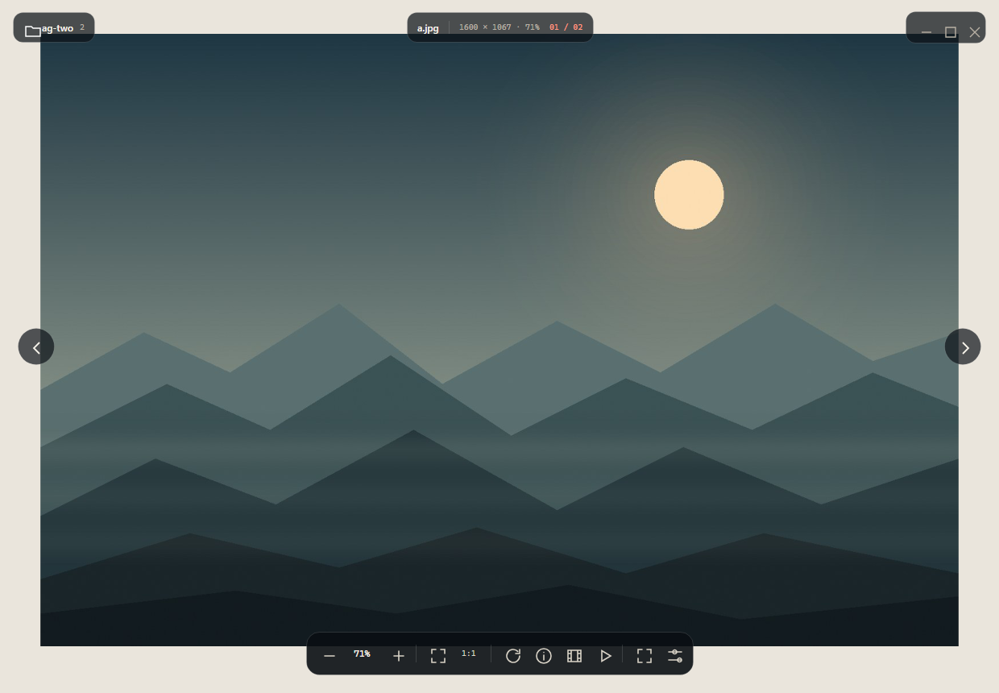
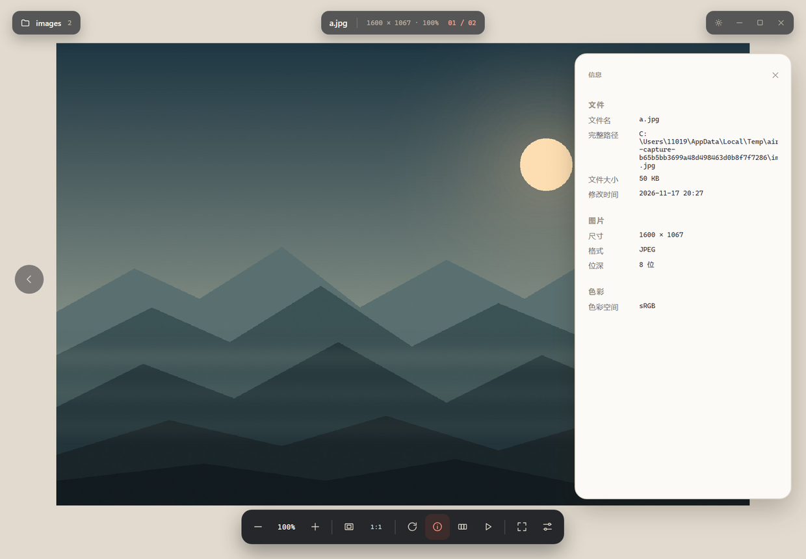

# AirGlance

**English** · [简体中文](README.zh-CN.md)

**Whole folders, one glance.** · 「一个文件夹，一眼看完。」

AirGlance is a desktop image viewer for Windows, macOS and Linux. It opens a folder, shows one image, and lets you step through the rest without tabs, libraries or a workspace. Version 0.4.0 is the current development build; 0.3.0 is the latest public release. It is deliberately small.

- [Download](#install) · [Image formats](#image-formats) · [Keyboard](#keyboard) · [Performance](#performance) · [Known limitations](#known-limitations) · [Build from source](#build-from-source)

## What it does

- Opens from the command line, a drag-and-drop, or the open dialog. The window appears first; the image follows as soon as it is decoded.
- Browses one folder in natural order (`img2` before `img10`), with a 160 px filmstrip and wrap-around previous / next.
- Opens a second canvas with `D` or the split-view button in the dock. The two canvases can show adjacent images from one folder or independent A/B folders; click a canvas or press `Tab` to choose the active one. The active canvas is marked by a 2 px identity border and badge ring; the other image is not dimmed. Right-click either canvas for a pane-specific menu, including Open folder… and Swap A/B.
- The right pane header reserves the window-control area and truncates its file/folder chips instead of drawing under the Maximize button.
- Each canvas has its own previous/next capsule above the image. It targets only that canvas; the inactive pair is at 60% opacity but still clickable, and the pair is hidden when that canvas is empty or has one image.
- The dual filmstrip is split 50/50: A's folder list on the left, B's folder list on the right, each scrolling and selecting independently. An empty half shows only its A/B badge, with no text or button; if both sides are empty the filmstrip is disabled. The information drawer has A/B tabs.
- Fit window, fit width and 100% views; the wheel zooms around the pointer, Shift + wheel pans sideways, dragging pans, double-click toggles 100% and fit.
- Applies the EXIF orientation before the first pixel is shown, and converts embedded ICC profiles (Display P3, Adobe RGB) to sRGB for display.
- Rotates and flips for display only. Save a copy as JPEG, PNG or WebP, or copy the image; the original file is never written.
- Fullscreen, a 3 / 5 / 10 second slideshow, and an information panel with file, image, ICC and EXIF fields.
- English and Chinese switch at runtime. Light, dark and follow-system themes; the system high-contrast setting is honoured.
- Settings and thumbnails stay on your machine. There is no account, no telemetry, and no network code.

## Screenshots

| Viewer | Filmstrip |
| --- | --- |
|  |  |

| Info panel | Empty state |
| --- | --- |
|  |  |

| Dark theme | Fullscreen |
| --- | --- |
|  |  |

| Dual canvas |
| --- |
|  |

## Image formats

A file is recognised by its extension. Raster formats must also decode with SkiaSharp; SVG is parsed and rasterized with Svg.Skia. The supported formats are:

| Format | Extensions | Notes |
| --- | --- | --- |
| JPEG | `.jpg`, `.jpeg`, `.jfif` | EXIF orientation and embedded ICC to sRGB. JPEG copies flatten transparency onto white. |
| PNG | `.png` | Alpha and embedded ICC are preserved. A 16-bit PNG is reported as 16-bit but displayed and saved at 8-bit. |
| WebP | `.webp` | Still images with alpha; embedded ICC to sRGB. |
| BMP | `.bmp` | Decoded through SkiaSharp. |
| GIF | `.gif` | Animated GIFs play and loop automatically; static GIFs show one frame. |
| ICO | `.ico` | One image is selected from the icon by the codec. |
| TIFF | `.tif`, `.tiff` | First page only. Common LZW, Deflate and JPEG-compressed TIFFs; orientation, alpha and 16-bit sources are handled. |
| SVG | `.svg` | Static vector graphics, rasterized at the display size with Svg.Skia. CSS is rendered; JavaScript is not executed. |

Not supported:

- HEIC / HEIF
- AVIF
- RAW camera formats such as CR2, CR3, NEF, ARW, DNG, RAF, ORF and RW2
- Video files such as MP4, MOV, WebM and MKV

Why these are absent:

- **HEIC / HEIF and AVIF** need native HEVC/AV1 codec libraries that are not part of the SkiaSharp build AirGlance ships. HEIC also brings HEVC patent licensing, and both need their own container, orientation and colour handling.
- **RAW** files are not display-ready pixels. Opening one requires demosaicing, white balance, a camera colour matrix, tone mapping and often lens corrections. That is a separate LibRaw-class engine, not a decoder switch.
- **Video** needs demuxing, a video decoder, audio/video synchronisation and a media stack such as FFmpeg or the OS media APIs. That is outside a still-image viewer, and the codec licensing and package size are significant.

AirGlance deliberately uses SkiaSharp for raster formats and Svg.Skia for SVG on every platform instead of falling back to OS codecs. Adding native codecs would make Windows, macOS and Linux behave differently, add per-platform native libraries and licensing, and could push the AOT packages toward or past the 30 MB size budget.

The formats above are deliberately absent; there is no platform-codec fallback. Renaming a file to a supported extension does not help: the content check still fails, and the file is reported as corrupt rather than opened. Files with an unsupported extension are rejected even if their content happens to be a supported image.

## Install

0.3.0 is not on the product site yet. Download it from the [v0.3.0 GitHub release](https://github.com/RyzenWang/AirGlance/releases/tag/v0.3.0).

### Windows

1. Download `AirGlance-0.3.0-win-x64.zip` (or `win-arm64`).
2. Unzip it anywhere and run `AirGlance.exe`.

The 0.1 portable build is not code-signed, so SmartScreen warns the first time. Choose **More info → Run anyway**. The executable is a NativeAOT build; it does not need a .NET runtime installed.

### macOS

1. Download `AirGlance-0.3.0-osx-arm64.zip` or `-osx-x64.zip`.
2. Unzip `AirGlance.app`, then right-click the app and choose **Open** the first time. Gatekeeper will keep blocking a normal double-click until the app is notarised, which 0.1 is not.

### Linux

```bash
tar -xzf AirGlance-0.3.0-linux-x64.tar.gz
./AirGlance
```

The archive also contains `airglance.desktop` and PNG icons. Copy them into `~/.local/share/applications/` and `~/.local/share/icons/hicolor/` for a menu entry. The portable build registers no default handler.

### Platform status

The release publishes six archives. Runtime verification is narrower than that:

| Platform | Archive | NativeAOT binary actually run |
| --- | --- | --- |
| Windows x64 | `win-x64.zip` | **Verified** on the reference machine (0.3.0) |
| Linux x64 | `linux-x64.tar.gz` | **Verified** by the maintainer |
| Windows arm64 | `win-arm64.zip` | Unverified |
| macOS arm64 | `osx-arm64.zip` | Unverified |
| macOS x64 | `osx-x64.zip` | Unverified |
| Linux arm64 | `linux-arm64.tar.gz` | Unverified |

"Verified" means the AOT binary was launched and displayed an image. The Windows x64 entry refers to 0.3.0; the Linux x64 entry was verified against 0.1.1 by the maintainer. The other archives are produced by CI but have not been run on their platform. Clipboard image copy was verified on Windows x64 with PNG and JPEG files; copy-path and Windows display scaling above 100% are still unverified. See [shipping](docs/shipping.md).

## Keyboard

Mouse and trackpad:

| Action | Behavior |
| --- | --- |
| Wheel | Zoom at the pointer |
| Shift + wheel | Pan sideways |
| Drag | Pan when the image is larger than the viewport |
| Double-click | Toggle fit window and 100% |
| Left/right edge buttons | Previous / next image |
| Click a canvas | Make it the active A/B canvas |
| Drag the divider | Change the dual-canvas split (25%–75%); double-click resets 50/50 |

| Key | Action |
| --- | --- |
| `Ctrl+O` / `Ctrl+Shift+O` | Open an image / a folder |
| `←` `→` | Previous / next image |
| `PgUp` `PgDn` | Previous / next image, always |
| `Space` / `Backspace` | Next / previous image |
| `+` `-` | Zoom in / out around the pointer |
| `0` `1` `2` | Fit window / 100% / fit width |
| `R` / `Shift+R` | Rotate clockwise / counter-clockwise (single view; deferred in dual view) |
| `H` / `V` | Flip horizontally / vertically (single view; deferred in dual view) |
| `F` / `F11` / `Esc` | Fullscreen; exit fullscreen or close overlays |
| `S` | Start or stop the slideshow; any key stops it (disabled in dual view) |
| `I` / `C` | Information panel / split filmstrip |
| `D` | Enter or leave dual view |
| `Tab` / `Shift+Tab` | Switch the active A/B canvas |
| `X` | Swap the two dual-view canvases |
| `Ctrl+C` | Copy the image (active preview in dual view) |
| `Ctrl+Shift+C` | Copy the active image path (single view) |
| `Ctrl+Shift+S` | Save a copy (single view; deferred in dual view) |
| `Ctrl+Shift+L` | Switch English / Chinese |
| `F1` | The full shortcut list |

Right-click the image for open, copy, show-in-folder, open-with and settings. In dual view, right-clicking a canvas opens that pane’s menu first and targets only that pane.

## Performance

Measured on Windows 10 Pro 22H2 (19045), Intel Xeon E5-2697 v4, 32 GB RAM, .NET 10.0.14, NativeAOT `win-x64`. Ten fresh processes per row, median from `tools/bench.ps1`; the full method and raw values are in [docs/performance.md](docs/performance.md).

| Metric | Target | 0.3.0 |
| --- | --- | --- |
| Cold start to first window | ≤ 500 ms | 222.0 ms |
| 24 MP JPEG first frame | ≤ 500 ms | 424.7 ms |
| 100 MP JPEG first frame (fit window) | ≤ 2.0 s | 327.0 ms |
| 24 MP fit-window peak working set | ≤ 250 MB | 84.5 MB |
| Windows x64 portable zip | ≤ 30 MB | 20.51 MB |

The 0.3.0 build meets the startup and first-frame targets on the reference machine: the window is up in about 222 ms and a 24 MP image is on screen in about 425 ms. The window chrome is built in C# instead of XAML, which removed the largest first-frame cost; decoding overlaps window construction. A cold first run can be slower while the operating system scans the executable, so the median is the number to compare with the budget. The numbers are measured, not projections. See [docs/performance.md](docs/performance.md) for the raw runs.

## Known limitations

These are limitations, not a promise list.

- No HEIC, AVIF or RAW. SkiaSharp cannot decode them and AirGlance does not ship platform codecs.
- Animated GIFs play; animated WebP and APNG remain still images. Video is not supported.
- TIFF shows the first page only. CMYK, multi-page and some exotic compression variants are not part of the initial support contract.
- No gallery, database, tags, ratings, search, batch conversion or rename, filters, layers, text, stitching, cloud sync or accounts.
- No tabs. Dual view is one window with two explicit A/B canvases, not a tab strip. No tray icon and no single-instance forwarding.
- Dual view loads bounded previews on both sides; per-canvas rotate/flip, save-copy and slideshow are deferred. Two 100 MP images at 100% simultaneously are not supported, and pair stepping (left N / right N+1) is not included.
- No cropping and no lossless JPEG rotation. Rotate and flip only change what is on screen.
- 16-bit PNGs are reported as 16-bit but displayed and re-saved as 8-bit.
- 100 MP images use a file-backed tile cache at 100%: the measured peak working set for a 10000 × 10000 JPEG is about **458 MB**, settling to about **88 MB** once the tiles are written. The temporary tile file is about 400 MB while the image is open. A 48 MP PNG can still peak near 300 MB because the PNG preview decode cannot be scaled by the codec; smaller machines should keep very large PNGs to fit view.
- The 0.1 Windows portable build is unsigned and the macOS build is not notarised. The MSIX package is not published yet.

## Build from source

You need the .NET 10 SDK. The solution targets `net10.0` and pins the SDK to 10.0.100 with `rollForward: latestFeature`.

```bash
git clone https://github.com/RyzenWang/AirGlance.git
cd AirGlance
dotnet restore AirGlance.sln
dotnet build AirGlance.sln -c Release
dotnet test AirGlance.sln -c Release
```

Run it:

```bash
dotnet run --project src/AirGlance.App -- path/to/photo.jpg
```

NativeAOT publish for this machine:

```bash
dotnet publish src/AirGlance.App/AirGlance.App.csproj \
  -c Release -r win-x64 -p:PublishAot=true -p:StripSymbols=true
```

`packaging/scripts/pack.ps1` and `pack.sh` wrap the per-platform packaging. AOT builds cannot be cross-compiled, so each platform is built on its own machine.

Tests cover EXIF orientations 1–8, ICC conversion, scaled decoding, the natural sort, folder enumeration, settings recovery, thumbnail caching, export and filename safety, and the view model plus real window keyboard flow. See `tests/`.

## Command line

```text
AirGlance [options] [file or folder]

  -h, --help            Show help
      --version         Show the version
      --bench=startup   Measure first window, first frame and memory, then exit
      --bench=decode    Measure a fit-window decode, then exit
      --bench=scan      Measure folder enumeration and first thumbnails, then exit
  --                    Treat every following argument as a path
```

A folder opens its first supported image. The first displayable path wins; other arguments are ignored. `--bench=startup` prints `first_window_ms`, `first_frame_ms`, `decode_ms`, `image_mp` and `peak_ws_mb` to standard output.

## Privacy

AirGlance contains no `HttpClient`, no sockets, no telemetry, no crash upload and no update check. The only outbound action is a link you click yourself: the GitHub entry in the status bar opens your browser. Settings live in the per-user settings folder; thumbnails live in the per-user cache and are removed after 30 days.

## License

MIT. See [LICENSE](LICENSE) and [THIRD-PARTY-NOTICES.md](THIRD-PARTY-NOTICES.md).

More detail: [architecture](docs/architecture.md) · [format matrix](docs/formats.md) · [performance method](docs/performance.md) · [shipping](docs/shipping.md) · [interaction design](docs/design/interaction-v2.en.md) · [dual-canvas design v4](docs/design/dual-view-v4.en.md) · [changelog](CHANGELOG.md).
