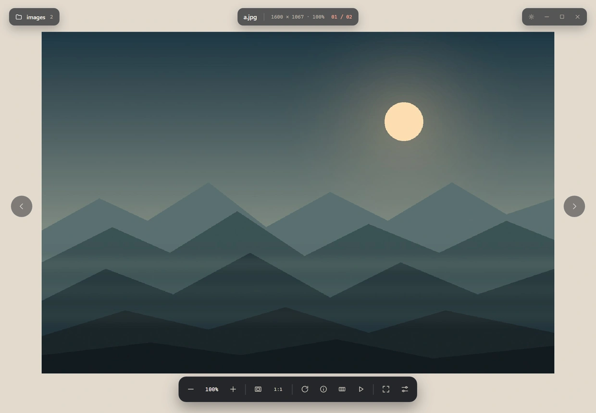
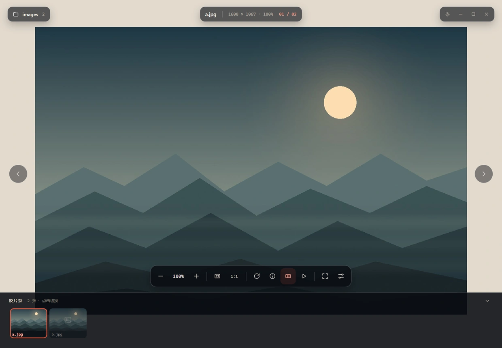
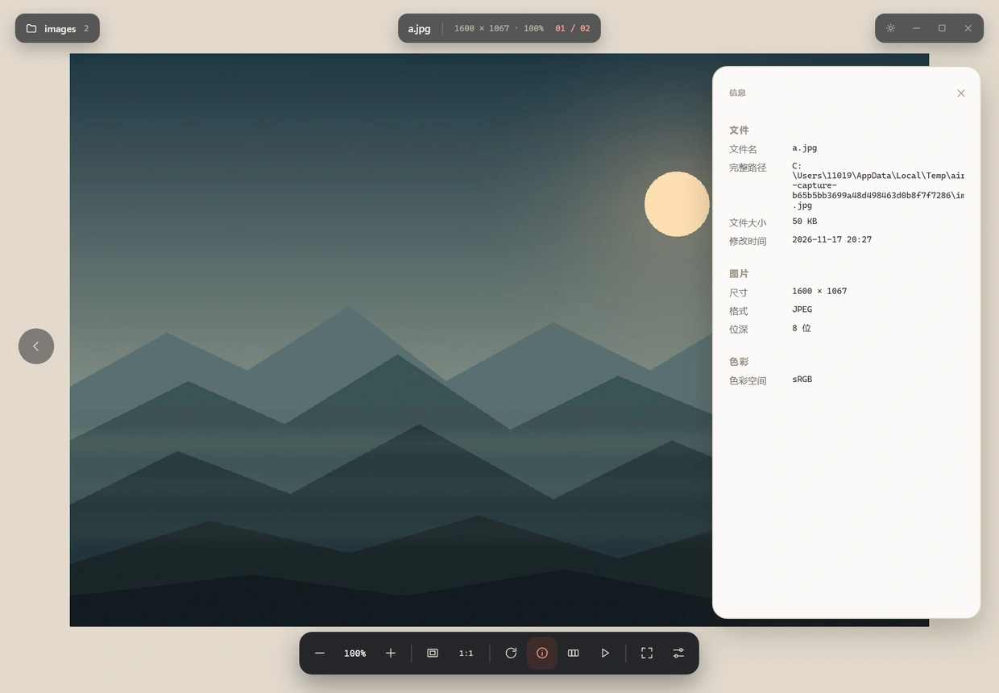
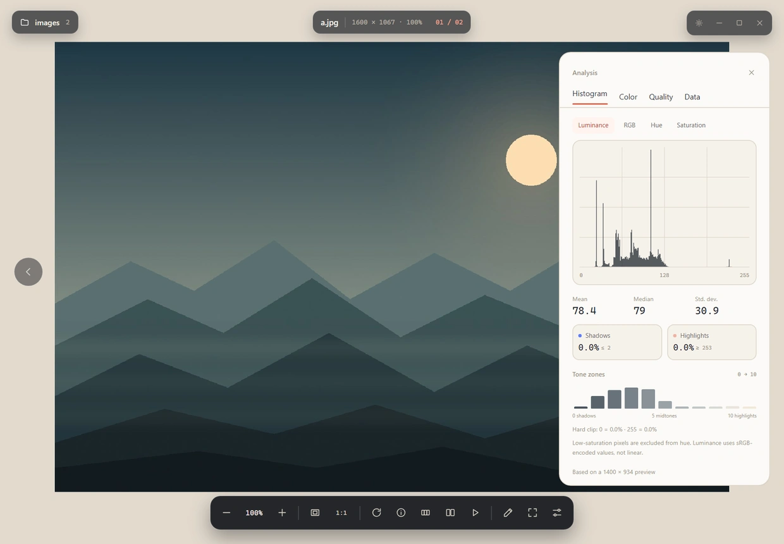
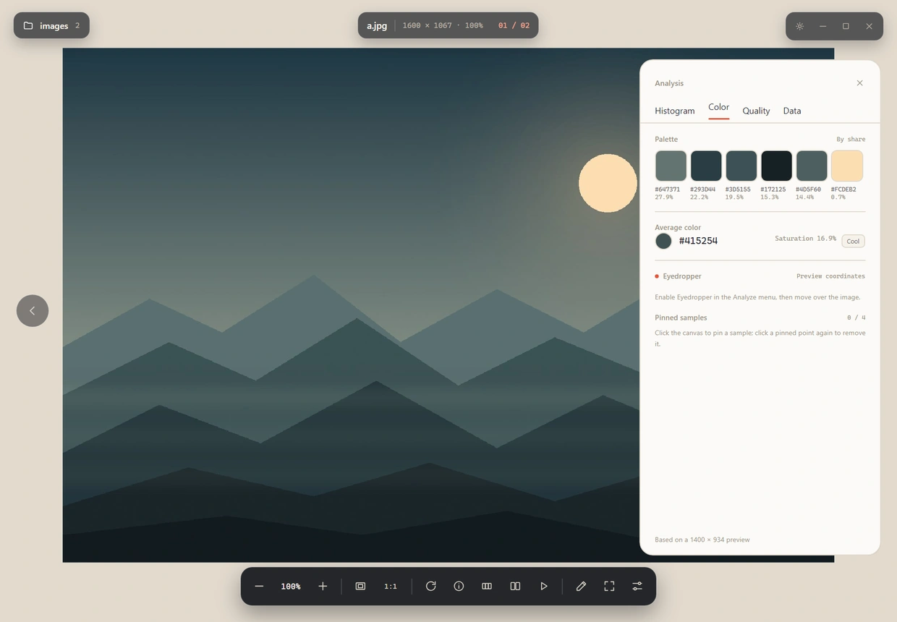
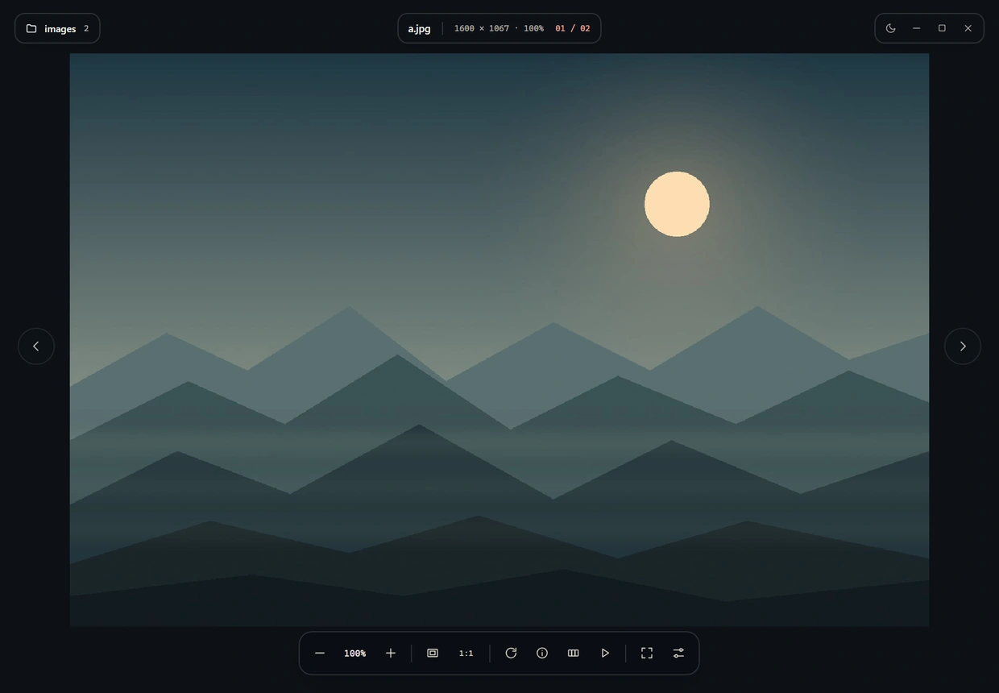
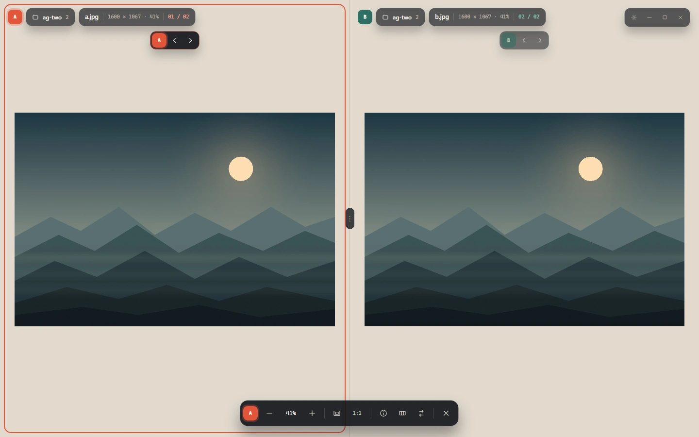

<p align="center">
  <a href="README.md">English</a> &nbsp;·&nbsp; <strong>简体中文</strong>
</p>

<h1 align="center">AirGlance</h1>

<p align="center">
  <strong>一个文件夹，一眼看完。</strong>
</p>

<p align="center">
  <a href="https://apps.microsoft.com/detail/9p30h2pjg0f6"><strong>Microsoft Store</strong></a>
  &nbsp;·&nbsp;
  <a href="https://github.com/RyzenWang/AirGlance/releases/latest">最新发布</a>
</p>

AirGlance 是一个适用于 Windows、macOS 和 Linux 的桌面看图工具。它一次打开一个文件夹、显示一张图片，不用标签页、图库或工作区就能浏览其余图片。当前版本是 0.7.0，也是最新公开二进制版本。它刻意保持小巧。

> **Windows：** 推荐从 [Microsoft Store](https://apps.microsoft.com/detail/9p30h2pjg0f6) 安装，更新由商店负责。商店版本可能落后于 GitHub Release；Windows、macOS 和 Linux 的便携包仍可在 [GitHub Releases](https://github.com/RyzenWang/AirGlance/releases/latest) 下载。

- [下载](#安装) · [图片格式](#图片格式) · [键盘](#键盘) · [性能](#性能) · [已知限制](#已知限制) · [从源码构建](#从源码构建)

## 功能

- 可以从命令行、拖放或打开对话框启动。窗口先出现，图片解码完成后立即显示。
- 按自然顺序浏览一个文件夹（`img2` 排在 `img10` 前），带 160 px 胶片条，上一张 / 下一张在两端循环。
- 按 `D` 或点击底部 dock 的双画布按钮打开第二块画布。两块画布可以显示同一文件夹的相邻图片，也可以各自打开 A/B 文件夹；点击画布或按 `Tab` 选择当前画布。当前画布用 2 px 身份色边框和徽标光环标识，另一侧图片不变暗。右键任一画布会打开该画布的专属菜单，包含“打开文件夹…”和“交换 A/B”。
- 右屏标题为窗口控制区和固定页数槽位预留空间；文件夹名最多 12 字符，文件名在默认宽度下最多 8 字符（宽屏 14 字符）并保留扩展名；文件信息框最大 340 px；hover 可查看完整名称，不再叠到最大化按钮下方。
- 每块画布在图片上方都有自己的上一张/下一张胶囊，只翻该画布；非当前组 60% 不透明但仍可点击，空画布或只有一张图时隐藏。
- 双画布胶片条固定 50/50：左半区是 A 的文件夹列表，右半区是 B 的文件夹列表，各自独立滚动和选中。空半区只保留 A/B 徽标，不显示文字或按钮；两侧都为空时胶片条不可用。信息面板保留 A/B 标签。
- 适应窗口、适应宽度和 100% 三种视图，并带有平滑缩放动画；滚轮以指针为中心缩放，Shift + 滚轮横向平移，拖动平移，双击在 100% 和适应窗口之间切换。
- 在显示第一个像素前应用 EXIF 方向，并把内嵌 ICC 配置文件（Display P3、Adobe RGB）转换为 sRGB 显示。
- 在编辑抽屉（`Ctrl+E`）中非破坏性地旋转、翻转和裁剪；Cancel 会恢复之前的视图，原文件永远不会被写入。可以按质量和缩放选项另存为 JPEG、PNG 或 WebP，也可以复制图片到剪贴板。
- 全屏、3 / 5 / 10 秒幻灯片，以及包含文件、图片、ICC 和 EXIF 字段的信息面板。
- 右键「分析」打开只读抽屉：亮度 / RGB / 色相 / 饱和度直方图、裁切与影调分区、主色板与取色器样本、清晰度 / 噪声 / JPEG 估算和图像数据。只做单图，不导出。
- 中英文运行时切换。浅色、深色和跟随系统主题。
- 设置和缩略图只保存在本机。没有账号、没有遥测，也没有网络代码。

## 界面截图

| 浏览 | 胶片条 |
| --- | --- |
|  |  |

| 信息面板 | 空状态 |
| --- | --- |
|  |  |

| 分析 | 分析 · 色彩 |
| --- | --- |
|  |  |

| 暗色主题 | 全屏 |
| --- | --- |
|  |  |

| 双画布 |
| --- |
|  |

## 图片格式

文件先按扩展名识别。普通位图格式由 SkiaSharp 解码；TIFF 由 LibTiff 解码，SVG 由 Svg.Skia 解析并光栅化，AVIF 在 Windows x64/arm64、macOS 和 Linux 构建中使用随包分发的 libavif + dav1d 解码。支持以下格式：

| 格式 | 扩展名 | 说明 |
| --- | --- | --- |
| JPEG | `.jpg`、`.jpeg`、`.jfif` | 应用 EXIF 方向，内嵌 ICC 转为 sRGB。JPEG 副本会把透明区域压平到白色。 |
| PNG | `.png` | 保留透明通道和内嵌 ICC。16 位 PNG 会显示为 16 位，但显示和另存时按 8 位处理。 |
| WebP | `.webp` | 支持带透明通道的静态图片；内嵌 ICC 转为 sRGB。动画 WebP 与 GIF 一样自动播放并循环。 |
| AVIF | `.avif` | Windows x64/arm64、macOS x64/arm64、Linux x64/arm64。显示第一帧，支持透明通道、10/12 位源、`irot`/`imir`、clean aperture、ICC/EXIF 元数据；不支持 AVIF 导出。Windows arm64 使用交叉编译的 arm64 解码器，不带 x86 SIMD。 |
| BMP | `.bmp` | 通过 SkiaSharp 解码。 |
| GIF | `.gif` | 动画 GIF 自动播放并循环；静态 GIF 只显示一帧。 |
| ICO | `.ico` | 由编解码器从图标中选择一张图片。 |
| TIFF | `.tif`、`.tiff` | 只显示第一页。支持常见 LZW、Deflate 和 JPEG 压缩 TIFF；处理方向、透明通道和 16 位源。 |
| SVG | `.svg` | 静态矢量图，由 Svg.Skia 按显示尺寸光栅化。渲染 CSS，不执行 JavaScript。 |

不支持：

- HEIC / HEIF
- RAW 相机格式，例如 CR2、CR3、NEF、ARW、DNG、RAF、ORF、RW2
- 视频文件，例如 MP4、MOV、WebM、MKV

不支持的原因：

- **HEIC / HEIF** 需要原生 HEVC 解码器，AirGlance 不内置，因此不在当前包内。AVIF 使用 AV1 而不是 HEVC，Windows x64/arm64、macOS 和 Linux 构建已支持。
- **RAW** 不是可直接显示的像素。打开 RAW 需要去马赛克、白平衡、相机色彩矩阵、色调映射，通常还需要镜头校正；这需要一套 LibRaw 级别的引擎，而不是切换一个解码器。
- **视频** 需要解复用、视频解码、音画同步，以及 FFmpeg 或系统媒体 API 之类的媒体栈。这超出了静态看图工具的范围，编解码授权和包体大小也是显著成本。

AirGlance 使用 SkiaSharp 处理普通位图、LibTiff 处理 TIFF、Svg.Skia 处理 SVG，并在 Windows x64/arm64、macOS 和 Linux 构建中随包分发 libavif + dav1d 处理 AVIF。不再包含 libvips 原生库，也不回退到系统编解码器。没有 AVIF 解码器的构建会从文件选择器和文件夹扫描中隐藏 `.avif`，不会宣称支持一个打不开的格式。

## 安装

Windows 用户推荐从 [Microsoft Store](https://apps.microsoft.com/detail/9p30h2pjg0f6) 安装；各平台的便携包在 [v0.7.0 GitHub Release](https://github.com/RyzenWang/AirGlance/releases/tag/v0.7.0)。商店版本可能落后于 GitHub Release。

### Microsoft Store（Windows）

1. 打开 [Microsoft Store 上的 AirGlance](https://apps.microsoft.com/detail/9p30h2pjg0f6)。
2. 选择 **获取** 或 **安装**，更新由商店负责。

### Windows 便携版

1. 下载 `AirGlance-0.7.0-win-x64.zip`（或 `win-arm64`）。
2. 解压到任意位置，运行 `AirGlance.exe`。

Windows 便携版没有代码签名，首次运行会出现 SmartScreen 警告。选择 **更多信息 → 仍要运行**。可执行文件是 NativeAOT 构建，不需要安装 .NET 运行时。

### macOS

1. 下载 `AirGlance-0.7.0-osx-arm64.zip` 或 `-osx-x64.zip`。
2. 解压 `AirGlance.app`，第一次启动时右键点击应用并选择 **打开**。在应用完成公证之前，Gatekeeper 会一直阻止普通双击；0.7.0 尚未公证。

### Linux

```bash
tar -xzf AirGlance-0.7.0-linux-x64.tar.gz
./AirGlance
```

压缩包还包含 `airglance.desktop` 和 PNG 图标。把它们复制到 `~/.local/share/applications/` 和 `~/.local/share/icons/hicolor/` 可以获得菜单项。便携版不会注册默认打开方式。

### 平台状态

发布包含六个压缩包，但实际运行验证的范围更小：

| 平台 | 压缩包 | 实际运行过 NativeAOT 二进制 |
| --- | --- | --- |
| Windows x64 | `win-x64.zip` | **已验证** — 已启动 0.7.0 本地 AOT 构建并显示图片 |
| Linux x64 | `linux-x64.tar.gz` | **已验证**（维护者，0.1.1） |
| Windows arm64 | `win-arm64.zip` | 未验证 |
| macOS arm64 | `osx-arm64.zip` | 未验证 |
| macOS x64 | `osx-x64.zip` | 未验证 |
| Linux arm64 | `linux-arm64.tar.gz` | 未验证 |

“已验证”是指实际启动过 AOT 二进制并显示过图片。Windows x64 条目对应 0.7.0 本地 AOT 构建；此前已发布的 0.5.0 压缩包已用 JPEG、TIFF、SVG 和 GIF 冒烟测试；Linux x64 由维护者在 0.1.1 上验证。其他压缩包由 CI 构建，但尚未在对应平台上运行。剪贴板图片复制已在 Windows x64 上用 PNG 和 JPEG 验证；复制路径和 100% 以上 Windows 显示缩放仍未验证。详见 [shipping](docs/shipping.md)。

Windows x64 版本也通过 [Microsoft Store](https://apps.microsoft.com/detail/9p30h2pjg0f6) 分发；商店版本可能落后于 GitHub Release，更新由 Windows 负责。

## 键盘

鼠标 / 触控板：

| 操作 | 行为 |
| --- | --- |
| 滚轮 | 以指针为中心缩放 |
| Shift + 滚轮 | 横向平移 |
| 拖动 | 图片大于视口时平移 |
| 双击 | 在适应窗口与 100% 之间切换 |
| 左右边缘按钮 | 上一张 / 下一张 |
| 点击画布 | 把该侧设为当前 A/B 画布 |
| 拖动分隔条 | 调整双画布比例（25%–75%）；双击恢复 50/50 |

| 按键 | 操作 |
| --- | --- |
| `Ctrl+O` / `Ctrl+Shift+O` | 打开图片 / 文件夹 |
| `←` `→` | 上一张 / 下一张 |
| `PgUp` `PgDn` | 上一张 / 下一张（始终） |
| `Space` / `Backspace` | 下一张 / 上一张 |
| `+` `-` | 以指针为中心放大 / 缩小 |
| `0` `1` `2` | 适应窗口 / 100% / 适应宽度 |
| `R` / `Shift+R` | 顺时针 / 逆时针旋转（单图；双画布暂缓） |
| `H` / `V` | 水平 / 垂直翻转（单图；双画布暂缓） |
| `F` / `F11` / `Esc` | 全屏；退出全屏或关闭浮层 |
| `S` | 开始或停止幻灯片；任意键停止（双画布下禁用） |
| `I` / `C` | 信息面板 / 左右分割胶片条 |
| `D` | 进入 / 退出双画布 |
| `Tab` / `Shift+Tab` | 切换当前 A/B 画布 |
| `X` | 交换双画布 |
| `Shift+F10` / 右键 | 打开当前画布菜单（双画布） |
| `Ctrl+C` | 复制图片（双画布下复制当前预览） |
| `Ctrl+Shift+C` | 复制当前图片路径（单图模式） |
| `Ctrl+Shift+S` | 另存副本（单图；双画布暂缓） |
| `Ctrl+E` | 打开或关闭编辑抽屉 |
| `Ctrl+Shift+L` | 切换英文 / 中文 |
| `F1` | 完整快捷键列表 |

右键点击图片可以打开、复制、在文件夹中显示、用其他应用打开以及进入设置。双画布下，右键画布会先打开该画布的专属菜单，菜单只作用于该侧。

## 性能

在已发布的 0.7.0 Windows x64 二进制上测量，机器为 Windows 10 Pro 22H2 (19045)、2 × Intel Xeon E5-2697 v4（16 核）、32 GB 内存、.NET 10.0.14、NativeAOT `win-x64`，日期 2026-11-24。测量使用一个空的设置目录，以默认的适应窗口打开。24 MP 各行十次全新进程，100 MP 行五次，取 `tools/bench.ps1` 的中位数；完整方法和原始数据见 [docs/performance.md](docs/performance.md)。

| 指标 | 目标 | 0.7.0 |
| --- | --- | --- |
| 冷启动到首窗 | ≤ 500 ms | 250.5 ms |
| 24 MP JPEG 首帧 | ≤ 500 ms | 415.7 ms |
| 100 MP JPEG 首帧（适应窗口） | ≤ 2.0 s | 341.4 ms |
| 24 MP 适应窗口内存峰值 | ≤ 250 MB | 88.1 MB |
| Windows x64 便携 zip | ≤ 30 MB | 21.84 MiB |

0.7.0 在参考机器上达到启动和首帧目标：窗口约 251 ms 出现，24 MP 图片约 416 ms 上屏，峰值工作集约 88 MB。0.7.0 的窗口外壳比 0.3.0 更重（`window-ctor-ui` 约 46 ms，0.3.0 约 14 ms），因此首窗更晚；首帧和内存仍在预算内。首次冷启动时操作系统扫描可执行文件可能更慢，因此应以中位数对比预算。这些是实测数字，不是估算。原始运行数据见 [docs/performance.md](docs/performance.md)。

## 已知限制

这些是限制，不是承诺清单。

- HEIC/HEIF 和相机 RAW 不支持。AVIF 由 Windows x64/arm64、macOS x64/arm64、Linux x64/arm64 构建支持；Windows arm64 解码器是交叉编译的，不带 x86 SIMD。
- AVIF 只显示第一帧，动画 AVIF 不播放，另存副本也不能写 AVIF。
- 动画 GIF 和动画 WebP 会播放；APNG 仍是静态图。视频不支持。
- TIFF 只显示第一页。BigTIFF 已支持并有夹具测试；部分特殊压缩变体不在支持范围内；托管 LibTiff 路径覆盖 stripped、tiled、pyramidal 和 planar 文件，包括 8/16 位 RGB、CMYK、RGBA、浮点和调色板数据。
- 没有图库、数据库、标签、评分、搜索、批量转换或重命名、滤镜、图层、文字、拼接、云同步或账号。
- 没有标签页。双画布是一个窗口内明确的 A/B 两块画布，不是标签栏。没有托盘图标，也没有单实例转发。
- 双画布两侧都加载有界预览；逐画布旋转/翻转、另存副本和幻灯片暂缓。不支持两张 100 MP 图片同时 100%，也不包含成对前进（左 N / 右 N+1）。
- 裁剪、旋转和翻转都是会话内编辑，没有无损 JPEG 旋转，原文件永远不会被重写。双画布以及仅代理/分块图片下编辑不可用。
- 16 位 PNG 会显示为 16 位，但显示和另存时按 8 位处理。
- 100 MP 图片在 100% 时使用基于文件的分块缓存：10000 × 10000 JPEG 的实测工作集峰值约 **464 MB**，分块写完后稳定在约 **125 MB**。图片打开期间临时分块文件约 400 MB。48 MP PNG 仍可能峰值接近 300 MB，因为 PNG 预览解码无法由编解码器缩放；内存较小的机器查看超大 PNG 时建议使用适应窗口。
- Windows 便携版未签名，macOS 版未公证。Microsoft Store 版本已通过商店提供；便携版仍是离线/ARM64 的选择。

## 从源码构建

需要 .NET 10 SDK。解决方案目标为 `net10.0`，并通过 `rollForward: latestFeature` 将 SDK 固定到 10.0.100。

AVIF 解码需要随包分发的原生解码器。Windows x64 使用 Visual Studio C++ 工具、CMake/Ninja、Python + Meson 和 NASM：

```powershell
powershell -ExecutionPolicy Bypass -File native/avif/build.ps1
```

macOS 和 Linux 使用 CMake、Ninja、Meson，x64 还需要 NASM：

```bash
bash native/avif/build.sh
```

打包脚本会为各自目标自动构建。没有原生库时，`.avif` 会从文件选择器和文件夹扫描中隐藏，Windows AVIF 测试会失败并提示构建命令。Windows arm64 解码器由 `native/avif/build-win-arm64.ps1` 使用 LLVM 交叉构建：

```powershell
powershell -ExecutionPolicy Bypass -File native/avif/build-win-arm64.ps1 -LlvmDirectory "C:\Program Files\LLVM\bin"
```

详见 [native/avif/README.md](native/avif/README.md)。

```bash
git clone https://github.com/RyzenWang/AirGlance.git
cd AirGlance
dotnet restore AirGlance.sln
dotnet build AirGlance.sln -c Release
dotnet test AirGlance.sln -c Release
```

运行：

```bash
dotnet run --project src/AirGlance.App -- path/to/photo.jpg
```

为当前机器发布 NativeAOT：

```bash
dotnet publish src/AirGlance.App/AirGlance.App.csproj \
  -c Release -r win-x64 -p:PublishAot=true -p:StripSymbols=true
```

`packaging/scripts/pack.ps1` 和 `pack.sh` 封装了各平台打包。AOT 无法交叉编译，因此每个平台都在对应机器上构建。

测试覆盖 EXIF 方向 1–8、ICC 转换、缩放解码、自然排序、文件夹枚举、设置恢复、缩略图缓存、导出和文件命名安全，以及视图模型和真实窗口键盘流程。见 `tests/`。

## 命令行

```text
AirGlance [选项] [文件或文件夹]

  -h, --help            显示帮助
      --version         显示版本
      --bench=startup   测量首窗、首帧和内存后退出
      --bench=decode    测量适应窗口解码后退出
      --bench=scan      测量文件夹枚举和首批缩略图后退出
  --                    后续所有参数都按路径处理
```

文件夹会打开其中第一张受支持的图片。第一个可显示的路径生效，其他参数被忽略。`--bench=startup` 会向标准输出打印 `first_window_ms`、`first_frame_ms`、`decode_ms`、`image_mp` 和 `peak_ws_mb`。

## 隐私

AirGlance 不包含 `HttpClient`、socket、遥测、崩溃上传或更新检查。唯一的外发动作是你主动点击的链接：状态栏中的 GitHub 会打开浏览器。设置保存在用户设置目录，缩略图保存在用户缓存目录并在 30 天后清理。

## 许可证

MIT。见 [LICENSE](LICENSE) 和 [THIRD-PARTY-NOTICES.md](THIRD-PARTY-NOTICES.md)。

更多细节：[架构](docs/architecture.zh-CN.md) · [格式矩阵](docs/formats.zh-CN.md) · [性能方法](docs/performance.zh-CN.md) · [发布流程](docs/shipping.zh-CN.md) · [交互设计](docs/design/interaction-v2.md) · [双画布设计 v6](docs/design/dual-view-v6.md) · [变更日志](CHANGELOG.md)。
