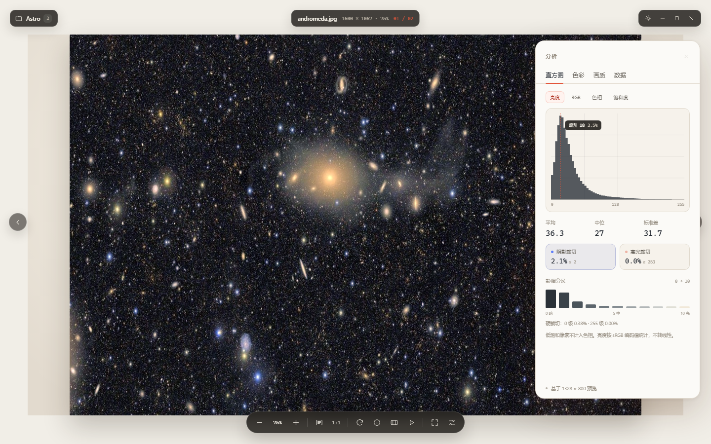

# AirGlance Analysis Menu and Panel — Design v1

**English** · [简体中文](analysis-menu.md)

> Scope: the **Analyze** submenu in the canvas context menu and a single analysis drawer (read-only, single image)
> Status: **implemented in the working tree, not released**; design board and real screenshots are included
> Date: 2026-11-23
> Baseline: 0.6.0; `BuildContextMenu()`, `BuildPaneMenu()`, `info-overlay`

Interaction board: [analysis-menu.html](analysis-menu.html) (open in a browser, switch states at the bottom left; `?ui=0` hides the state bar)



Design screenshots: [menu](analysis-v1-menu.png) · [histogram](analysis-v1-histogram.png) · [RGB](analysis-v1-rgb.png) · [color](analysis-v1-color.png) · [quality](analysis-v1-quality.png) · [data](analysis-v1-data.png) · [dark](analysis-v1-dark.png) · [dark menu](analysis-v1-menu-dark.png)

Application screenshots: [menu](implemented-analysis-menu.png) · [histogram](implemented-analysis-histogram.png) · [RGB](implemented-analysis-rgb.png) · [color](implemented-analysis-color.png) · [dark](implemented-analysis-dark.png)

The board uses [`analysis-demo.jpg`](analysis-demo.jpg) (a crop and grade of `crop-demo-bg.jpg`) as a sample image; it is design-only and is not shipped with the app.

This document defines interaction, data semantics and acceptance criteria only; it contains no code. Four boundaries are settled:

| Decision | Result | Effect on the design |
| --- | --- | --- |
| Presentation | **One analysis drawer** | The four menu items open the same drawer on different tabs; no separate windows and no on-canvas HUD |
| Scope | **Single image only** | No A/B comparison; no analysis entry in dual view; the drawer closes when dual view opens |
| Output | **Read-only** | No copy summary, no PNG/CSV export, no filtering or marking; those actions do not appear in the menu |
| Shortcuts / styling | **No new shortcut, no glass styling for the submenu** | `A` stays free; the submenu keeps the Fluent default; the drawer gets its own styling |

## 1. Current state

- The single-canvas context menu is built in [`BuildContextMenu()`](../../src/AirGlance.App/Views/MainWindow.axaml.cs#L2497). It has seven commands and two separators, is created on the first right-click and cached; a language switch clears and rebuilds it ([`OnLocalizationChanged`](../../src/AirGlance.App/Views/MainWindow.axaml.cs#L2434)).
- Dual view uses a different, hand-built card menu ([`BuildPaneMenu()`](../../src/AirGlance.App/Views/DualCanvasView.cs#L869)), not the same `ContextMenu`. This design does not touch it.
- There is no histogram or analysis code: `Histogram`, `灰度` and `分析` have no matches under `src/`. This is a new module.
- No `MenuItem` / `ContextMenu` styles exist; the menu uses the Avalonia Fluent default. Per the decision above, this design does not add styles.
- The information drawer's geometry can be reused as-is: 334 wide, 18 radius, 22 right margin, 82 top / 92 bottom (150 bottom with the filmstrip), see [`Border.info-overlay`](../../src/AirGlance.App/Styles/Controls.axaml#L1026).

## 2. Menu

### 2.1 Structure

```
Open image…
Open folder…
──────────────
Copy image
Copy path
Show in folder
Open with…
──────────────
Analyze ▸
    Histogram…
    Color…
    Quality…
    Image data…
    ──────────
    Eyedropper      ✓
──────────────
Settings
Keyboard shortcuts
```

- The first four items open **the same drawer** and only choose the initial tab. They are not four windows.
- Eyedropper is a checkable mode: checking it opens the drawer on the Color tab and puts the canvas into sampling mode; unchecking leaves both.
- The submenu sits after "Open with…" and before "Settings", with a separator on each side. It is created in code like the existing items; a `MenuItem` with child `MenuItem`s needs no new control. Menu items stay **plain text** with no icons, matching the existing `MenuItem` code.

### 2.2 Behaviour

| Situation | Behaviour |
| --- | --- |
| No image / loading | The whole Analyze submenu is disabled |
| Edit mode (including crop) | The whole submenu is disabled. The edit drawer occupies the right side and the two would overlap; if the drawer is open, close it when edit starts. Analysis is available after leaving edit |
| Fullscreen | Disabled. The information drawer and filmstrip are already hidden in fullscreen and analysis follows the same rule |
| Dual view | No Analyze entry; if the drawer is open when dual view starts, close it |
| Slideshow running | Opening analysis stops the slideshow so the image cannot change mid-analysis |
| Drawer already open | A tab item only switches the tab; the drawer is not recreated |
| Eyedropper checked again | Leaves sampling mode and unchecks |
| Language switch | Existing behaviour: the menu is cleared and rebuilt in the new language |

Do not bake checked state in when the menu is built. The menu is cached, so the correct point is just before `Open()` in [`OnCanvasPointerPressed`](../../src/AirGlance.App/Views/MainWindow.axaml.cs#L2485), where `IsEnabled` / `IsChecked` can be synced without adding a menu event.

### 2.3 Why no shortcut and no menu styling

- Shortcuts: `I`, `C`, `S`, `D`, `E`, `F`, `R`, `H`, `V` and `0/1/2` are taken. The decision is to add none, so `A` stays free and the shortcut list stays consistent.
- Styling: the existing context menu is not themed at all. Giving only the submenu a glass style would immediately highlight that the top level is still default. The decision is to accept the default until the menu is redesigned as a whole.

## 3. Drawer

### 3.1 Geometry

Reuse the `info-overlay` placement and surface; only the title and content change:

```text
┌────────────────────────────────────┐  width 334
│ Analysis                        × │  header 20,18,10,4
│ Histogram  Color  Quality  Data    │  tab row
│ ────────────────────────────────── │
│  [chart 294 × 190]                 │
│  mean 36.3 · median 27 · σ 31.7    │
│  shadows 2.1% · highlights 0.0%    │
│  tone zones ▁▂▃▅▇▅▃▂▁              │
│                                    │
│ Based on a 1328 × 800 preview      │  footer, 11 px
└────────────────────────────────────┘
```

- Size, radius, border, shadow and right margin all come from `Border.info-overlay`; there is no second drawer surface.
- Height follows the `InfoHost` rule: 150 bottom margin with the filmstrip, otherwise 92.
- Tabs are labels with a 1 px underline; the selected state uses the existing `Coral` / `AccentSoft` tokens and does not move layout.
- The chart card carries a `0 / 128 / 255` scale; RGB mode replaces it with an R / G / B legend.
- Tone zones are labelled `0 shadows / 5 midtones / 10 highlights`; clipping and statistics caveats sit underneath in small type.
- Quality tab: noise uses a three-step low / medium / high gauge, exposure marks the median on a 0–255 tone bar.
- Data tab is grouped as "Image / File / Transparency and colour / Animation".
- The footer is one fixed 11 px line: the analysis resolution and either "preview" or "original". It is part of the data's credibility and is not optional.

### 3.2 States

| State | Display |
| --- | --- |
| No image | The drawer does not open; the menu is disabled |
| Open, computing | Tabs and skeleton visible; values show "Analyzing…" |
| Ready | Chart + values + footer |
| Failed | "Could not analyze this image." plus one reason line; no dialog, no blocked viewing |
| Image changed | Keep the drawer and current tab, show computing, then replace |
| Fullscreen | Drawer hidden; state kept and restored on exit |
| Dual view / edit | Drawer closed; not restored automatically |

### 3.3 Interaction

- Open: only from the context menu. No shortcut and no dock button.
- Close: the drawer's × button or `Esc`.
- The `Esc` order slots analysis after edit and before information: crop → edit → fullscreen → **analysis** → information → filmstrip. Analysis, information and filmstrip are mutually exclusive, so only one can match.
- Information, filmstrip and analysis are mutually exclusive: opening one closes the other two, following [`ToggleInfo()`](../../src/AirGlance.App/ViewModels/MainWindowViewModel.cs#L762) / [`ToggleFilmstrip()`](../../src/AirGlance.App/ViewModels/MainWindowViewModel.cs#L772).
- The drawer is not shown in fullscreen, matching `InfoShown => InfoVisible && !IsFullscreen`.
- Only the last tab within the current session is remembered; nothing is written to settings.

## 4. Feature specification

The analysed object is always **the current image's decoded display pixels** (`_rawDecoded`), with no rotation or flip applied and no crop applied.

- Rotation and flip do not change any statistic, so analysis does not wait for edit state.
- In 0.6.0 a crop is only an export region; the canvas never loses pixels. v1 therefore analyses the whole frame and does not claim "crop applied".
- The eyedropper is the exception: it samples the bitmap currently shown on the canvas, so its coordinates follow rotation and flip.

### 4.1 Histogram tab

| Item | Content |
| --- | --- |
| Mode | Luminance (default) / RGB / Hue / Saturation, switched with a chip row |
| Luminance | 256 bins; `Y = round(0.2126R + 0.7152G + 0.0722B)` on sRGB-encoded values, not linearised |
| RGB | Three channels overlaid at about 0.55 alpha; per-channel clipping shares shown as well |
| Hue | 36 bins (10° each); pixels with `S < 0.10` or `V < 0.05` are ignored, and a caption under the chart says so |
| Saturation | 64 bins on HSL S |
| Statistics | Mean, median, standard deviation, all on 0–255 |
| Clipping | Shadows = `Y ≤ 2`, highlights = `Y ≥ 253`, shown as shares; hovering breaks out the hard 0 / 255 share |
| Tone zones | 11 zones (0–10), `zone = min(10, Y * 11 / 256)`; a 0–10 share bar |
| Chart interaction | Hover shows "level · share"; the Y axis toggles linear / logarithmic, linear by default |
| Logarithmic | `h' = log(1 + h) / log(1 + max)` only for legibility; the stored values do not change |

The chart is a custom `Control` drawn with `DrawingContext`; no chart library. At 294 px, 256 bins are narrower than one pixel, so draw a filled area, not individual bars.

### 4.2 Color tab

| Item | Content |
| --- | --- |
| Palette | Six colours, swatch + HEX + share (estimated from 65k samples), sorted by share |
| Eyedropper readout | Live on hover: position, sRGB 0–255, HEX, HSL, Lab, alpha |
| Pinned samples | A click pins a sample, up to four; clicking a pinned point removes it. UI state only, nothing written |
| Average colour | Mean R/G/B over non-transparent pixels, shown as HEX |
| Saturation | Mean HSL S |
| Warmth | `mean(R) - mean(B)`; an absolute value of 6 or less is neutral, otherwise warm / cool |

Palette algorithm: downsample to at most 65,536 samples, convert to OKLab, k-means with k=6, k-means++ initialisation, fixed seed, 12 iterations; merge clusters closer than 0.03 in OKLab and sort by share. The fixed seed keeps repeated runs identical.

The pinned-samples section shows a `2 / 4` count and the hint "click to pin, click again to remove", so the canvas does not look passive.

The eyedropper samples the preview bitmap: below 100% zoom one screen point covers several source pixels, so the readout marks them as "preview coordinates". Only at 100% with the full resolution loaded is it 1:1.

### 4.3 Quality tab

| Item | Content | Semantics and limits |
| --- | --- | --- |
| Sharpness | 0–100 plus sharp / soft / blurry | Luma downscaled to a 1024 long edge; mean 4-neighbour Laplacian magnitude divided by `σ(luma) + 8`; thresholds need calibrating against `tools/testdata`, first pass ≥ 65 sharp, 35–64 soft, < 35 blurry |
| Noise | σ plus low / medium / high | Immerkær estimate: `σ ≈ sqrt(π/2)/6 · mean(abs(Laplacian))`; sharpening inflates it, so label it an estimate. First pass < 2 low, 2–5 medium, > 5 high |
| JPEG compression | Estimated quality, chroma subsampling, baseline/progressive, bytes per pixel | Parse DQT / SOF / DRI. Quality is inferred from the IJG tables within about ±5 and shown as `~85`; subsampling and progressive are exact. Hidden for non-JPEG |
| Exposure | Shadow clip, highlight clip, tonal centre, highlight headroom | Clipping as in the histogram; centre from the median (< 64 dark, 64–192 midtones, > 192 bright); headroom from P99. No fake "-0.7 EV" recommendation |

Every score describes pixels, not taste. Sharpness is strongly scene-dependent (low-texture scenes score low), so v1 gives a relative label only and promises no absolute quality; ranking needs folder-level analysis.

The starfield in the board reports high noise: point-like stars inflate the Immerkær estimate, which is exactly why the caveat stays visible in the panel. Do not put a warning icon next to "high", or texture will read as a quality defect.

### 4.4 Data tab

Reuse the information panel's `InfoRow` layout (78 px label + monospaced value) and show only analysis-specific data:

| Row | Content |
| --- | --- |
| Dimensions | `6000 × 4000 · 24.0 MP · 3:2` |
| Format | `JPEG · 8-bit display · sRGB` (colour space from `ImageMetadata.ColorSpaceDisplay`) |
| File | Size + `B/px` (bytes ÷ pixels) |
| Alpha | "Opaque" when there is no alpha; otherwise opaque coverage, fully transparent and semi-transparent shares |
| Unique colours | At most 65,536 distinct colours are recorded; at the cap show "≥ 65,536" |
| Entropy | Shannon entropy of the luminance histogram, in bits, maximum 8.00 |
| Animation | Frames, total duration, loop count (-1 shown as "forever"); the first frame is analysed and does not refresh while the GIF plays |
| Analysis resolution | `Based on a 1920 × 1080 preview` or `Original 6000 × 4000` |

Dimensions come from file metadata after EXIF orientation and exclude in-session rotation or flip.

## 5. Data semantics

| Case | Rule |
| --- | --- |
| Pixel format | BGRA8888, **premultiplied**. Unpremultiply before stats: `c = a == 0 ? 0 : min(255, (c * 255 + a / 2) / a)` |
| Transparent pixels | `a == 0` is excluded from RGB / luminance / hue / saturation / averages; counted separately in the alpha histogram and coverage |
| Colour space | Embedded ICC is converted to sRGB at decode time, so stats describe the display space. Do not claim source-gamut coverage or out-of-gamut pixels |
| Bit depth | Display and analysis are 8-bit. 16-bit PNG and 10/12-bit AVIF source data do not participate |
| Preview | `PreviewTarget()` follows the viewport, 640–8192; dual view is fixed at 2400 × 1600 |
| Large TIFF | May be a proxy or tiled preview; the footer must state the actual analysis resolution and must not pretend it is the original |
| SVG | Rasterised at the target size, so the histogram changes with the window. v1 analyses the current raster and says so in the footer |
| Animation | The displayed frame is analysed; the data tab adds frame count, duration and loop count |
| ICO | The image selected by the codec is analysed |
| Edits | Rotation and flip do not affect stats; crop does not participate (see the top of section 4) |
| Eyedropper | Samples the displayed bitmap including rotation/flip; below 100% its coordinates are preview coordinates |

## 6. Computation and caching

1. One pass produces the luminance / RGB / hue / saturation / alpha histograms, the mean, the sum of squares, transparent counts and the unique-colour set (with a cap).
2. A second pass computes the Laplacian only (sharpness, noise) on luma downscaled to a 1024 long edge.
3. The palette runs k-means on 65k samples separately.
4. JPEG information comes from the file header and needs no second decode.
5. Everything runs in `Task.Run`; the UI thread only receives results. Navigation, closing the drawer and switching tabs never block.
6. Cache key: `path | edit version | width × height | frame`. LRU of four entries; it stores results only and **never holds pixel buffers**.
7. After navigation, the existing version check discards stale results. Closing the drawer need not cancel a running analysis (it finishes quickly and the result is reusable), but navigation must cancel.

## 7. Strings

About 40 new keys through `LocalizationService`; reusable information-panel keys (dimensions, format, bit depth, colour space, file size, frames) are used directly.

| Key | English | 简体中文 |
| --- | --- | --- |
| `L.Analyze` | Analyze | 分析 |
| `L.Analysis` | Analysis | 分析 |
| `L.AnalysisHistogram` | Histogram… | 直方图… |
| `L.AnalysisColor` | Color… | 色彩分析… |
| `L.AnalysisQuality` | Quality… | 画质分析… |
| `L.AnalysisData` | Image data… | 图像数据… |
| `L.AnalysisEyedropper` | Eyedropper | 取色器 |
| `L.AnalysisLuma` | Luminance | 亮度 |
| `L.AnalysisHue` | Hue | 色相 |
| `L.AnalysisSaturation` | Saturation | 饱和度 |
| `L.AnalysisMean` | Mean | 平均 |
| `L.AnalysisMedian` | Median | 中位 |
| `L.AnalysisStdDev` | Std. dev. | 标准差 |
| `L.AnalysisShadowClip` | Shadows | 阴影裁切 |
| `L.AnalysisHighlightClip` | Highlights | 高光裁切 |
| `L.AnalysisZones` | Tone zones | 影调分区 |
| `L.AnalysisPalette` | Palette | 主色板 |
| `L.AnalysisAverageColor` | Average color | 平均色 |
| `L.AnalysisWarm`, `L.AnalysisNeutral`, `L.AnalysisCool` | Warm / Neutral / Cool | 偏暖 / 中性 / 偏冷 |
| `L.AnalysisSharpness` | Sharpness | 清晰度 |
| `L.AnalysisSharp`, `L.AnalysisSoft`, `L.AnalysisBlurry` | Sharp / Soft / Blurry | 清晰 / 一般 / 模糊 |
| `L.AnalysisNoise` | Noise | 噪声 |
| `L.AnalysisNoiseLow`, `L.AnalysisNoiseMedium`, `L.AnalysisNoiseHigh` | Low / Medium / High | 低 / 中 / 高 |
| `L.AnalysisCompression` | JPEG compression | JPEG 压缩 |
| `L.AnalysisEstimatedQuality` | Estimated quality {0} | 估算质量 {0} |
| `L.AnalysisExposure` | Exposure | 曝光 |
| `L.AnalysisToneShadow`, `L.AnalysisToneMidtone`, `L.AnalysisToneHighlight` | Shadows / Midtones / Highlights | 偏暗 / 中间调 / 偏亮 |
| `L.AnalysisAnalyzing` | Analyzing… | 正在分析… |
| `L.AnalysisFailed` | Could not analyze this image. | 无法分析这张图片。 |
| `L.AnalysisPreviewNote` | Based on a {0} × {1} preview | 基于 {0} × {1} 预览 |
| `L.AnalysisOriginalNote` | Original {0} × {1} | 原图 {0} × {1} |
| `L.AnalysisLowSaturationIgnored` | Low-saturation pixels are excluded from hue. | 低饱和像素不计入色相。 |

## 8. Performance budget

| Item | Target |
| --- | --- |
| Drawer open to skeleton | ≤ 1 frame |
| Full analysis of an 8 MP preview | ≤ 150 ms |
| 24 MP at full resolution (background) | ≤ 600 ms |
| Effect on first-frame startup | 0: analysis runs only when the user opens it and is not on the startup path |
| Memory | Analysis object < 1 MB (unique-colour cap 65,536), no pixel buffer retained |

## 9. Tests

**Core unit tests** (synthetic images, no external files):

- Flat mid-grey → one bin, σ = 0, no clipping.
- Left black / right white → mean 127.5, shadow and highlight shares 50% each.
- Red / green / blue blocks → hue falls in three bins and low-saturation pixels are excluded.
- 50% transparent PNG → alpha coverage 50%, RGB stats use only opaque pixels.
- 1 × 1 image, fully transparent image, fully black image.
- Gradient → monotonic cumulative distribution.
- Three-colour image → palette returns three colours with correct shares.
- Fixed JPEG fixture → subsampling, progressive and estimated quality within tolerance.

**App tests**:

- With an image, the context menu has an Analyze submenu and five children; disabled with no image.
- "Histogram…" opens the drawer on the histogram tab; "Quality…" only switches tabs.
- Eyedropper checked state matches canvas pointer mode.
- Dual view and edit close the drawer; fullscreen hides it; `Esc` closes it.

**Manual acceptance**: one image each of JPEG / PNG (alpha) / WebP / AVIF / GIF / TIFF (proxy) / SVG / ICO; one 24 MP and one 100 MP file; light, dark and high-contrast themes.

## 10. Later

| Version | Content | Prerequisite |
| --- | --- | --- |
| v1.1 | Clipping warning and focus peaking (overlays) | Needs a canvas overlay layer, not drawer content |
| v1.1 | Histogram inside the edit drawer | Removes the "cannot analyse while editing" gap |
| v2 | A/B histograms, statistics difference, synchronised probe | Needs the dual-view `PaneSlot` |
| v2 | Similar/duplicate groups, folder health check | Folder-level analysis with a list/filter UI |
| TBD | Copy summary, PNG/CSV export | Requires lifting the read-only boundary |

Not planned: face / eyes-open / expression / subject recognition, OCR, auto-tagging, reverse image search, RAW histograms, video scopes, GPU-accelerated analysis.

## 11. Decision log

- 2026-11-23: one analysis drawer; single image only; read-only; no new shortcut and no glass styling for the submenu.

## 12. Implementation record

- **Core**: `ImageAnalyzer`, `ImageAnalysisResult`, `ImageAnalysisContext`, `PaletteColor`, `RgbColor`/`ColorMath`, `JpegInfo`; `ImageHeaderReader` now parses JPEG DQT/SOF/DRI. The analysed object is the decoded BGRA display pixels; premultiplied alpha is unpremultiplied and transparent pixels are excluded from colour statistics.
- **App**: `AnalysisViewModel` + `AnalysisDisplay` + `AnalysisLabels`; `AnalysisPanelView` (XAML, created on demand); `HistogramChart`, `MeterBar`, `ToneBar`; the drawer host, menu items, eyedropper pointer and markers in `MainWindow`; `ImageViewer.TryGetImagePixel` and `Samples`.
- **Tests**: 12 new Core analysis/JPEG tests and 9 new App interaction tests (menu items, open/close, dual view, fullscreen, info replacement, edit mode, tab switch, pinned samples, language switch). App tests pass 44/44; Core passes 198/199, with the only failure being the pre-existing AVIF native-decoder presence check (the local `airglance_avif.dll` is not built), unrelated to this change.
- **Deviations from the design board**:
  - The `0 / 128 / 255` scale and the RGB legend live in XAML; the hover readout is still drawn by `HistogramChart`.
  - The data-tab label column is 104 px instead of 78 px so the English "Analysis resolution" does not overlap its value.
  - The clipping cards get a tint only when the clipped share is at least 0.05%; otherwise a 0.0% card looks active.
  - The real screenshots use `analysis-demo.jpg`: sharpness 100, noise σ 8.6 "High", JPEG ~92, shadows 1.9%. The star texture inflating the noise estimate is expected and is why the caveat stays visible.
  - Application screenshots are 1240 × 860; the colour screenshot includes one pinned sample to show the canvas marker.
  - Animated GIFs always analyse the first frame and do not refresh during playback; the data tab still reports frame count, duration and loop count.
- **Still out of scope**: A/B comparison, folder-level analysis, copy/export, clipping-warning and focus-peaking overlays; analysis in edit, dual view and fullscreen follows section 2.2.
