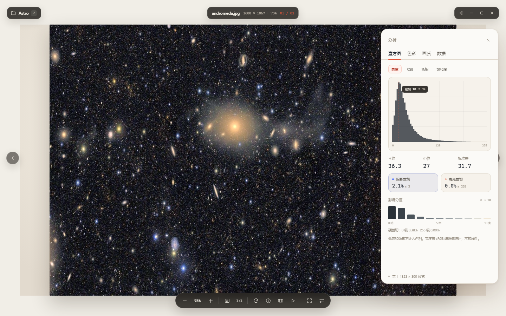

# AirGlance 分析菜单与面板设计稿 v1

[English](analysis-menu.en.md) · **简体中文**

> 范围：右键菜单「分析」子菜单 + 单一分析抽屉（只读、单图）
> 状态：**已实现（工作区，未发布）**；交互视觉稿与实际截图均已出
> 日期：2026-11-23
> 基线：0.6.0；`BuildContextMenu()`、`BuildPaneMenu()`、`info-overlay`

交互视觉稿：[analysis-menu.html](analysis-menu.html)（浏览器打开，左下角切换状态；`?ui=0` 隐藏状态条）



设计截图：[菜单](analysis-v1-menu.png) · [直方图](analysis-v1-histogram.png) · [RGB](analysis-v1-rgb.png) · [色彩](analysis-v1-color.png) · [画质](analysis-v1-quality.png) · [数据](analysis-v1-data.png) · [暗色](analysis-v1-dark.png) · [暗色菜单](analysis-v1-menu-dark.png)

实际应用截图：[菜单](implemented-analysis-menu.png) · [直方图](implemented-analysis-histogram.png) · [RGB](implemented-analysis-rgb.png) · [色彩](implemented-analysis-color.png) · [暗色](implemented-analysis-dark.png)

视觉稿使用 [`analysis-demo.jpg`](analysis-demo.jpg)（`crop-demo-bg.jpg` 的裁切与分级）作为示例图片，只用于设计稿，不进入应用资源。

本稿只定义交互、数据口径和验收标准，不包含代码。四项边界已经确认：

| 决策 | 结论 | 对设计的影响 |
| --- | --- | --- |
| 呈现 | **单一分析抽屉** | 四个菜单项打开同一抽屉的不同页签；不做独立窗口，也不做图上 HUD |
| 范围 | **只做单图** | 不做 A/B 对比；双画布不提供分析入口；进入双画布时关闭抽屉 |
| 产出 | **只读** | 不复制摘要、不导出 PNG/CSV、不参与筛选或标记；菜单里不出现这些动作 |
| 快捷键 / 样式 | **不新增快捷键，不补菜单玻璃样式** | `A` 保持空闲；右键子菜单沿用 Fluent 默认样式；抽屉样式单独定义 |

## 1. 现状

- 单画布右键菜单在 [`BuildContextMenu()`](../../src/AirGlance.App/Views/MainWindow.axaml.cs#L2497)，现在是 7 个命令 + 2 条分隔线，首次右键才构建并缓存；本地化切换时置空重建（[`OnLocalizationChanged`](../../src/AirGlance.App/Views/MainWindow.axaml.cs#L2434)）。
- 双画布是另一套自绘卡片菜单（[`BuildPaneMenu()`](../../src/AirGlance.App/Views/DualCanvasView.cs#L869)），不是同一个 `ContextMenu`，本稿不动它。
- 仓库里没有直方图或分析实现，`Histogram`、`灰度`、`分析` 在 `src/` 下均无命中；这是全新模块。
- 菜单没有任何 `MenuItem` / `ContextMenu` 样式，完全走 Avalonia 默认 Fluent 样式；本稿按确认结果不补样式。
- 信息抽屉的几何可以直接复用：宽 334、圆角 18、右边距 22、上 82 / 下 92（胶片条打开时下 150），见 [`Border.info-overlay`](../../src/AirGlance.App/Styles/Controls.axaml#L1026)。

## 2. 菜单

### 2.1 结构

```
打开图片…
打开文件夹…
──────────────
复制图片
复制路径
在文件夹中显示
打开方式…
──────────────
分析 ▸
    直方图…
    色彩分析…
    画质分析…
    图像数据…
    ──────────
    取色器      ✓
──────────────
设置
快捷键
```

- 前四项都打开**同一个分析抽屉**，只切换初始页签；不是四个窗口。
- 「取色器」是可勾选模式，勾选时打开抽屉并切到「色彩」页，同时在画布上进入取色状态；取消勾选退出。
- 子菜单放在「打开方式…」之后、「设置」之前，前后各保留一条分隔线。它和现有菜单项一样由代码创建，`MenuItem.Items` 挂子项即可，不需要新控件。菜单项保持**纯文本**，不加图标，与现有 `MenuItem` 的写法一致。

### 2.2 行为

| 场景 | 行为 |
| --- | --- |
| 没有图片 / 正在加载 | 「分析」子菜单整体禁用 |
| 编辑模式（含裁剪） | 「分析」子菜单整体禁用。编辑抽屉占右侧，两者会重叠；如果抽屉开着，进入编辑时先关闭。退出编辑后可用 |
| 全屏 | 禁用。全屏下信息抽屉和胶片条本来就不显示，分析也不破例 |
| 双画布 | 菜单里没有「分析」；进入双画布时如果抽屉开着，直接关闭 |
| 幻灯片运行中 | 打开分析先停止幻灯片，避免图片在分析过程中被切走 |
| 抽屉已打开 | 点击页签项只切换页签，不重建抽屉 |
| 再次点击「取色器」 | 退出取色状态并取消勾选 |
| 切换语言 | 沿用现有逻辑：菜单置空、按新语言重建 |

勾选状态不要在构建菜单时写死。菜单是缓存的，正确做法是在 [`OnCanvasPointerPressed`](../../src/AirGlance.App/Views/MainWindow.axaml.cs#L2485) 调用 `Open()` 之前同步一次 `IsEnabled` / `IsChecked`，不引入新的菜单事件。

### 2.3 为什么没有快捷键、没有菜单样式

- 快捷键：`I`、`C`、`S`、`D`、`E`、`F`、`R`、`H`、`V`、`0/1/2` 已占用；确认结果是不新增，因此 `A` 保持空闲，也不会出现「有快捷键但没写进快捷键表」的半成品。
- 样式：现有右键菜单没有主题化，单独给二级菜单补玻璃样式会立刻暴露一级菜单仍是默认样式。确认结果是先接受默认样式，等菜单整体重做时一起处理。

## 3. 抽屉

### 3.1 几何

沿用 `info-overlay` 的定位和外观，只改标题和内容：

```text
┌────────────────────────────────────┐  宽 334
│ 分析                            × │  头部 20,18,10,4
│ 直方图  色彩  画质  数据           │  页签行
│ ────────────────────────────────── │
│  [图表 294 × 190]                  │
│  平均 36.3 · 中位 27 · σ 31.7      │
│  阴影 2.1% · 高光 0.0%             │
│  影调分区 ▁▂▃▅▇▅▃▂▁               │
│                                    │
│ 基于 1328 × 800 预览               │  页脚 11 px
└────────────────────────────────────┘
```

- 尺寸、圆角、边框、阴影、右边距全部复用 `Border.info-overlay`，不新增第二套抽屉外观。
- 高度随 `InfoHost` 的规则：胶片条打开时下边距 150，否则 92。
- 页签用文字 + 底部 1 px 指示线；选中态用现有 `Coral` / `AccentSoft` token，不改布局。
- 图表卡片带 `0 / 128 / 255` 刻度；RGB 模式改为显示 R / G / B 图例。
- 影调分区条下方标 `0 暗 / 5 中 / 10 亮`；裁切和统计口径用小字写在图表下方。
- 画质页：噪声用低 / 中 / 高三段档位，曝光用 0–255 影调条标出中位。
- 数据页分「图像 / 文件 / 透明与颜色 / 动图」四组。
- 页脚固定一行 11 px 说明：分析分辨率，以及「预览」或「原图」。它是数据可信度的一部分，不可省略。

### 3.2 状态

| 状态 | 显示 |
| --- | --- |
| 无图片 | 抽屉不会打开；菜单禁用 |
| 已打开、计算中 | 页签和骨架可见，数值区显示「正在分析…」 |
| 就绪 | 图表 + 数值 + 页脚 |
| 计算失败 | 「无法分析这张图片」+ 原因一行；不弹窗、不阻塞看图 |
| 图片切换 | 保留抽屉和当前页签，内容进入计算中，完成后替换 |
| 全屏 | 抽屉隐藏；状态保留，退出全屏后恢复 |
| 双画布 / 编辑 | 抽屉关闭，不自动恢复 |

### 3.3 交互

- 打开：只能从右键菜单进入。没有快捷键，也没有 dock 按钮。
- 关闭：抽屉右上角 ×，或 `Esc`。
- `Esc` 顺序插在编辑之后、信息之前：裁剪 → 编辑 → 全屏 → **分析** → 信息 → 胶片条。分析、信息、胶片条三者互斥，实际只会命中一个。
- 信息、胶片条、分析三者互斥：打开一个自动关闭另外两个，沿用 [`ToggleInfo()`](../../src/AirGlance.App/ViewModels/MainWindowViewModel.cs#L762) / [`ToggleFilmstrip()`](../../src/AirGlance.App/ViewModels/MainWindowViewModel.cs#L772) 的写法。
- 全屏下抽屉不显示，与 `InfoShown => InfoVisible && !IsFullscreen` 一致。
- 记住的只是本次会话内最后打开的页签，不写入设置。

## 4. 功能规格

分析对象统一为：**当前图片解码后的显示像素**（`_rawDecoded`），未应用旋转/翻转，未应用裁剪。

- 旋转、翻转不改变任何统计结果，所以分析不必等编辑结果。
- 裁剪在 0.6.0 里只是导出时的区域，画布上并没有切掉像素；因此 v1 分析整帧，不宣称「已应用裁剪」。
- 取色器例外：它采样的是当前画布上显示的位图，所以旋转/翻转后的坐标与读数一致。

### 4.1 直方图页

| 项 | 内容 |
| --- | --- |
| 模式 | 亮度（默认）/ RGB / 色相 / 饱和度，一行 chip 切换 |
| 亮度直方图 | 256 桶；`Y = round(0.2126R + 0.7152G + 0.0722B)`，在 sRGB 编码值上计算，不转线性 |
| RGB 直方图 | 三通道叠加，透明度约 0.55；另给单通道裁切占比 |
| 色相直方图 | 36 桶（每桶 10°）；忽略 `S < 0.10` 或 `V < 0.05` 的像素，图表下方以小字注明「低饱和像素不计入色相」 |
| 饱和度直方图 | 64 桶，HSL 的 S |
| 统计 | 平均、中位、标准差；均以 0–255 显示 |
| 裁切 | 阴影 = `Y ≤ 2`，高光 = `Y ≥ 253`，显示占比；悬停显示硬裁切（0 / 255）占比 |
| 影调分区 | 11 区（0–10），`zone = min(10, Y * 11 / 256)`；显示 0–10 的占比条 |
| 图表交互 | 悬停显示「级别 · 占比」；纵轴可在「线性 / 对数」间切换，默认线性 |
| 对数 | `h' = log(1 + h) / log(1 + max)`，只为看清长尾，不改变统计值 |

图表用自绘 `Control`（`DrawingContext`），不引入图表库。256 桶在 294 px 宽度上会小于 1 px，实际画成填充面积图，不画单根柱子。

### 4.2 色彩页

| 项 | 内容 |
| --- | --- |
| 主色板 | 6 色，色块 + HEX + 占比（按 65k 样本估算）；按占比降序 |
| 取色器读数 | 悬停实时读数：坐标、sRGB 0–255、HEX、HSL、Lab、Alpha |
| 钉住样本 | 单击画布钉住一个样本，最多 4 个；再次单击已钉位置移除。纯界面状态，不写文件 |
| 平均色 | 非透明像素的平均 R/G/B，显示 HEX |
| 饱和度 | 平均 HSL S |
| 冷暖 | `mean(R) - mean(B)`，绝对值 ≤ 6 记「中性」，否则「偏暖 / 偏冷」 |

主色板算法：降采样到不超过 65,536 个样本，转 OKLab，k-means（k=6，k-means++ 初始化，固定种子，12 次迭代），合并 OKLab 距离小于 0.03 的簇，按样本占比排序。固定种子保证同一张图每次结果一致。

钉住样本区显示 `2 / 4` 计数和「单击钉住、再次单击移除」提示，避免用户不知道画布可以点。

取色器采样的是预览位图：缩放小于 100% 时一个屏幕点对应多个源像素，读数里标注「预览坐标」。100% 且全分辨率已加载时才是 1:1。

### 4.3 画质页

| 项 | 内容 | 口径与限制 |
| --- | --- | --- |
| 清晰度 | 0–100 分 + 「清晰 / 一般 / 模糊」 | 灰度缩到长边 1024，计算 4 邻域 Laplacian 平均幅值，除以 `σ(亮度) + 8` 归一；阈值需用 `tools/testdata` 样张标定，初版 ≥ 65 清晰、35–64 一般、< 35 模糊 |
| 噪声 | σ + 「低 / 中 / 高」 | Immerkær 估计：`σ ≈ sqrt(π/2)/6 · mean(abs(Laplacian))`；锐化会抬高读数，标注「估算」。初版 < 2 低、2–5 中、> 5 高 |
| JPEG 压缩 | 估算质量、色度子采样、基线/渐进、字节/像素 | 解析 DQT / SOF / DRI。质量按 IJG 量化表反推，误差约 ±5，显示为 `~85`；子采样和渐进是确定值。非 JPEG 不显示这一行 |
| 曝光 | 阴影裁切、高光裁切、影调重心、高光余量 | 裁切口径同直方图；重心用中位数分档（< 64 偏暗、64–192 中间调、> 192 偏亮）；余量用 P99。不给「建议 -0.7 EV」这种伪精度 |

所有分数都只描述「这张图的像素」，不是审美判断。单张图的清晰度受题材影响很大（低纹理场景天然低分），所以 v1 只给相对标签，不承诺绝对质量；要排名得等文件夹级分析。

视觉稿里的星场示例会得到「噪声高」：星点纹理抬高了 Immerkær 估计值，这是把口径说明常驻在面板里的原因。实现时不要在“高”旁边加警告图标，避免把纹理误读成画质问题。

### 4.4 数据页

复用信息面板的 `InfoRow` 样式（78 px 标签 + 等宽值），只放分析特有的数据：

| 行 | 内容 |
| --- | --- |
| 尺寸 | `6000 × 4000 · 24.0 MP · 3:2` |
| 格式 | `JPEG · 显示 8 位 · sRGB`（色彩空间用 `ImageMetadata.ColorSpaceDisplay`） |
| 文件 | 大小 + `B/px`（字节数 ÷ 像素数） |
| Alpha | 无 Alpha 时显示「不透明」；有则显示不透明覆盖、全透明、半透明占比 |
| 唯一颜色 | 最多记录 65,536 个不同颜色；达到上限显示「≥ 65,536」 |
| 熵 | 亮度直方图的 Shannon 熵，单位 bit，最大 8.00 |
| 动图 | 帧数、总时长、循环次数（-1 显示「无限」）；分析第一帧，播放中不随帧刷新 |
| 分析分辨率 | `基于 1920 × 1080 预览` 或 `原图 6000 × 4000` |

尺寸取文件元数据（EXIF 定向后），不含会话内的旋转/翻转。

## 5. 数据口径

| 情况 | 规则 |
| --- | --- |
| 像素格式 | BGRA8888，**预乘 Alpha**。统计前先解预乘：`c = a == 0 ? 0 : min(255, (c * 255 + a / 2) / a)` |
| 透明像素 | `a == 0` 不参与 RGB / 亮度 / 色相 / 饱和度 / 平均值；单独进 Alpha 直方图和覆盖统计 |
| 色彩空间 | 解码时已把嵌入 ICC 转到 sRGB，统计的是显示空间。不能据此声称测量了源色域或越界像素 |
| 位深 | 显示与统计都是 8 位。16 位 PNG、10/12 位 AVIF 的源数据不参与 |
| 预览 | `PreviewTarget()` 取视图大小，范围 640–8192；双画布固定 2400 × 1600 |
| 大 TIFF | 可能只有代理/分块预览；页脚必须写实际分析分辨率，不冒充原图 |
| SVG | 按目标尺寸栅格化，直方图会随窗口大小变。v1 直接分析当前栅格结果并在页脚标注 |
| 动图 | 分析当前显示帧；数据页另外给帧数、时长、循环 |
| ICO | 分析解码器选中的那一张 |
| 编辑 | 旋转/翻转不影响统计；裁剪不参与（见第 4 节开头） |
| 取色器 | 采样当前显示位图，含旋转/翻转；缩放时坐标是预览坐标 |

## 6. 计算与缓存

1. 一次遍历同时得到：亮度 / RGB / 色相 / 饱和度 / Alpha 直方图、均值、平方和、透明计数、唯一色集合（带上限）。
2. 第二次遍历只做 Laplacian（清晰度、噪声），输入先缩到长边 1024。
3. 主色板在 65k 样本上单独跑 k-means。
4. JPEG 信息来自文件头，不重新解码。
5. 全部在 `Task.Run` 里执行；UI 线程只接收结果。导航、关抽屉、切页签都不阻塞。
6. 缓存键：`路径 | 编辑版本 | 宽 × 高 | 帧号`。LRU 最多 4 条，只存分析结果，**不持有像素缓冲**。
7. 导航后旧任务用现有版本号机制丢弃结果；抽屉关闭不必取消已启动的任务（很快完成，结果可复用），但导航必须取消。

## 7. 文案

新增约 40 个键，全部走 `LocalizationService`；能复用的信息面板键（尺寸、格式、位深、色彩空间、文件大小、帧数）直接复用。

| 键 | English | 简体中文 |
| --- | --- | --- |
| `L.Analyze` | Analyze | 分析 |
| `L.Analysis` | Analysis | 分析 |
| `L.AnalysisHistogram` | Histogram… | 直方图… |
| `L.AnalysisColor` | Color… | 色彩分析… |
| `L.AnalysisQuality` | Quality… | 画质分析… |
| `L.AnalysisData` | Image data… | 图像数据… |
| `L.AnalysisEyedropper` | Eyedropper | 取色器 |
| `L.AnalysisLuma` | Luminance | 亮度 |
| `L.AnalysisHue` | Hue | 色相 |
| `L.AnalysisSaturation` | Saturation | 饱和度 |
| `L.AnalysisMean` | Mean | 平均 |
| `L.AnalysisMedian` | Median | 中位 |
| `L.AnalysisStdDev` | Std. dev. | 标准差 |
| `L.AnalysisShadowClip` | Shadows | 阴影裁切 |
| `L.AnalysisHighlightClip` | Highlights | 高光裁切 |
| `L.AnalysisZones` | Tone zones | 影调分区 |
| `L.AnalysisPalette` | Palette | 主色板 |
| `L.AnalysisAverageColor` | Average color | 平均色 |
| `L.AnalysisWarm`, `L.AnalysisNeutral`, `L.AnalysisCool` | Warm / Neutral / Cool | 偏暖 / 中性 / 偏冷 |
| `L.AnalysisSharpness` | Sharpness | 清晰度 |
| `L.AnalysisSharp`, `L.AnalysisSoft`, `L.AnalysisBlurry` | Sharp / Soft / Blurry | 清晰 / 一般 / 模糊 |
| `L.AnalysisNoise` | Noise | 噪声 |
| `L.AnalysisNoiseLow`, `L.AnalysisNoiseMedium`, `L.AnalysisNoiseHigh` | Low / Medium / High | 低 / 中 / 高 |
| `L.AnalysisCompression` | JPEG compression | JPEG 压缩 |
| `L.AnalysisEstimatedQuality` | Estimated quality {0} | 估算质量 {0} |
| `L.AnalysisExposure` | Exposure | 曝光 |
| `L.AnalysisToneShadow`, `L.AnalysisToneMidtone`, `L.AnalysisToneHighlight` | Shadows / Midtones / Highlights | 偏暗 / 中间调 / 偏亮 |
| `L.AnalysisAnalyzing` | Analyzing… | 正在分析… |
| `L.AnalysisFailed` | Could not analyze this image. | 无法分析这张图片。 |
| `L.AnalysisPreviewNote` | Based on a {0} × {1} preview | 基于 {0} × {1} 预览 |
| `L.AnalysisOriginalNote` | Original {0} × {1} | 原图 {0} × {1} |
| `L.AnalysisLowSaturationIgnored` | Low-saturation pixels are excluded from hue. | 低饱和像素不计入色相。 |

## 8. 性能预算

| 项 | 目标 |
| --- | --- |
| 首次打开抽屉到出现骨架 | ≤ 1 帧 |
| 8 MP 预览全部分析完成 | ≤ 150 ms |
| 24 MP 全分辨率（后台） | ≤ 600 ms |
| 对启动首帧的影响 | 0：分析只在用户打开时执行，不参与启动路径 |
| 内存 | 分析对象 < 1 MB（唯一色上限 65,536），不保留像素缓冲 |

## 9. 测试

**Core 单元测试**（合成图，不依赖外部文件）：

- 纯中灰 → 单桶、σ = 0、裁切 0。
- 左黑右白 → 平均 127.5、阴影/高光各 50%。
- 红/绿/蓝三块 → 色相落在三个桶，低饱和像素不计入。
- 50% 透明 PNG → Alpha 覆盖 50%，RGB 统计只算不透明部分。
- 1 × 1 图片、全透明图片、全黑图片。
- 渐变图 → 累计分布单调。
- 三色图 → 主色板返回 3 色，比例正确。
- 固定 JPEG 样本 → 子采样、渐进、估算质量在容差内。

**App 测试**：

- 有图时右键菜单含「分析」子菜单和 5 个子项；无图时禁用。
- 点击「直方图…」打开抽屉并选中直方图页；再点「画质分析…」只切页签。
- 「取色器」勾选/取消的状态与画布指针状态一致。
- 进入双画布或编辑时抽屉关闭；进入全屏时隐藏；`Esc` 关闭。

**手工验收**：JPEG / PNG（透明）/ WebP / AVIF / GIF / TIFF（代理）/ SVG / ICO 各一张；24 MP 与 100 MP 各一张；深色、浅色两套主题。

## 10. 后续

| 版本 | 内容 | 前提 |
| --- | --- | --- |
| v1.1 | 裁切警告、焦点峰值（覆盖层） | 需要新增画布叠加层，不属于抽屉 |
| v1.1 | 编辑抽屉内嵌直方图 | 解决「编辑时不能分析」的割裂 |
| v2 | A/B 双直方图、统计差异、同步探针 | 需要接双画布的 `PaneSlot` |
| v2 | 相似/重复、文件夹体检 | 属于文件夹级分析，需要列表/筛选界面 |
| 待定 | 复制摘要、导出 PNG/CSV | 需要先放开「只读」边界 |

不做：人脸/睁眼/表情/主体识别、OCR、自动标签、反向搜图、RAW 直方图、视频示波器、GPU 加速分析。

## 11. 决策记录

- 2026-11-23：单一分析抽屉；只做单图；只读；不新增快捷键，不补二级菜单玻璃样式。

## 12. 实现记录

- **Core**：`ImageAnalyzer`、`ImageAnalysisResult`、`ImageAnalysisContext`、`PaletteColor`、`RgbColor`/`ColorMath`、`JpegInfo`；`ImageHeaderReader` 增加 JPEG DQT/SOF/DRI 解析。分析对象是解码后的 BGRA 显示像素，预乘 alpha 先解预乘，透明像素不计入颜色统计。
- **App**：`AnalysisViewModel` + `AnalysisDisplay` + `AnalysisLabels`；`AnalysisPanelView`（XAML，首次需要时创建）；`HistogramChart`、`MeterBar`、`ToneBar`；`MainWindow` 的分析抽屉 host、菜单子项、取色器指针与标记；`ImageViewer.TryGetImagePixel` 与 `Samples`。
- **测试**：Core 新增 12 个分析/JPEG 解析测试；App 新增 9 个交互测试（菜单项、打开/关闭、双画布、全屏、信息面板替换、编辑模式、切页签、取色器钉住、语言切换）。App 测试 44/44 通过；Core 测试 198/199 通过，唯一失败是仓库原有的 AVIF 原生解码器存在性检查（本机未构建 `airglance_avif.dll`），与本次改动无关。
- **与设计稿的差异**：
  - 图表刻度（`0 / 128 / 255`）和 RGB 图例放在 XAML 中，悬停读数仍由 `HistogramChart` 自己绘制。
  - 数据页标签列从 78 px 放宽到 104 px，避免英文 `Analysis resolution` 与值重叠。
  - 裁切提示卡只有在裁切像素占比 ≥ 0.05% 时才着色；否则 `0.0%` 卡片会看起来像命中。
  - 实际截图使用 `analysis-demo.jpg`：清晰度 100、噪声 σ 8.6「高」、JPEG ~92、阴影 1.9%。星场纹理抬高噪声估计是预期结果，也是口径说明常驻的原因。
  - 应用截图尺寸为 1240 × 860；色彩页截图带一个钉住样本，用于展示画布标记。
  - 动图固定分析第一帧，不随播放刷新；数据页仍给出帧数、时长和循环次数。
- **仍未做**：A/B 对比、文件夹级分析、复制/导出、裁切警告与焦点峰值覆盖层；编辑、双画布和全屏中的分析入口按第 2.2 节处理。
