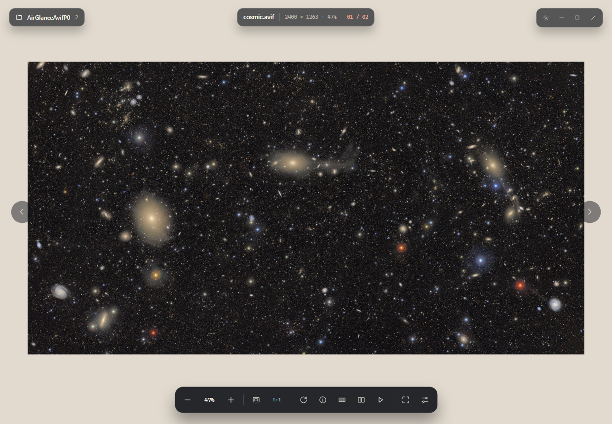

# AVIF 支持验证

> 状态：历史记录。0.4.1 通过 libvips 支持 AVIF，0.5.0 随 libvips 移除；2026-11-20
> 已通过 libavif + dav1d 在 Windows x64/arm64、macOS 和 Linux 恢复，
> 见 [avif-revival.md](avif-revival.md)。

## 结果

Windows x64 的 NetVips.Native 包包含 libheif + AOM，可以直接解码 AVIF。

实测：

- 2400 × 1263 AVIF 可以正常打开；
- 扩展名加入 `SupportedFormats` 后出现在文件夹列表和打开对话框中；
- 元数据、预览和 1:1 缩放走 NetVips；
- 动画 AVIF 目前只显示第一帧。

## 集成

- `.avif` 加入支持格式；
- `ImageDecoder` 将 AVIF 路由到 `NetVipsImageDecoder`；
- 预览、完整解码和元数据均使用 libvips；
- `DecodeFullRaw` 支持 AVIF 的编辑路径；
- 测试：`sample.avif` 解码为 1440 × 900，缩放到 800 px。

## 限制

- 原生包目前是 Windows x64；macOS/Linux 需要对应 NetVips native 包。
- AVIF 动画只显示第一帧。
- ICC/HEIC 仍未处理；HEIC 需要的 HEVC 解码器不在当前 native 包中。
