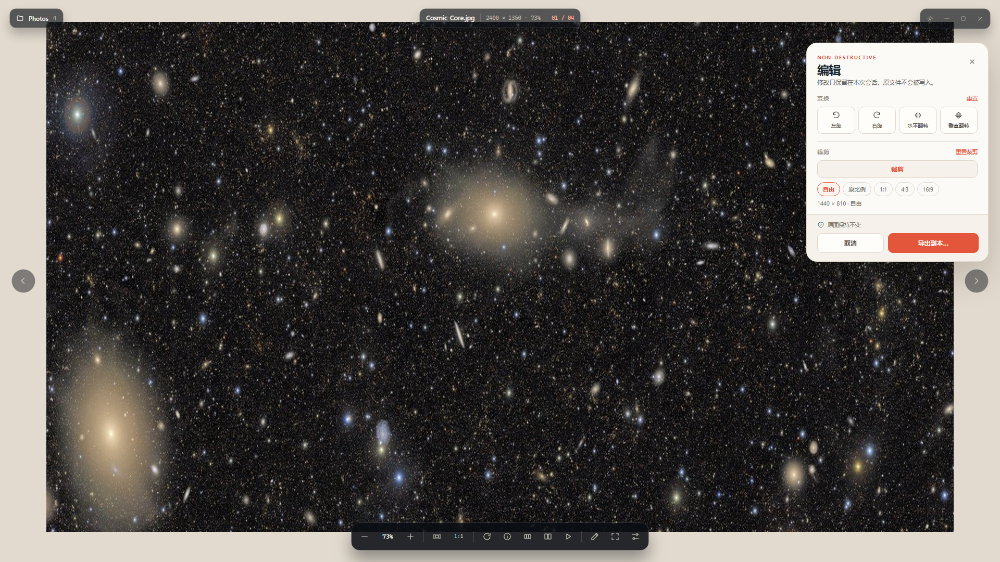
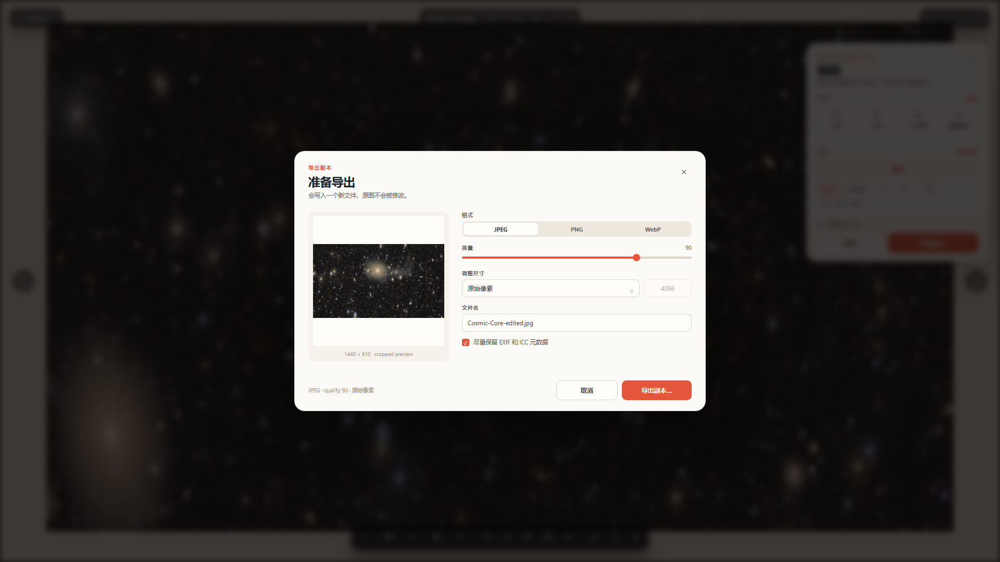

# 裁剪完成直接导出 + 单一导出按钮 — v3 交互视觉稿

> 状态：等待确认，尚未实现。  
> 原型：[crop-done-export-v3.html](crop-done-export-v3.html)  
> 静态稿：[紧凑编辑面板](crop-done-export-v3-edit.png) · [裁剪完成后直接导出](crop-done-export-v3-export.png)

## 已按确认调整

- 按钮仍叫 **完成**，不改名为“完成并导出”。
- 导出窗口取消后返回编辑面板，并保留裁剪。
- 删除整个 EXPORT 区块和导出卡片，只保留右下角导出按钮。
- 删除后的区域不留白，也不加提示文案：面板改为内容高度，footer 紧跟 Crop 区块。

---

# 一、紧凑编辑面板



调整：

- 删除 `EXPORT` 标题和整个导出卡片；
- 面板不再拉伸到窗口底部；
- 面板高度由内容决定；
- Crop 区块结束后立即显示 footer；
- footer 只保留：
  - `取消`
  - `导出副本…`
- 不留空白区域；
- 不添加“请使用右下角导出”等提示文案。

最终结构：

```text
编辑
  变换
  裁剪
  ─────────
  原图保持不变
  [ 取消 ] [ 导出副本… ]
```

---

# 二、完成裁剪后直接导出

```text
编辑面板
  → Crop
    → 沉浸式裁剪
      → 完成 / Enter
        → 保留裁剪
        → 退出裁剪模式
        → 立即打开导出副本窗口
```



完成后：

- 裁剪 chrome 全部退出；
- 紧凑编辑面板恢复；
- 主窗口压暗、模糊；
- 导出窗口居中打开；
- 左侧预览使用当前裁剪区域；
- 预览尺寸显示裁剪后的实际尺寸；
- `完成` 按钮文案保持不变。

## 取消导出

在导出窗口点击 `取消` 或 `Esc`：

- 关闭导出窗口；
- 返回编辑面板；
- **保留刚才的裁剪**；
- 可以继续编辑或再次从右下角导出。

## Esc 语义

| 位置 | 行为 |
| --- | --- |
| 沉浸式裁剪 | 恢复进入裁剪前的范围，返回编辑面板，不打开导出 |
| 导出窗口 | 返回编辑面板，保留裁剪 |

## 导出成功

沿用现有逻辑：

- 写入副本；
- 结束编辑；
- 返回原始查看状态。

---

# 三、最终交互

| 操作 | 行为 |
| --- | --- |
| Crop | 进入沉浸式裁剪 |
| 完成 / Enter | 保留裁剪 + 直接打开导出窗口 |
| 取消 / Esc（裁剪） | 恢复进入前裁剪 + 返回编辑 |
| 取消 / Esc（导出） | 返回编辑 + 保留裁剪 |
| 右下角导出副本 | 唯一手动导出入口 |

---

# 四、待确认

1. 紧凑面板的最终高度和 footer 位置是否确认？
2. 删除 EXPORT 区块后不留白、不加提示，是否确认？
3. 完成裁剪后直接打开导出窗口，是否确认？
4. 导出取消后返回编辑并保留裁剪，是否确认？
