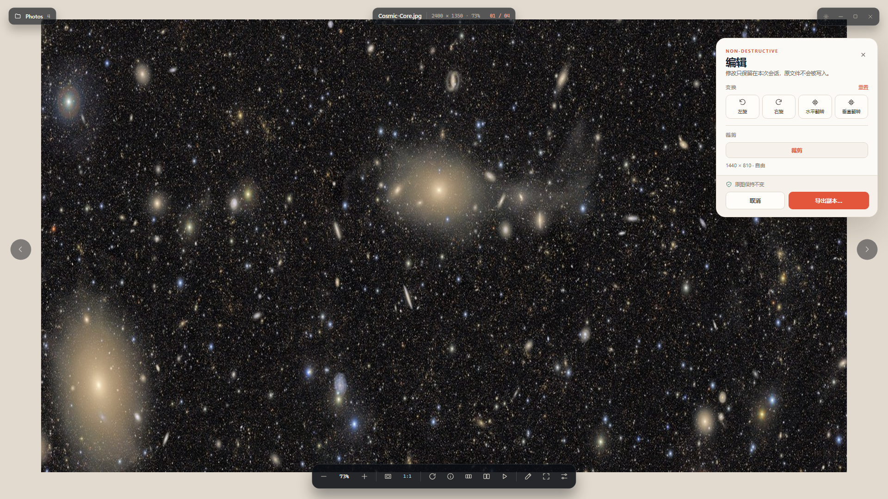
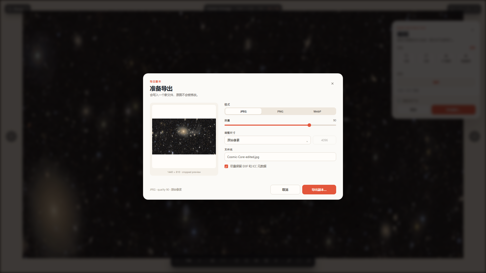

# 简化裁剪区块 — v4 交互视觉稿

> 状态：等待确认，尚未实现。  
> 原型：[crop-simplified-v4.html](crop-simplified-v4.html)  
> 静态稿：[简化后的编辑面板](crop-simplified-v4-edit.png) · [完成裁剪后直接导出](crop-simplified-v4-export.png)

## 本次调整

沉浸式裁剪已经包含：

- 比例选择；
- 重置；
- 取消；
- 完成；
- 8 向裁剪手柄。

因此编辑面板不再重复这些操作，只保留：

1. **Crop / 裁剪** 入口；
2. 当前裁剪结果的只读尺寸摘要。

不再保留：

- `重置裁剪` 按钮；
- Free / Original / 1:1 / 4:3 / 16:9 比例 chip；
- 任何裁剪开关。

---

# 一、简化后的编辑面板



裁剪区块变成：

```text
裁剪
[ 裁剪 ]
1440 × 810 · 自由
```

- `裁剪` 是唯一进入沉浸式裁剪的入口；
- 尺寸摘要只读，不响应点击；
- 所有比例、重置、取消、完成操作都在沉浸式底部工具栏里；
- 面板保持内容高度，footer 紧跟裁剪区块；
- 面板中没有空白区域；
- 没有导出卡片，只有右下角 `导出副本…` 按钮。

最终面板：

```text
编辑
  变换
  裁剪
    [ 裁剪 ]
    1440 × 810 · 自由
  ─────────
  原图保持不变
  [ 取消 ] [ 导出副本… ]
```

---

# 二、沉浸式裁剪保留的操作

底部工具栏继续保留：

```text
裁剪尺寸
自由 / 原比例 / 1:1 / 4:3 / 16:9
重置
取消
完成
```

进入沉浸式裁剪后，面板完全隐藏，不会挡住裁剪角点。

---

# 三、完成裁剪后直接导出

行为保持不变：

```text
裁剪
  → 沉浸式裁剪
    → 完成 / Enter
      → 保留裁剪
      → 退出裁剪
      → 直接打开导出副本
```



在导出窗口取消：

- 返回编辑面板；
- 保留刚才的裁剪；
- 可以通过面板中的 `裁剪` 再次进入沉浸式调整；
- 或从右下角再次导出。

---

# 四、需要确认

1. 编辑面板只保留 `裁剪` 按钮和只读尺寸摘要，是否确认？
2. 删除 `重置裁剪` 和所有比例 chip，是否确认？
3. 沉浸式底部工具栏继续保留比例、重置、取消、完成，是否确认？
4. 完成裁剪后直接打开导出窗口，是否确认？
