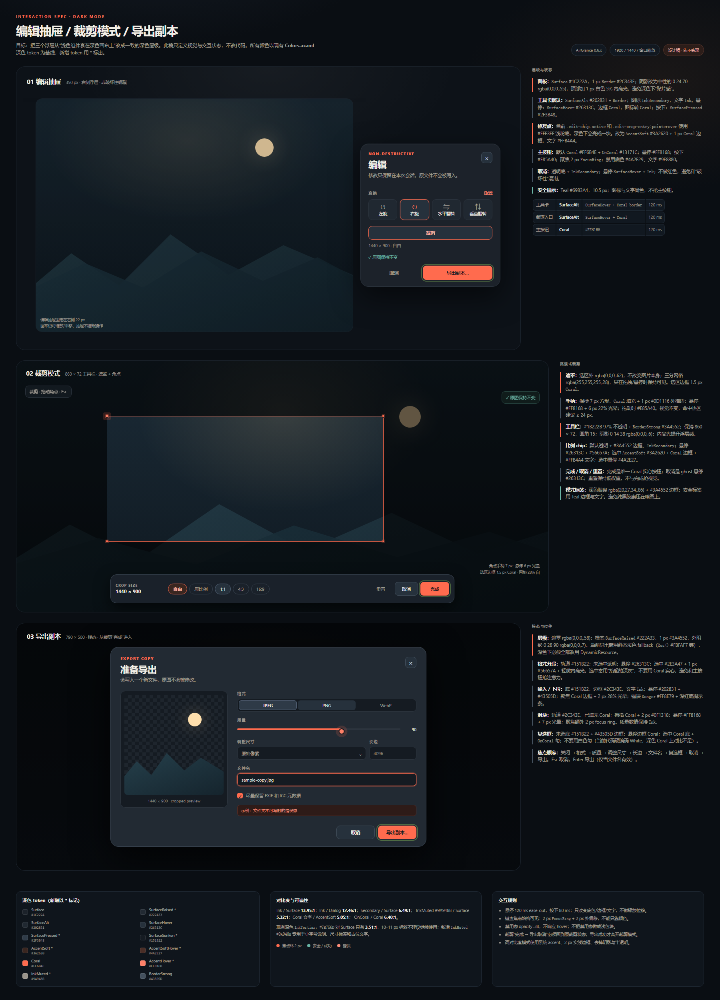

# AirGlance 深色模式交互设计稿

> 范围：编辑抽屉、裁剪模式、导出副本模态  
> 状态：**设计稿，先不实现**  
> 日期：2026-11-20  
> 基线：现有 `Colors.axaml` 深色 token + 0.6.x 布局尺寸



设计板源文件：[dark-edit-export-crop.html](dark-edit-export-crop.html)（可直接用浏览器打开、放大查看）

---

## 1. 设计目标

这三个浮层现在的问题不是“深色不够黑”，而是**浅色组件直接套在深色画布上**：

- 编辑抽屉的面板底色已经跟随主题，但选中 chip、裁剪入口 hover 仍是 `#FFF3EF` 浅粉；
- 裁剪工具栏的 chip 边框还是 `#DED5CA`，选中态是浅粉底；
- 导出模态的绝大多数颜色来自 `EditExportDialog` 里的静态浅色 `Res()` 回退，整个窗口基本不跟随深色主题；
- 主按钮 hover 用 `Opacity=0.9`，在深色下会把珊瑚色和文字一起压暗，和设计 token 不一致。

本稿的目标：

1. **同一套深色语义**：编辑抽屉、裁剪工具栏、导出模态使用同一组 surface / border / text / accent token，不再各写各的浅色值。
2. **层级清楚**：画布最暗，编辑抽屉浮起一层，导出模态再浮起一层；靠 surface 明度 + 边框 + 阴影，而不是纯黑描边。
3. **状态完整**：默认 / hover / pressed / focus / disabled / selected 六个状态都有明确值，尤其是指标里的按钮 hover 和选中背景。
4. **不改布局骨架**：保持 350 px 编辑抽屉、860 × 72 裁剪栏、790 × 500 导出模态，降低实现和回归成本。
5. **可访问**：小字号文字达到 4.5:1，焦点环始终可见，不靠颜色单独表达选中/错误。

---

## 2. 现状审计

| 区域 | 当前实现 | 深色下的问题 | 设计处理 |
| --- | --- | --- | --- |
| 导出模态整体 | `EditExportDialog.Res()` 返回 `#FBFAF7`、`#F6F2EB`、`#E3DAD0`、`#23211F` 等浅色静态值（[EditExportDialog.cs:514](src/AirGlance.App/Views/EditExportDialog.cs#L514)） | 整个导出窗口基本是浅色，和深色主界面割裂 | 改为主题资源；新增 `SurfaceRaised` / `SurfaceSunken` / `DialogScrim` |
| 格式分段轨道 | `#EEE7DD` 硬编码（[EditExportDialog.cs:154](src/AirGlance.App/Views/EditExportDialog.cs#L154)） | 深色里出现一条浅米色轨道 | 轨道 `SurfaceSunken`；选中段 `#2E3A47` + `#56657A` 边框 |
| 导出强调色 | `Resources["SystemAccentColor"] = #E3563B` 固定浅色珊瑚（[EditExportDialog.cs:64](src/AirGlance.App/Views/EditExportDialog.cs#L64)） | 深色强调色偏暗，滑块/复选框不协调 | 使用主题 `Coral`（深色 `#FF6B4E`） |
| 复选框勾 | `Brushes.White`（[EditExportDialog.cs:73](src/AirGlance.App/Views/EditExportDialog.cs#L73)） | 白勾放在亮珊瑚上对比不足 | 深色用 `OnCoral #13171C`，不要用白色 |
| 导出窗口阴影 | 棕色 `rgba(30,22,16,.35)`（[EditExportDialog.cs:322](src/AirGlance.App/Views/EditExportDialog.cs#L322)） | 深色背景上偏脏、层级不明显 | 中性黑阴影 + 顶部 1 px 内高光 |
| 编辑选中 chip | `#FFF3EF`（[Controls.axaml:1248](src/AirGlance.App/Styles/Controls.axaml#L1248)） | 深色里亮成一块浅粉 | `AccentSoft #3A2620` + `Coral` 边框 + `#FFB4A4` 文字 |
| 裁剪入口 hover | `#FFF3EF`（[Controls.axaml:1321](src/AirGlance.App/Styles/Controls.axaml#L1321)） | 同上 | `SurfaceHover` + `Coral` 边框 |
| 裁剪 chip 边框 | `#DED5CA`（[Controls.axaml:1343](src/AirGlance.App/Styles/Controls.axaml#L1343)） | 浅色描边在暗画布上太跳 | `#3A4552` 默认，hover `#56657A` |
| 裁剪选中 chip | `#FFF3EF`（[Controls.axaml:1351](src/AirGlance.App/Styles/Controls.axaml#L1351)） | 同上 | `AccentSoft` + `Coral` 边框 |
| 主按钮 hover | `Opacity=0.9`（[Controls.axaml:1303](src/AirGlance.App/Styles/Controls.axaml#L1303)、[Controls.axaml:1397](src/AirGlance.App/Styles/Controls.axaml#L1397)） | 文字和背景一起变暗，状态不可控 | 显式 `AccentHover #FF8168`，按下 `AccentPressed #E85A40` |
| 面板/裁剪栏阴影 | 棕色 `#33281F18` / `#55281F18`（[Controls.axaml:1180](src/AirGlance.App/Styles/Controls.axaml#L1180)、[Controls.axaml:1333](src/AirGlance.App/Styles/Controls.axaml#L1333)） | 深色下阴影发脏、边界不清晰 | 中性黑阴影 + 边框 + 内高光 |
| 裁剪手柄 | 固定 `#D65A43` + 白描边（[CropOverlay.cs:21](src/AirGlance.App/Controls/CropOverlay.cs#L21)） | 和深色主题的 `Coral` 不一致 | 使用主题 `Coral`；白描边保证任意图片上都可见 |
| 小字号说明 | 深色 `InkTertiary #7B756D` | 对 Surface 仅 **3.51:1**，10–11 px 偏弱 | 新增 `InkMuted #9A948B`，达到 5.32:1 |

结论：**不要靠“把浅色值全部变暗”解决**。需要先把层级和状态语义定清楚，再映射到资源。

---

## 3. 设计原则

1. **Canvas → Panel → Modal 三层明度**  
   画布 `#10161D`，编辑抽屉 `#1C222A`，导出模态 `#222A33`。越靠前的任务层越亮，但差距控制在 5–8 个明度点，避免“黑色卡片叠黑色卡片”。

2. **边框比阴影更重要**  
   深色下大阴影容易糊成一片。每个浮层至少保留 1 px 边框；阴影只负责“离开画布”的感觉。

3. **一个区域只有一个 Coral 实心主按钮**  
   编辑抽屉的「导出副本…」、裁剪栏的「完成」、导出模态的「导出副本…」是各自区域唯一的 accent 实心按钮。其他按钮用 ghost / neutral，避免满屏珊瑚。

4. **选中态用 AccentSoft，不用 Coral 实心**  
   比例 chip、格式段、工具卡的选中态用暖色低饱和底 `#3A2620` + Coral 边框；Coral 实心只留给主操作。

5. **hover 不改布局**  
   只改背景、边框、图标/文字颜色；不做放大、位移、阴影跳动。120 ms ease-out，按下 80 ms。

6. **焦点不是 hover 的替代品**  
   键盘焦点始终有 2 px `FocusRing` + 2 px 外偏移；鼠标 hover 不显示焦点环。

7. **深色不是纯黑**  
   使用带一点暖灰的 Ink 和 Surface；纯黑只用于图片遮罩和模态 scrim。

---

## 4. 色彩 token

### 4.1 新增/调整 token

| 语义 | Key | 深色值 | 用途 |
| --- | --- | --- | --- |
| 浮起面板 | `SurfaceRaised` * | `#222A33` | 导出模态、需要再高一层的面板 |
| 下沉控件 | `SurfaceSunken` * | `#151B22` | 输入框、下拉、格式轨道、预览框 |
| 按下中性 | `SurfacePressed` * | `#2F3B48` | 工具卡/chip/ghost 按钮按下 |
| 悬浮层 | `SurfaceOverlay` * | `#1B222B` | 裁剪工具栏 97% 不透明底 |
| 强调 hover | `AccentHover` * | `#FF8168` | 主按钮 hover、强调描边 hover |
| 强调按下 | `AccentPressed` * | `#E85A40` | 主按钮 pressed |
| 选中暖底 | `AccentSoft` * | `#3A2620` | chip/格式段选中底 |
| 选中 hover | `AccentSoftHover` * | `#4A2E27` | 选中项 hover |
| 选中按下 | `AccentSoftPressed` * | `#57352B` | 选中项 pressed |
| 弱化文字 | `InkMuted` * | `#9A948B` | 10–11 px 标签、尺寸、占位 |
| 模态遮罩 | `DialogScrim` * | `#B3000000` | 导出模态背景；不要改全局 `Scrim` |
| 焦点环 | `FocusRing` * | `#B3FF6B4E` | 2 px 外焦点环 |

\* 为建议新增的 key，不代表已经实现。

### 4.2 复用现有 token

| 语义 | Key | 深色值 |
| --- | --- | --- |
| 窗口底 | `Paper` | `#13171C` |
| 主面板 | `Surface` | `#1C222A` |
| 次级面板 | `SurfaceAlt` | `#202831` |
| 中性 hover | `SurfaceHover` | `#26313C` |
| 边框 | `Border` | `#2C343E` |
| 强边框 | `BorderStrong` | `#43505D` |
| 主文字 | `Ink` | `#F3EFE6` |
| 次文字 | `InkSecondary` | `#ABA49A` |
| 强调 | `Coral` | `#FF6B4E` |
| 强调上的文字 | `OnCoral` | `#13171C` |
| 安全/成功 | `Teal` | `#69B3A4` |
| 错误 | `Danger` | `#FF8E79` |
| 画布 | `Canvas` | `#171E27` |

### 4.3 对比度校验

| 组合 | 对比度 | 结论 |
| --- | --- | --- |
| `Ink` / `Surface` | 13.95:1 | AAA |
| `Ink` / `SurfaceRaised` | 12.65:1 | AAA |
| `InkSecondary` / `Surface` | 6.49:1 | AA |
| `InkMuted` / `Surface` | 5.32:1 | AA（小字号可用） |
| `InkMuted` / `SurfaceRaised` | 4.76:1 | AA |
| `Coral` 文字 / `AccentSoft` | 5.05:1 | AA |
| `#FFB4A4` / `AccentSoft` | 8.33:1 | AAA |
| `OnCoral` / `Coral` | 6.40:1 | AA |
| `Danger` / `Surface` | 7.16:1 | AA |

**不要继续用**：`InkTertiary #7B756D` 对 `Surface` 只有 3.51:1；它只适合装饰性文字，不适合 10–11 px 标签。

---

## 5. 组件规范

### 5.1 编辑抽屉

```
┌─ 编辑 ───────────────────── × ┐
│ NON-DESTRUCTIVE               │
│ 修改只保留在本次会话…          │
│ ───────────────────────────── │
│ 变换                      重置 │
│ [↺ 左旋] [↻ 右旋] [⇋ 水平翻转] [⇅ 垂直翻转] │
│ ───────────────────────────── │
│ [          裁剪          ]    │
│ 1440 × 900 · 自由             │
│ ✓ 原图保持不变                │
│ ───────────────────────────── │
│ [ 取消 ]   [ 导出副本… ]      │
└───────────────────────────────┘
```

尺寸保持不变：350 px 宽、20 px 圆角、内边距约 18–19 px；工具卡 52 px 高；底部按钮 38 px 高。

| 元素 | 默认 | Hover | Pressed | Focus | Disabled |
| --- | --- | --- | --- | --- | --- |
| 面板 | `Surface` + `Border`；阴影 `0 24 70 rgba(0,0,0,.55)` + 顶部 5% 内高光 | — | — | — | — |
| 关闭 × | 透明，`InkSecondary` | `SurfaceHover` + `BorderStrong`，`Ink` | `SurfacePressed` | 2 px focus ring | — |
| 分区标签 | `InkMuted`，10.5 px SemiBold，字距 1.1 | — | — | — | — |
| 重置链接 | `Coral` 文字 | `#FF8168` + 下划线 | `#E85A40` | 2 px focus ring | opacity .38 |
| 变换工具卡 | `SurfaceAlt` + `Border`；图标 `InkSecondary`，文字 `Ink` | `SurfaceHover` + `Coral` 边框；图标 `Coral` | `SurfacePressed` + `AccentPressed` 边框 | 2 px focus ring | opacity .38 |
| 裁剪入口 | `SurfaceAlt` + `Border`；文字 `Coral` | `SurfaceHover` + `Coral` 边框；文字 `#FFB4A4` | `SurfacePressed` | 2 px focus ring | opacity .38 |
| 尺寸/自由 | `InkMuted` | — | — | — | — |
| 安全提示 | `Teal` 图标 + 文字 | — | — | — | — |
| 取消 | 透明；`InkSecondary` | `SurfaceHover` + `Ink` | `SurfacePressed` | 2 px focus ring | opacity .38 |
| 导出副本… | `Coral` + `OnCoral` | `AccentHover #FF8168` | `AccentPressed #E85A40` | 2 px focus ring + 2 px offset | 底色 `#4A2E29`，文字 `#9E8880` |

**关键修复**：不要再用 `#FFF3EF`；选中/强调底色一律走 `AccentSoft`，主按钮 hover 不再用整体 `Opacity=0.9`。

### 5.2 裁剪模式

```
┌ 裁剪 · 拖动角点 · Esc ─────────────────────── ✓ 原图保持不变 ┐
│                                                              │
│          ┌────────────────────────────┐                      │
│          │        crop selection      │                      │
│          │   1/3 grid, Coral border   │                      │
│          └────────────────────────────┘                      │
│                                                              │
│  ┌ CROP SIZE ─┐ │ [自由] [原比例] [1:1] [4:3] [16:9] │ 重置 取消 完成 ┐
└──────────────────────────────────────────────────────────────┘
```

尺寸保持不变：裁剪栏 **860 × 72**、圆角 15、底部间距 24；比例 chip 27 px 高；操作按钮 34 px 高。

#### 裁剪画布

| 元素 | 深色值 | 说明 |
| --- | --- | --- |
| 选区外遮罩 | `rgba(0,0,0,.62)` | 保留图片，不改变像素 |
| 选区边框 | `Coral #FF6B4E`，1.5 px | 与主强调一致 |
| 三分网格 | `rgba(255,255,255,.28)`，1 px | 拖拽/悬停时保持可见 |
| 角点手柄 | 7 px 方形，`Coral` 填充，1 px `rgba(255,255,255,.85)` 外描边 | 白描边保证在暗图/亮图上都可见 |
| 手柄 hover | `AccentHover #FF8168` + 6 px 22% 光晕 | 仅颜色变化，不改变手柄尺寸 |
| 手柄拖动 | `AccentPressed #E85A40` | 拖动中不要闪回默认色 |
| 边缘热区 | 视觉 7 px，命中 ≥ 24 px | 交互建议，不一定本期改 |

#### 裁剪工具栏

| 元素 | 默认 | Hover | Pressed | Selected / Active | Focus |
| --- | --- | --- | --- | --- | --- |
| 工具栏 | `SurfaceOverlay` 97% + `BorderStrong`；阴影 `0 14 38 rgba(0,0,0,.6)` | — | — | — | — |
| CROP SIZE 标签 | `InkMuted`，8.5 px Bold，字距 1.3 | — | — | — | — |
| 尺寸值 | `Ink`，12 px SemiBold | — | — | — | — |
| 比例 chip | 透明 + `#3A4552` 边框；`InkSecondary` | `SurfaceHover` + `#56657A`；`Ink` | `SurfacePressed` | `AccentSoft` + `Coral` 边框 + `#FFB4A4`；SemiBold | 2 px `FocusRing` |
| 选中 chip hover | — | `AccentSoftHover #4A2E27` + `AccentHover` 边框；`Ink` | `AccentSoftPressed #57352B` | — | — |
| 重置 | 透明，`InkSecondary` | `SurfaceHover` + `Ink` | `SurfacePressed` | — | 2 px ring |
| 取消 | 透明，`InkSecondary` | `SurfaceHover` + `Ink` | `SurfacePressed` | — | 2 px ring |
| 完成 | `Coral` + `OnCoral`，SemiBold | `AccentHover` | `AccentPressed` | — | 2 px ring |

模式标签：

- 左侧「裁剪 · 拖动角点 · Esc」：`rgba(20,27,34,.86)` 底 + `Border` 边框 + `InkSecondary` 文字。
- 右侧「✓ 原图保持不变」：同上底，`Teal` 文字 + `#2A4B45` 边框。
- 不要用纯黑 `#000` 胶囊；暗图上会变成一块死黑。

#### 裁剪 → 导出状态流

```
编辑抽屉 [裁剪]
      ↓
裁剪模式（可调整选区/比例）
      ↓ [完成]
导出模态
  ├─ [取消] / Esc / ×  → 回到裁剪模式（选区、比例、工具栏原样）
  └─ [导出成功]        → 退出编辑模式，恢复顶部/底部 chrome
```

这是本稿的硬性交互要求：**取消导出不能丢失裁剪状态**。当前代码已经修过这一条，深色改造不能把它改回去。

### 5.3 导出副本模态

```
┌ 准备导出 ─────────────────────────────── × ┐
│ EXPORT COPY                               │
│ 会写入一个新文件，原图不会被修改。          │
│ ┌ preview ─────┐  格式 [JPEG][PNG][WebP]  │
│ │              │  质量 ────●──── 90        │
│ │   cropped    │  调整尺寸 [原始像素] [4096]│
│ │   preview    │  文件名 [sample-copy.jpg] │
│ └──────────────┘  [✓] 尽量保留 EXIF/ICC    │
│ ───────────────────────────────────────── │
│                        [取消] [导出副本…] │
└───────────────────────────────────────────┘
```

尺寸保持不变：790 × 500，20 px 圆角；左侧预览 268 px；右侧设置区自适应。

| 元素 | 默认 | Hover | Focus | Disabled / Error |
| --- | --- | --- | --- | --- |
| 遮罩 | `DialogScrim #B3000000` | — | — | — |
| 模态 | `SurfaceRaised` + `#3A4552` 边框；阴影 `0 28 90 rgba(0,0,0,.7)` + 顶部 6% 内高光 | — | — | — |
| 标题/副标题 | `Ink` / `InkSecondary` | — | — | — |
| 关闭 × | 透明 + `InkSecondary` | `SurfaceHover` + `Ink` | 2 px ring | — |
| 预览框 | `SurfaceSunken` + `Border`，12 px 圆角 | — | — | — |
| 预览说明 | `InkMuted`，10 px | — | — | — |
| 格式轨道 | `SurfaceSunken` + `Border`，9 px 圆角 | — | — | — |
| 格式段 | 透明 + `InkSecondary` | `SurfaceHover` + `Ink` | 2 px ring | — |
| 格式段选中 | `#2E3A47` + `#56657A` 边框 + `Ink`；轻微内高光 | 保持选中底，文字 `Ink` | 2 px ring | — |
| 滑块轨道 | `#2C343E` | — | — | 禁用 opacity .38 |
| 滑块已填充 | `Coral` | — | — | — |
| 滑块拇指 | `Coral` + 2 px `#0F1318` | `AccentHover` + 7 px 光晕 | 2 px ring | 禁用 opacity .38 |
| 输入/下拉 | `SurfaceSunken` + `Border`；`Ink` | `SurfaceAlt` + `BorderStrong` | `Coral` 边框 + 2 px 28% 光晕 | 错误：`Danger` 边框 + 深红提示条 |
| 文件名 | 同输入 | 同输入 | 同输入 | 空/非法：`Danger` 边框 + 说明 |
| 复选框 | 未选：`SurfaceSunken` + `#43505D` 边框 | 边框 `Coral` | 2 px ring | 禁用 opacity .38 |
| 复选框选中 | `Coral` 底 + `OnCoral` 勾 | `AccentHover` 底 | 2 px ring | — |
| 取消 | 透明 + `InkSecondary` | `SurfaceHover` + `Ink` | 2 px ring | — |
| 导出副本… | `Coral` + `OnCoral` | `AccentHover` | 2 px ring | 底色 `#4A2E29`，文字 `#9E8880` |

错误提示：

- 底 `#2E1B18`、边框 `#5A2E27`、文字 `Danger #FF8E79`；必须同时有图标/文字，不能只变红。
- 成功/保存提示用 `Teal #69B3A4`，不要用 Coral。

---

## 6. 交互与动效

| 项目 | 规范 |
| --- | --- |
| hover 进入 | 120 ms ease-out；仅背景/边框/文字颜色 |
| 按下 | 80 ms；背景到 `SurfacePressed` / `AccentPressed`；不做缩放 |
| 焦点 | 2 px `FocusRing` + 2 px `outline-offset`；不因鼠标点击而隐藏 |
| 模态出现 | 140 ms：opacity 0→1 + scale .98→1；不要弹跳 |
| 裁剪栏出现 | 120 ms：opacity + 4 px 上移；不要从屏幕外飞入 |
| 主题切换 | 如果支持窗口打开时切换，颜色立即更新，不做长动画；避免闪白 |
| 减弱动效 | 跟随系统 `ReduceMotion`，关闭位移/缩放，仅保留颜色变化 |
| 指针 | 可点击元素 `Hand`；禁用元素 `Arrow` 且不响应 hover |
| 键盘 | `Tab` 顺序：关闭 → 格式 → 质量 → 调整尺寸 → 长边 → 文件名 → 复选框 → 取消 → 导出；`Esc` 取消；`Enter` 导出（文件名有效时） |
| 点击遮罩 | **不关闭**模态，避免误触丢失裁剪状态；只通过取消/Esc/× 关闭 |

---

## 7. 响应式与缩放

本期不改变固定尺寸，但需要保证在常见 DPI 下不裁切：

- 125% / 150% 缩放：导出模态按逻辑像素 790 × 500 渲染；在 1366 × 768、150% 下高度接近上限，需要预留 `max-height: calc(100vh - 48px)`，预览区可压缩，设置区不滚动。
- 裁剪栏 860 px 在 1280 宽、150% 下会超出；建议后续把比例 chip 的文字宽度压缩，或允许 chip 横向滚动，不换行。
- 编辑抽屉 350 px 在窄窗口下仍贴右侧 22 px；不压缩到 300 px 以下，否则工具卡文字会换行。
- 任何 hover 状态都不能改变元素尺寸，避免布局抖动。

> 响应式不是本期重点；如果实现时发现 1280 × 720 / 150% 有裁切，再单独开一版窄窗设计。

---

## 8. 可访问性

1. **对比度**：正文 ≥ 4.5:1；大字号 ≥ 3:1；`InkMuted` 替代 `InkTertiary` 用于小标签。
2. **焦点可见**：所有按钮、chip、输入、滑块、复选框都有 2 px focus ring；焦点环在深色底上使用 70% 珊瑚，不能只靠边框变色。
3. **不靠颜色单独传达**：选中 chip 同时有底色、边框、SemiBold；错误同时有图标/文案；安全提示有 ✓ 图标。
4. **高对比度模式**：使用系统 accent，边框改为 2 px 实线，去掉阴影/半透明；不要在 HC 下使用 `AccentSoft` 低对比底色。
5. **屏幕阅读器**：关闭 × 需要 `AutomationProperties.Name`；图标按钮需要可读名称；裁剪手柄至少提供键盘可调的替代路径（后续单独设计）。
6. **文本缩放**：系统字体放大时，chip 高度和按钮高度用 `MinHeight` 而非固定 `Height`，避免文字被裁切。

---

## 9. 后续实现映射（本次不做）

| 设计项 | 实现位置（建议） |
| --- | --- |
| 新增 token | `src/AirGlance.App/Styles/Colors.axaml` 的 Light/Dark ThemeDictionaries |
| 编辑抽屉 hover / 选中 | `Controls.axaml` 的 `Button.edit-tool`、`edit-chip.active`、`edit-crop-entry`、`edit-primary` |
| 裁剪栏 | `Controls.axaml` 的 `Border.crop-bar`、`Button.crop-bar-chip`、`crop-bar-reset/action/primary` |
| 裁剪画布 | `CropOverlay.cs` 的 `DimBrush`、`BorderPen`、`GridPen`、`HandleBrush`；主题切换时 `InvalidateVisual()` |
| 导出模态 | `EditExportDialog.cs`：删除静态浅色 `Res()`，改为 `DynamicResource`/`FindResource`；格式轨道、复选框勾、阴影、accent 全部走主题 |
| 裁剪模式标签 | `MainWindow.axaml.cs` 的 `CropModeTag` / `CropSafeTag`；改用 `DynamicResource` |
| 焦点样式 | `Controls.axaml` 增加 `:focus-visible` / `:focus` 选择器；统一 `FocusRing` |
| 视觉回归 | 深色/浅色各截三张：编辑抽屉、裁剪栏、导出模态；至少覆盖 default / hover / active |

实现顺序建议：

1. 先补 token + 导出模态（问题最大、独立）；
2. 再改编辑抽屉的选中/hover；
3. 最后改裁剪栏和 CropOverlay（涉及自绘，需要主题切换重绘）。

---

## 10. 验收清单

- [ ] 深色编辑抽屉：面板为 `#1C222A`，不再出现 `#FFF3EF` / `#FBFAF7` 浅色块。
- [ ] 编辑工具卡 hover：背景 `#26313C`、边框 `#FF6B4E`、图标变 Coral；按下为 `#2F3B48`。
- [ ] 编辑「导出副本…」hover：`#FF8168`，不是整体透明度变暗。
- [ ] 裁剪栏：默认 chip 边框 `#3A4552`；hover `#26313C` + `#56657A`；选中 `#3A2620` + `#FF6B4E` + `#FFB4A4`。
- [ ] 裁剪栏「完成」hover `#FF8168`；「取消/重置」ghost hover 不抢主按钮。
- [ ] 裁剪手柄在暗图/亮图上都可见；hover 有光晕，拖动不闪色。
- [ ] 导出模态整体深色：`#222A33` 面板、`#151B22` 输入/格式轨道、`#B3000000` 遮罩。
- [ ] 导出格式选中段为 `#2E3A47` + `#56657A`，不是浅米色轨道。
- [ ] 滑块、复选框、输入框的 hover/focus/disabled 状态一致；复选框勾为 `OnCoral`，不是白色。
- [ ] 导出取消后回到裁剪模式，选区/比例/工具栏状态不丢。
- [ ] Tab 顺序正确；Esc 取消；Enter 在文件名有效时导出。
- [ ] 125% / 150% 缩放下无裁切、无文字截断。
- [ ] 高对比度模式下边框/焦点可见，不依赖半透明。
- [ ] 主题切换（如果窗口打开时允许）颜色即时更新，无闪白。

---

## 11. 待确认

1. 裁剪手柄是否保持 7 px 方形？本稿建议保持几何，只换色 + 光晕，减少回归面。
2. 裁剪栏 97% 不透明是否可接受？Avalonia 没有稳定的背景模糊，本稿不建议做 backdrop blur。
3. 是否允许修改 `InkTertiary`？建议**不改全局**，新增 `InkMuted`，避免影响信息面板等其他区域。
4. 导出格式选中态用中性抬升 `#2E3A47`，还是用 `AccentSoft`？本稿推荐中性，保持“主按钮唯一 Coral 实心”的层级。
5. 是否需要在主题切换时同步刷新 `CropOverlay` 的自绘 brush？如果需要，必须显式重绘，不能只靠资源字典。

---

**本稿只定义设计，不包含代码实现。** 实现前建议先确认第 11 节的 5 个问题。
