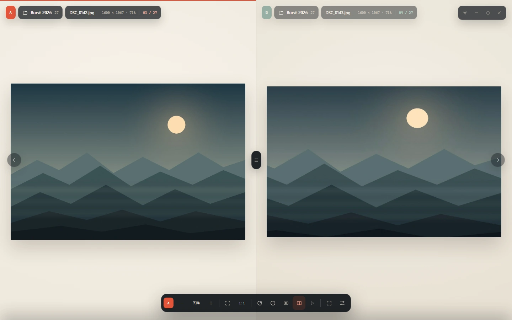
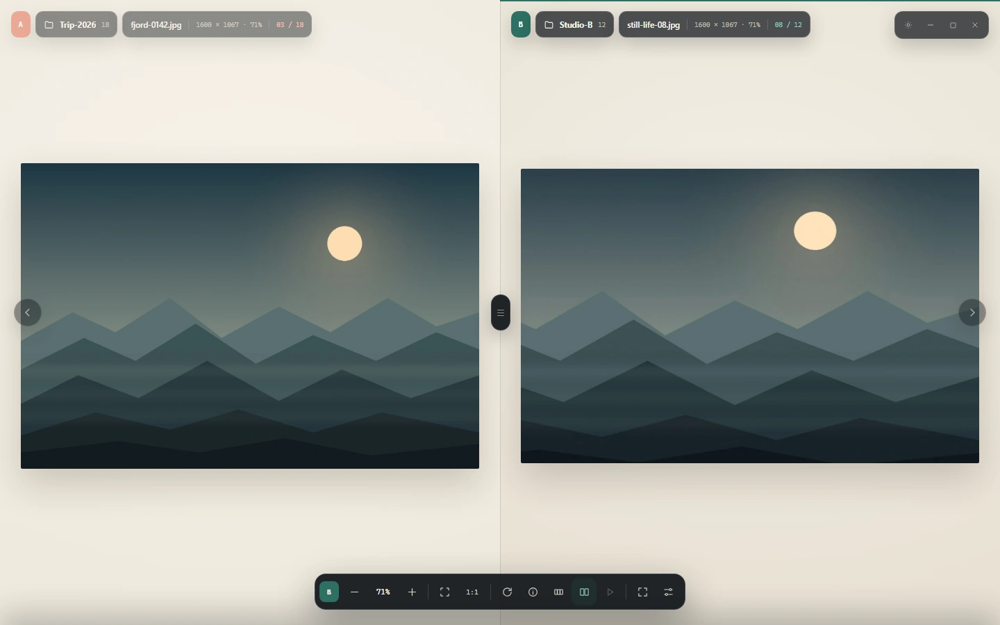
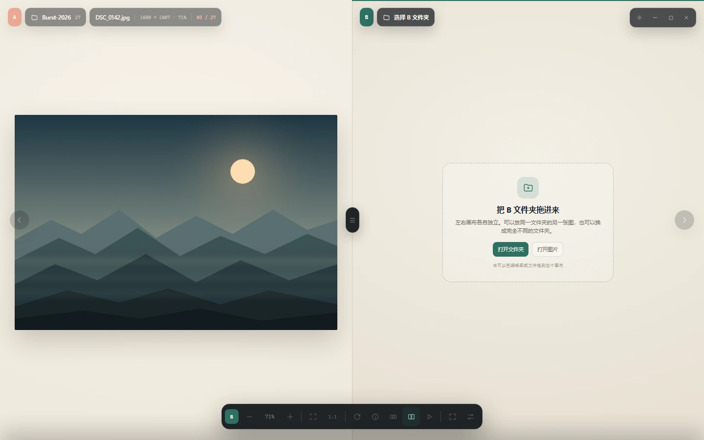

# AirGlance Dual-Canvas View v1

**English** · [简体中文](dual-view-v1.md)

> Interaction design draft. This document describes behaviour, layout and states only; it does not change application code.
>
> **Confirmed (2026-11-18):** two side-by-side canvases in one window; the right canvas shows the next image when entering from a folder; v1 does not include pair stepping; viewing two 100 MP images at 100% simultaneously is not an acceptance requirement.
>
> **Implementation status (0.4.0 local build, pending review and remote push):** Phase 1 is implemented. See [implemented-dual.webp](implemented-dual.webp).



## 0. Scope and assumptions

Here, “dual screen” is confirmed to mean **two side-by-side canvases inside one AirGlance window**, not a window spread across two physical monitors.

- Each canvas shows one image.
- The two images can come from the same folder or from different folders.
- One canvas is the **active pane**. The keyboard, dock, information panel and filmstrip target it by default.
- Physical dual monitors are a separate design (two top-level windows or a detachable pane) and are outside v1.

## 1. Core model

```text
Window
├── Pane A: folder + current image + zoom/pan + edit state
├── Pane B: folder + current image + zoom/pan + edit state
├── active pane: A or B
└── shared chrome: dock, filmstrip, info, window buttons
```

Each pane owns:

- its folder context and `ImageNavigator`;
- the current image and position;
- zoom, pan and fit mode;
- rotation/flip state;
- its large-image tile cache.

There is one active pane at a time. A uses coral, B uses teal. The colours identify panes; they do not alter image content.

## 2. Entering and leaving

### Enter dual view

- Press **`D`** in single view, or click the dock's “side by side” button.
- The current image stays in the left canvas.
- If the folder has a next image, the right canvas opens it; otherwise the right canvas shows an empty state.
- Entering dual view closes transient info/filmstrip overlays, so the user is not comparing two panels at once.

### Leave dual view

- Press **`D`** again or click the same dock button.
- The active pane's image, folder and zoom state become the single view.
- `Esc` priority: close info/filmstrip → exit fullscreen → exit dual view.

### Opening content

| Action | Target |
| --- | --- |
| `Ctrl+O` | Open an image in the active pane |
| `Ctrl+Shift+O` | Open a folder in the active pane |
| Click the A/B folder chip | Open/replace that pane's folder |
| Drop a folder or image on a canvas | Open it in that pane |
| Drop a thumbnail on the other canvas | Open that image there (Phase 2) |
| Empty-right-canvas actions | Replace only the right pane |

Opening a new folder never changes the other pane. Opening an image makes its pane active.

## 3. Same-folder viewing


- Both canvases share one folder list, but **each keeps its own current image**.
- Default pair: left `N`, right `N+1`.
- Left navigation does not move the right pane, and vice versa.
- To compare two specific images, activate the right pane and choose a thumbnail.
- v1 does **not** add “pair stepping”. The user can choose any second image, so forcing both indexes to move together would break the expected model. The product has confirmed it is not needed for now and it is not in Phase 2.

### Filmstrip in the same folder

The filmstrip follows the active pane and shows `A · Burst-2026 · 27`. Thumbnails can carry both A/B markers:

- A's current image: coral border and `A` badge;
- B's current image: teal border and `B` badge;
- clicking a thumbnail changes the active pane's current image;
- the filmstrip is not duplicated, preserving vertical space.

## 4. Different folders



- Each canvas has its own folder chip with its own name and count.
- The folders are completely independent. Leaving dual view keeps only the active pane's folder.
- If the right pane is empty, drop folder B or use “Open folder”.
- A/coral and B/teal identify the panes; the active pane has a 2 px identity line at the top.
- Swap panes: click the swap button on the divider, or press `X`; both panes exchange their complete folder, image and zoom state.

In different-folder mode:

- The filmstrip shows only the active pane's folder; changing active changes the strip.
- The info panel has A/B tabs. Changing the tab also changes the active pane, so information and operations never disagree.
- Side arrows, dock, rotate, copy and save target the active pane only.
- Slideshow is disabled in dual view (dimmed button, explanatory tooltip), avoiding two independent timers.

## 5. Layout and visual language

### Canvases

- 50/50 split with a 1 px divider.
- The divider has a 19 px hit area. Drag range is **25%–75%**; double-click resets 50/50.
- Pane padding is slightly smaller than single view (about 30 px) so both images can be large.
- Each pane fits and zooms independently.
- Images keep a soft shadow, matching single view.

### Pane header

Each pane's top-left contains:

```text
[A] [folder icon  folder name  27] [file name  1600×1067  71%  03/27]
```

- A/B badge is a 28 × 38 colour block.
- The active header is opaque; the inactive header is about 62% opaque.
- The active pane has a 2 px identity line at the top.
- Window controls remain global rather than per-pane.
- On narrow windows, dimensions/zoom disappear first; name and position stay.

### Bottom dock

- A pane badge `A`/`B` is added on the left, in the identity colour.
- All dock actions target the active pane.
- A “side by side” button is highlighted in dual view.
- Slideshow is disabled in dual view.
- Below 1120 px, the pane headers switch to compact mode (dimensions, zoom, position and folder count hidden). The dual-view minimum window is 1000 px.

### Filmstrip and information

- The filmstrip is a global overlay but its content follows the active pane.
- The information panel stays a right overlay, about 330 px wide, with A/B tabs.
- The two panels remain mutually exclusive.

### Fullscreen

- Both panes and the divider remain; top chips and bottom dock hide.
- Moving the pointer to an edge restores chrome; the divider remains adjustable.
- `Esc` exits fullscreen before leaving dual view.

## 6. Interaction table

| Action | Behaviour |
| --- | --- |
| `D` | Enter/leave dual view |
| `Tab` / `Shift+Tab` | Next/previous active pane |
| Click a pane | Activate it |
| Wheel | Zoom the pane under the pointer; that pane becomes active |
| Drag | Pan the active pane |
| Double-click image | Toggle fit / 100% in that pane |
| `←` / `→` | Previous/next image in the active pane |
| `PgUp` / `PgDn` | Previous/next image in the active pane |
| `Ctrl+O` | Open image in active pane |
| `Ctrl+Shift+O` | Open folder in active pane |
| `I` / `C` | Info/filmstrip for the active pane |
| `R` / `H` | Rotate/flip active pane |
| `X` | Swap panes |
| Drag divider | Change split ratio |
| Double-click divider | Reset 50/50 |
| `F` / `F11` | Dual-view fullscreen |
| `Esc` | Close overlays → exit fullscreen → exit dual view |

## 7. Empty and error states

### Empty right canvas



- The right canvas shows a dashed card: drop folder B, open a folder, or open an image.
- Its header becomes `B · Choose folder B`; the file chip is hidden.
- Image-specific dock controls dim; split view, settings and fullscreen remain available.
- The window and left canvas stay usable.

### Other cases

- Folder with one image: right canvas shows the empty state and an “open another folder” action.
- Corrupt/unsupported image: the error is local to that pane; the other pane keeps working.
- File deleted externally: the affected pane shows an error and the other pane does not jump.
- Drag hover: the target pane shows a 2 px identity border and a “Drop on B” hint.
- Animated GIF: panes animate independently; changing active does not reset the other animation.
- Two 100 MP images: viewing both at 100% is not required. v1 only guarantees full resolution for the active pane; an inactive huge image may stay on preview. Ordinary images can still both be at 100%.

## 8. Visual specification

| Item | Specification |
| --- | --- |
| A identity | coral `#E3563B` |
| B identity | teal `#2E6F63` |
| Active line | 2 px at the top of the pane |
| Inactive header | 62% opacity |
| Divider | 1 px, 19 px hit area |
| Split range | 25%–75%, default 50/50 |
| Pane padding | about 30 px (single view uses 48 px) |
| Pane header | 38 px chip, 28 × 38 A/B badge |
| Filmstrip | 138 px, follows active pane |
| Info panel | 330 px, A/B tabs at the top |
| Minimum window | 1000 px; compact headers below 1120 px |

## 9. Interaction trade-offs

- The key state is the **active pane**, not “both panes receive input”.
- Clicking is explicit activation; wheel and drag are direct manipulation, so they also activate the pane under the pointer.
- Hover does not switch the header/filmstrip, avoiding flicker while moving the mouse.
- `←/→` never moves both panes; it targets the active pane.
- v1 does not synchronise zoom or pan. Different image sizes make percentage sync ambiguous; a later optional “sync zoom percent” can be added.

## 10. Phases

### Phase 1 (implemented)

- Single-window dual canvas with independent folder, image and navigation;
- same folder starts with the next image;
- different folders through drop or folder chips;
- active pane, swap and divider;
- dock/info/filmstrip target the active pane;
- empty/error states and fullscreen.

### Phase 2

- Synchronised zoom percentage;
- drag thumbnails between panes;
- independent per-pane window title/status;
- restore the last dual layout.

### Phase 3

- Physical dual monitors: two top-level windows, active sync, cross-monitor drag;
- independent GPU/compositor paths;
- per-monitor fullscreen.

## 11. Confirmed decisions

- “Dual screen” means two side-by-side canvases in one window, not two physical monitors.
- The right canvas opening the next image when entering from a folder matches the expectation.
- v1 does not need pair stepping (left N / right N+1).
- Viewing two 100 MP images at 100% simultaneously is not a v1 acceptance requirement.

The v1 interaction scope is settled; there are no open interaction questions. Only Phase 1 start approval remains.

## 12. Implementation notes

The 0.4.0 local build implements:

- same-window A/B canvases, same-folder next image, and independent folders;
- active pane, `Tab`, `X` swap, 25%–75% divider drag and double-click reset;
- independent zoom/pan/fit per canvas; the wheel activates the canvas under the pointer;
- shared dock, filmstrip and information drawer following the active pane;
- empty right canvas, per-canvas open actions, drag/drop and error states;
- dual-view fullscreen, with `Esc` ordered overlays → fullscreen → dual view;
- GIF playback in a pane, 2.5 s chrome auto-hide, and copying the active preview.

Not included: per-canvas rotate/flip, save-copy, slideshow; two 100 MP images at 100%; pair stepping; physical dual monitors. Both canvases load bounded previews, so memory does not grow without limit with source dimensions.

## 13. Interactive prototype

Open:

- same folder: `docs/design/dual-view-v1.html?state=same`
- same folder + filmstrip: `?state=filmstrip`
- different folders: `?state=folders`
- empty right pane: `?state=empty`
- info panel: `?state=info`
- dark theme: add `&theme=dark`
- hide prototype state bar: add `&ui=0`

The buttons in the prototype are visual only; they are not connected to the application.
