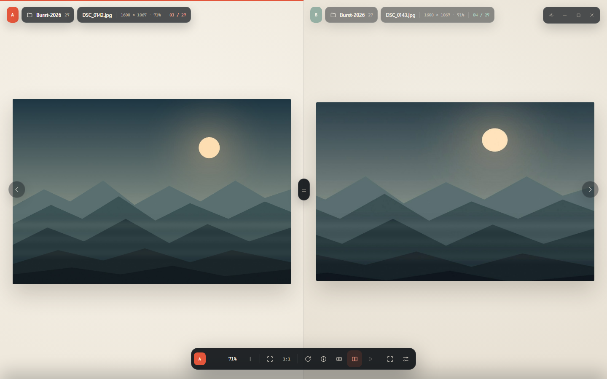
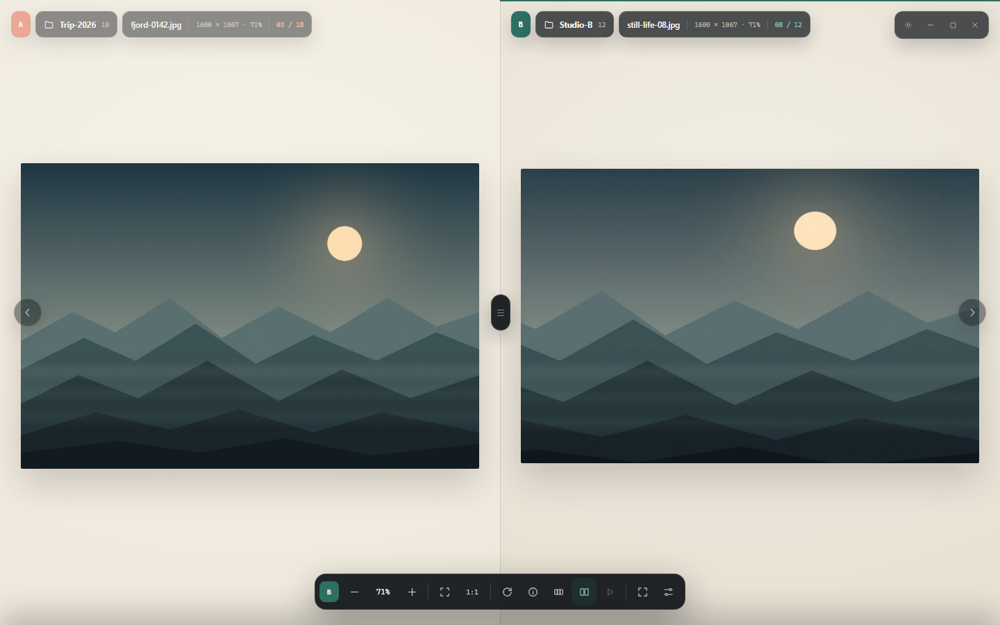
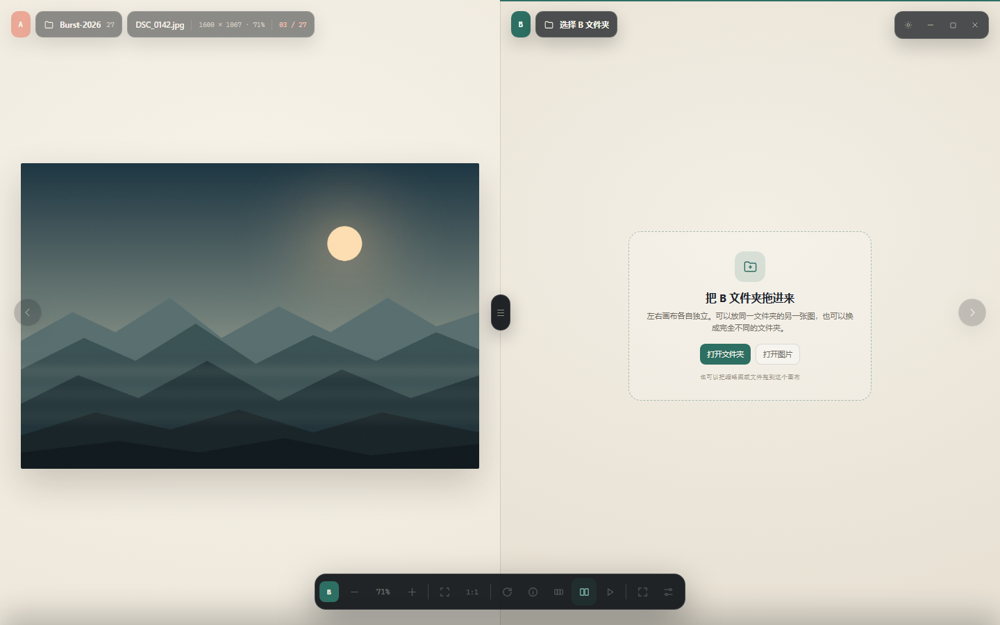

# AirGlance 双画布查看 v1

[English](dual-view-v1.en.md) · **简体中文**

> 交互设计稿。本文只描述行为、布局和状态，不修改应用代码。
>
> **已确认（2026-11-18）**：同窗口左右双画布；同文件夹进入时右画布默认下一张；v1 不做成对前进；双 100 MP 同时 100% 不是验收要求。



## 0. 范围与假设

这里的“双屏”已确认指**同一个 AirGlance 窗口内的左右双画布**，不是把窗口拆到两个物理显示器上。

- 左右画布各显示一张图片。
- 两张图可以来自同一文件夹，也可以来自不同文件夹。
- 一个窗口内只有一个“当前画布”，键盘、底部 dock、信息面板和胶片条默认作用于它。
- 物理双显示器是另一套方案（两个顶层窗口或可拖出的 pane），不纳入 v1。

## 1. 核心模型

```text
Window
├── Pane A: folder + current image + zoom/pan + edit state
├── Pane B: folder + current image + zoom/pan + edit state
├── active pane: A or B
└── shared chrome: dock, filmstrip, info, window buttons
```

每个 pane 有自己的：

- 文件夹上下文和 `ImageNavigator`；
- 当前图片、图片位置；
- 缩放、平移、适应模式；
- 旋转/翻转状态；
- 大图瓦片缓存。

全局只有一个 active pane。`A` 使用 coral，`B` 使用 teal，颜色只用于区分身份，不改变图片内容。

## 2. 入口与退出

### 进入双画布

- 单图模式按 **`D`**，或点击底部 dock 的“并排查看”按钮。
- 当前图片留在左画布。
- 如果当前文件夹里还有下一张，右画布自动打开下一张；否则右画布显示空状态。
- 双画布激活时，关闭信息/胶片条等浮层，避免一进入就比较两个面板。

### 退出双画布

- 按 **`D`** 或再次点击“并排查看”。
- 退出时保留 **active pane** 的图片、文件夹和缩放状态，变成单图。
- `Esc` 的优先级：先关闭信息/胶片条，再退出全屏，最后才退出双画布。

### 打开内容

| 操作 | 目标 |
| --- | --- |
| `Ctrl+O` | 在当前画布打开图片 |
| `Ctrl+Shift+O` | 在当前画布打开文件夹 |
| 点击 A/B 的文件夹 chip | 在该画布打开/更换文件夹 |
| 拖放文件夹或图片到画布 | 在该画布打开 |
| 拖放缩略图到另一画布 | 在目标画布打开该图（Phase 2） |
| 右画布空状态按钮 | 只替换右画布，不影响左画布 |

打开新文件夹时，另一画布保持不动。双击/打开画布内图片时，画布自动成为 active。

## 3. 同文件夹查看


- 两个画布共用同一个文件夹列表，但**各自维护当前图片**。
- 进入时的默认组合：左 `N`，右 `N+1`。
- 左画布浏览 `N-1/N+1` 不会自动改变右画布；右画布同样独立。
- 若用户只想比较两张指定图片：进入双画布后，在右画布点击目标缩略图即可。
- v1 **不做“成对步进”**。原因是用户可能选择任意第二张图，强制两边同步索引会破坏“左右各自选一张”的预期。当前产品确认暂不需要，Phase 2 也不排入。

### 同文件夹的胶片条

胶片条默认跟随 active pane，标题显示 `A · Burst-2026 · 27 张`。缩略图上可以同时出现 A/B 两个小标记：

- A 的当前图用 coral 边框和 `A` 标记；
- B 的当前图用 teal 边框和 `B` 标记；
- 点击缩略图切换 active pane 的当前图；
- 胶片条本身不复制成两条，节省垂直空间。

## 4. 不同文件夹对比



- 每个画布有独立的文件夹 chip，显示自己的文件夹名和图片数量。
- 左、右文件夹可以完全不同；退出双画布时只保留 active pane 的文件夹。
- 右画布初始为空时，拖入 B 文件夹或点击“打开文件夹”即可。
- 画布身份用 A/coral、B/teal 区分；active 画布顶部有 2 px 身份色线。
- 交换画布：点击中间分隔条上的交换按钮，或按 `X`；两个 pane 的文件夹、图片、缩放状态整体交换。

不同文件夹模式下：

- 胶片条只显示 active pane 的文件夹；切换 active 后内容整体切换。
- 信息面板顶部有 A/B 标签；切换标签同时切换 active pane，避免“看的是 B 的信息，操作却落在 A”。
- 两侧导航箭头、底部 dock、旋转、复制、保存都只作用于 active pane。
- 幻灯片在双画布下禁用（按钮变暗，tooltip 说明原因），避免两个画布各自计时。

## 5. 布局与视觉


### 画布

- 左右各占 50%，中间 1 px 分隔线。
- 分隔条有 19 px 的命中区，拖动比例限制在 **25%–75%**；双击恢复 50/50。
- 每个 pane 的内边距比单图略小（约 30 px），让两张图尽量大。
- 图片按各自 pane 的可用区域独立 fit；缩放/平移互不影响。
- 图片周围保留轻微阴影，和单图模式一致。

### 画布标题

每个 pane 左上角有：

```text
[A] [文件夹 icon  文件夹名  27] [文件名  1600×1067  71%  03/27]
```

- A/B 徽标是 28 × 38 的色块；
- active pane 的标题不透明，非 active 的标题约 62% 不透明度；
- active pane 顶部有 2 px 身份色线；
- 右下角窗口控制保持全局，不跟 pane 走；
- 窗口较窄时隐藏尺寸/缩放字段，只保留文件名和位置。

### 底部 dock

- dock 左侧增加 active pane 徽标 `A`/`B`，颜色与身份色一致。
- 所有 dock 操作（缩放、fit、1:1、旋转、信息、胶片条）默认作用于 active pane。
- 新增一个“并排查看”按钮，双画布时高亮。
- 幻灯片在双画布下禁用。
- 窗口宽度不足 900 px 时，优先压缩 dock 的间距和文字；不建议在 720 px 以下比较两张图。

### 胶片条与信息面板

- 胶片条是**全局浮层**，但内容跟随 active pane。
- 信息面板保留右侧浮层，宽度约 330 px；顶部 A/B 标签表示当前 pane。
- 两个面板仍互斥：打开信息会收起胶片条，反之亦然。

### 全屏

- 进入全屏时保留两个 pane 和分隔条，隐藏顶部 chip 和底部 dock。
- 鼠标移动到边缘时恢复 chrome；移动分隔条仍可调整比例。
- `Esc` 先退出全屏，再退出双画布。

## 6. 交互表

| 操作 | 行为 |
| --- | --- |
| `D` | 进入/退出双画布 |
| `Tab` / `Shift+Tab` | 下一个/上一个 active pane |
| 点击 pane | 激活该 pane |
| 滚轮 | 在当前指针所在 pane 缩放；指针所在 pane 同时成为 active |
| 拖动 | 当前 pane 平移 |
| 双击图片 | 当前 pane 在 fit / 100% 间切换 |
| `←` / `→` | 当前 pane 上一张/下一张 |
| `PgUp` / `PgDn` | 当前 pane 上一张/下一张 |
| `Ctrl+O` | 当前 pane 打开图片 |
| `Ctrl+Shift+O` | 当前 pane 打开文件夹 |
| `I` / `C` | 当前 pane 的信息/胶片条（全局浮层） |
| `R` / `H` | 当前 pane 旋转/翻转 |
| `X` | 交换左右画布 |
| 拖动分隔条 | 改变左右比例 |
| 双击分隔条 | 恢复 50/50 |
| `F` / `F11` | 双画布全屏 |
| `Esc` | 关闭浮层 → 退出全屏 → 退出双画布 |

## 7. 空状态与异常

### 右画布为空



- 右画布显示 dashed card：把 B 文件夹拖进来 / 打开文件夹 / 打开图片。
- 右画布标题变为 `B · 选择 B 文件夹`，不再显示无关的文件 chip。
- dock 的缩放等“当前图片”操作变暗，只有并排查看、设置和全屏保持可用。
- 全局窗口和左侧画布保持正常。

### 其他情况

- 文件夹只有一张图：右画布空状态，提供“打开另一个文件夹”。
- 图片损坏/格式不支持：错误只显示在对应 pane，另一个 pane 继续可用。
- 外部删除当前文件：当前 pane 显示错误，另一个 pane 不跳转。
- 拖放悬停：目标 pane 出现 2 px 身份色边框和“放到 B”提示。
- 动画 GIF：两个 pane 可独立播放；切换 active 不重置另一边的动画。
- 100 MP 双图：不要求两个 pane 同时 100%。v1 只保证 active pane 的完整分辨率，非 active 的巨大图可以使用预览；普通图片仍可两边同时 100%。

## 8. 视觉规格

| 项目 | 规格 |
| --- | --- |
| A 身份色 | coral `#E3563B` |
| B 身份色 | teal `#2E6F63` |
| active 线 | 2 px，位于 pane 顶部 |
| 非 active 标题 | 62% 不透明度 |
| 分隔线 | 1 px，命中区 19 px |
| 分隔比例 | 25%–75%，默认 50/50 |
| 画布内边距 | 约 30 px（单图为 48 px） |
| 画布标题 | 38 px chip，A/B 28 × 38 徽标 |
| 胶片条 | 138 px，内容跟随 active pane |
| 信息面板 | 330 px，顶部 A/B 标签 |
| 推荐最小窗口 | 900 px；720 px 只做紧凑降级 |

## 9. 键盘与鼠标的取舍

- 双画布最重要的状态是 **active pane**，而不是“两边同时接收输入”。
- 点击是显式激活；滚轮和拖放是直接操作，因此会顺带激活指针所在 pane。
- 不做“鼠标悬停即切换标题/胶片条”，避免移动鼠标时面板闪烁。
- 不把 `←/→` 同时用于“两边翻页”；方向键只作用于 active pane。
- 不在 v1 做同步缩放/同步平移；两张图尺寸不同的时候，同步百分比不一定有比较意义，后续可做“同步 zoom 百分比”作为可选开关。

## 10. 分阶段落地

### Phase 1（建议本次实现）

- 单窗口双画布：
  - A/B pane 独立文件夹、图片和导航；
  - 同一文件夹自动右侧下一张；
  - 不同文件夹可拖放/文件夹 chip 打开；
  - active pane、交换、分隔条；
  - dock/信息/胶片条作用于 active pane；
  - 空状态、错误状态、全屏。

### Phase 2

- 同步缩放百分比；
- 拖拽缩略图到另一个 pane；
- 每个 pane 的独立窗口标题/状态栏；
- 记住上次双画布布局。

### Phase 3（另立方案）

- 物理双显示器：两个顶层窗口、窗口间 active 同步、跨显示器拖拽；
- 独立 GPU/合成器路径；
- 每个显示器独立全屏。

## 11. 确认结论

- “双屏”指同一窗口内左右双画布，不是物理双显示器。
- 同文件夹进入双画布时，右画布默认取下一张，符合预期。
- v1 不需要“左 N / 右 N+1”的成对前进。
- 两张 100 MP 图片同时 100% 查看不是 v1 的验收要求。

v1 交互范围已收敛，无剩余待确认项。实现前只需确认按 Phase 1 开工。

## 12. 可交互原型

打开：

- 默认同文件夹：`docs/design/dual-view-v1.html?state=same`
- 同文件夹 + 胶片条：`?state=filmstrip`
- 不同文件夹：`?state=folders`
- 右画布为空：`?state=empty`
- 信息面板：`?state=info`
- 暗色：加 `&theme=dark`
- 隐藏原型状态条：加 `&ui=0`

原型里的按钮只做视觉演示，不连接真实应用。
