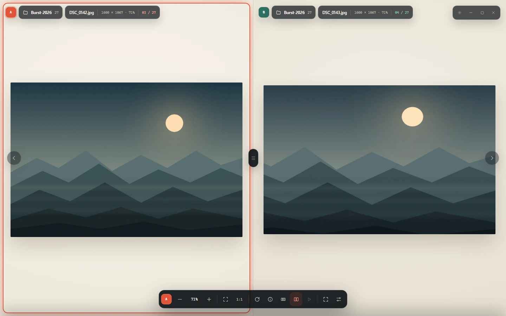
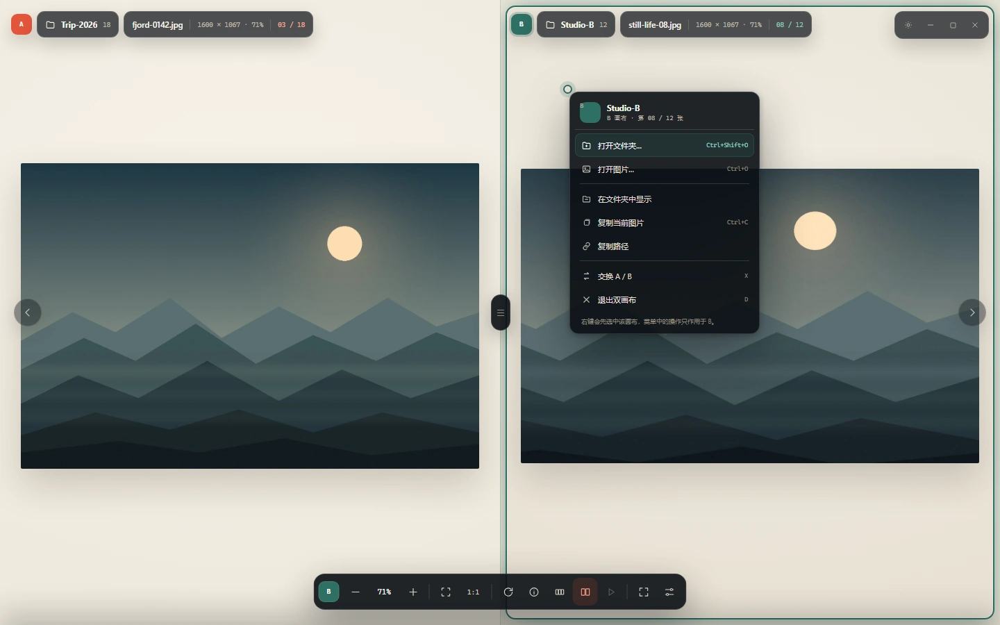
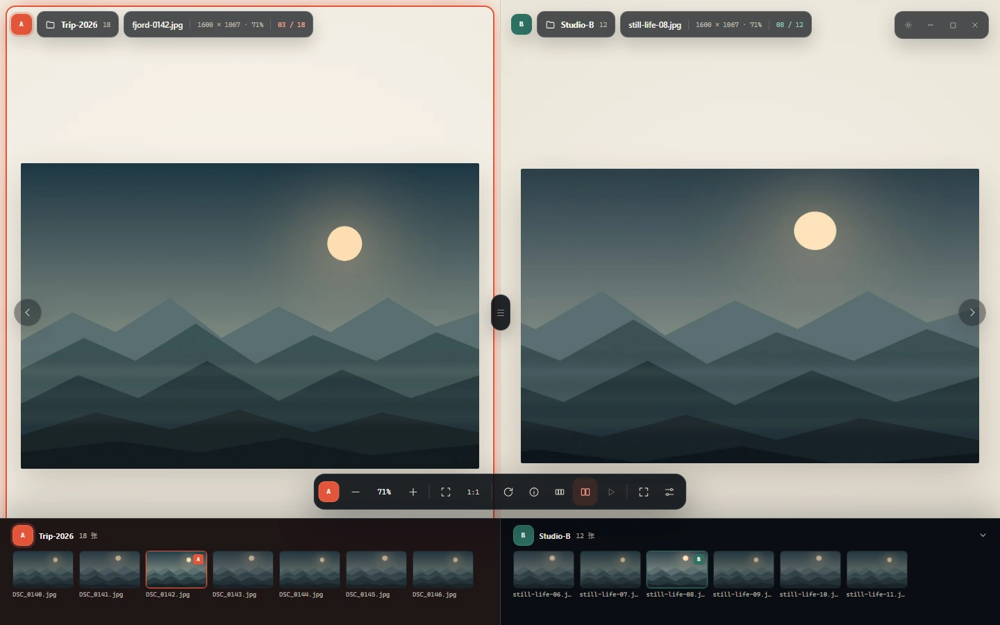
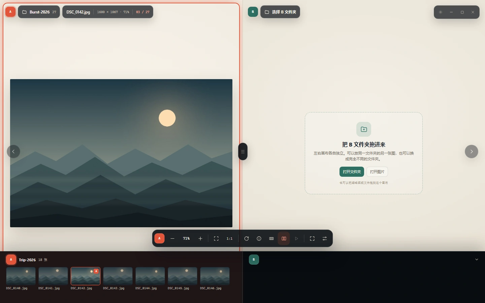

# AirGlance Dual-Canvas Interaction Design v2

**English** · [简体中文](dual-view-v2.md)

> Interaction revision after the v1 implementation. **The main v2 revision and the 3.3 empty filmstrip half are implemented in the local 0.4.0 build.**
>
> Revised areas: active-canvas perception, pane context menu, split filmstrip, and A/B badge consistency.

## 0. Four revision goals

| # | v1 problem | v2 response |
| --- | --- | --- |
| 1 | The selected pane was hard to see beyond a thin top line | Add a full identity border and badge ring; keep the inactive pane untouched; mirror the active state in the dock and filmstrip |
| 2 | No way to open a folder in a specific pane by right-clicking | Right-click activates that pane first, then opens a pane-specific menu with **Open folder…** as the primary action |
| 3 | One global filmstrip could not show A and B file lists at once | Split the filmstrip into A and B halves, each with its own folder, scroll position and selection |
| 4 | The pane A/B badge was squeezed to 28×38 and differed from the dock’s 28×30 badge | Use one **30×30** badge with the same radius, type, weight and padding everywhere |

## 1. Active-canvas perception



### 1.1 Three simultaneous cues

The active canvas uses the following cues, and **never changes the other pane’s image brightness, saturation or opacity**:

1. **Full border**: a 2 px identity-colour border inset 8 px from the pane edge, radius 14 px. A is coral, B is teal.
2. **Badge ring**: the active A/B badge gets a 3 px same-colour ring at 26%; the inactive badge has none.
3. **Synchronised highlights**: the dock A/B badge, the matching filmstrip half and the information-panel A/B tab all follow the active canvas.

The canvas **no longer has a full-width identity line at its top edge**. The inactive canvas **has no scrim**; both images stay at their original brightness, saturation and opacity. The active state is carried by the border, badge ring and synchronised highlights, with no text label.

### 1.2 Badge states

| State | Active canvas | Inactive canvas |
| --- | --- | --- |
| Badge fill | Solid A coral / B teal | Same solid colour |
| Badge ring | 3 px same-colour ring at 26% | None |
| Header | 100% opacity, no text label | 100% opacity, no text label |
| Canvas | 2 px identity border | Original image at 100%, no scrim |

### 1.3 Behaviour

- Clicking any image, blank area or empty state in a pane activates it immediately.
- Right-click activates the pane first, then opens the menu.
- `Tab` / `Shift+Tab` cycles A/B.
- The wheel activates the pane under the pointer while zooming it.
- Hover does not switch the active pane; this avoids flickering borders, headers and filmstrip halves as the pointer moves.
- The active pane changes only through user action; window focus changes do not change it.

## 2. Pane context menu



### 2.1 Opening

- Right-click the image, blank area or empty state of A or B.
- **Activate that pane first**, then open the menu near the pointer. The menu header immediately shows the clicked pane’s A/B badge and folder.
- Right-clicking an inactive pane does not require a left click first.
- Right-clicking the dock, filmstrip thumbnails or window buttons does not open this pane menu.
- `Shift+F10` opens the same menu for the active pane as a keyboard path.
- `Esc` or an outside click closes the menu without leaving dual view.

### 2.2 Menu structure

| Group | Item | Behaviour |
| --- | --- | --- |
| Primary | **Open folder…** | Open a folder in this pane only; `Ctrl+Shift+O` |
| Primary | Open image… | Open an image in this pane; `Ctrl+O` |
| — | Show in folder | Reveal the current image |
| — | Copy current image | Copy this pane’s preview; `Ctrl+C` |
| — | Copy path | Copy this pane’s current path |
| — | Swap A / B | Same as `X` |
| — | Exit dual view | Same as `D` |

- The first item uses the pane identity colour at low opacity so “Open folder” is the visual primary action.
- On an empty pane, “Open folder…” remains available; reveal/copy items are disabled.
- The menu is 274 px wide with a dark glass surface; the header is about 48 px tall.
- This menu replaces the single-view global context menu in dual view, removing any ambiguity about which pane a folder will open into.

### 2.3 Placement

- Default placement is 8 px below/right of the pointer; it flips near window edges.
- It never covers the clicked point; the header colour matches the pane.
- A footer states: “Right-click selects this canvas first; the menu only affects B.”

## 3. Split filmstrip



### 3.1 Layout

The filmstrip changes from one global strip to two halves:

```text
┌───────────────────────────┬───────────────────────────┐
│ A  Burst-2026  27  Active │ B  Studio-B  12  photos   │
│ [thumb][thumb][thumb]…    │ [thumb][thumb][thumb]…    │
└───────────────────────────┴───────────────────────────┘
```

- The left half lists only A’s folder; the right half lists only B’s folder.
- The split is **fixed at 50/50** and does not follow the canvas divider. A 60/40 canvas still gets two 50% filmstrip halves.
- Each half scrolls horizontally and independently.
- The strip is 154 px high; when open, the dock moves up to 166 px.
- Each half header is 30 px high and contains a 30×30 A/B badge, folder name and image count; no text label.

### 3.2 Active half

- The active canvas’s half gets a 10% identity tint and a badge ring; there is no top line or text label.
- The other half keeps its thumbnails and readable header without a scrim.
- Both halves keep the current-image border and A/B corner mark; the active half is brighter, but the other current image is never hidden.
- Clicking an A-half thumbnail activates A and switches its image.
- Clicking a B-half thumbnail activates B and switches its image.

### 3.3 Empty half




- If B has no image or folder, its half keeps the fixed 50% width but shows **only the 30×30 B badge**.
- The empty half does **not** show “No folder open”, a folder name, a count, an empty-state card, a dashed placeholder or an “Open folder” button.
- It has no thumbnails, no hover and no click target. Folder/image actions remain in the main canvas’s empty card above.
- When B later opens a folder, its list appears in place without changing the split.
- The same applies when A is empty.
- One empty side: the strip opens with the populated list plus the quiet badge-only half.
- Both sides empty: the strip does not open; the dock’s filmstrip button and `C` are disabled, avoiding a strip with two blank halves.

### 3.4 Relationship with info and dock

- Filmstrip and information panel remain mutually exclusive.
- The dock moves up when the strip is open and never covers thumbnails.
- The strip shows image lists only; the global file chip is not repeated. Each half header carries its folder and count.
- Thumbnail marks are not duplicated globally: A’s half shows only A marks, B’s half only B marks.

### 3.5 Responsive behaviour

| Window width | Behaviour |
| --- | --- |
| ≥ 1120 px | Full headers, counts and A/B badges |
| 1000–1119 px | Counts hidden; A/B badge and folder name remain; thumbnails shrink |
| < 1000 px | Dual view cannot shrink further; minimum window is 1000 px |

## 4. A/B badge consistency

### 4.1 Shared specification

The old pane header badge was **28×38** and visibly stretched; the dock was **28×30**. v2 defines one component:

| Property | Specification |
| --- | --- |
| Size | **30 × 30** |
| Radius | 9 px |
| Type | JetBrains Mono / Cascadia Mono, 10 px, 700 |
| Text colour | A `#FFF9EF`, B `#F4FFFB` |
| Fill | A coral, B teal |
| Inner edge | 1 px white at 12% |
| Active ring | 3 px same colour at 26% |

The same component is used in:

- the pane header;
- the dock’s current-pane badge;
- each filmstrip half header;
- the context-menu header.

### 4.2 Alignment

- The pane header row is 38 px tall; the 30 px badge is vertically centred and **no longer fills the full row height**.
- Badge-to-folder-chip gap is 7 px; there is no text label after the badge.
- The badge is `flex: 0 0 30px` and must never be compressed by the header row.
- Narrow windows change only the fields after the badge (metadata, zoom, position, count), not the badge proportions.

### 4.3 No text label

- The active canvas uses only the identity border, badge ring and synchronised highlights; it does **not** show a “Current canvas” or “Current” label.
- The inactive canvas keeps no placeholder label either.
- Narrow windows hide metadata fields after the badge; the border and badge treatment do not change.

## 5. Interaction table (delta)

| Action | v2 behaviour |
| --- | --- |
| Left-click a canvas | Activate it |
| Right-click a canvas | Activate it, then open its pane menu |
| Menu → Open folder… | Open the folder in that pane only |
| `Shift+F10` | Open the same pane menu for the active canvas |
| `Tab` / `Shift+Tab` | Switch active pane; border, dock and filmstrip half follow |
| `X` | Swap A/B while keeping the current pane identity |
| `C` | Open/close the split filmstrip; unavailable when both sides are empty |
| A-half thumbnail | Select A and switch A’s image |
| B-half thumbnail | Select B and switch B’s image |
| Drag the main divider | Only the canvas ratio changes; the split filmstrip stays at 50/50 |
| `Esc` | Close context menu, then info/filmstrip, then fullscreen, then dual view |

## 6. Visual specification

| Item | Specification |
| --- | --- |
| Active canvas border | 2 px, inset 8 px, radius 14 px |
| A/B badge | 30 × 30, radius 9, 10 px mono 700 |
| Context menu | 274 px wide, dark glass, radius 13 |
| Menu item | 34 px high, 15 px icon, shortcut right-aligned |
| Split filmstrip | 154 px high, fixed 50/50, 1 px centre divider |
| Filmstrip half header | 30 px high, 30 × 30 badge |
| Filmstrip thumbnail | 88 × 54, radius 6, 2 px current border |
| Empty filmstrip half | 30 × 30 A/B badge only; no text, button or placeholder |
| Minimum dual window | 1000 px |
| Compact header threshold | 1120 px |

## 7. Unchanged

- Same-folder entry: A shows the current image, B opens the next.
- Independent folders, indexes, zoom and pan per pane.
- `D` enters/leaves; `Tab` switches; `X` swaps.
- Dual fullscreen, GIF playback and 2.5 s chrome auto-hide.
- Per-pane rotate/flip, save-copy and slideshow remain deferred.
- Two 100 MP images at 100% simultaneously remain unsupported.

## 8. Implementation notes (landed)

These were landed in the local 0.4.0 build:

1. Add a pane-context-menu controller storing the clicked pane index; every command receives the pane explicitly.
2. Split the filmstrip into two item lists with a fixed 50/50 ratio; it does not follow the main divider.
3. Add a shared `PaneBadge` visual specification for the pane header, dock, filmstrip and menu.
4. On active change, update the border, badge ring, dock, filmstrip half and information-panel tab together; never alter either image’s pixels.
5. Reuse the existing folder picker for “Open folder…”, but pass the target pane explicitly.

## 9. Confirmed decisions

- The inactive canvas has **no scrim** and keeps its original brightness, saturation and opacity.
- The split filmstrip is **fixed at 50/50** and does not follow the canvas ratio.
- The context menu keeps “Swap A/B” and “Exit dual view”.
- The active canvas has **no “Current canvas/Current” text label**; it uses the identity border, badge ring and synchronised highlights.
- The A/B badge is unified at **30×30**.

## 10. Prototype and screenshots

Implementation screenshots:

- [Dual canvas with the active frame and 30 px badges](implemented-dual.webp)
- [Split filmstrip](implemented-dual-filmstrip.webp)
- [Empty filmstrip half (implemented)](implemented-dual-filmstrip-empty.webp)

Prototype:

| State | Link |
| --- | --- |
| Active canvas A | `docs/design/dual-view-v2.html?state=same` |
| Right-click menu on B | `docs/design/dual-view-v2.html?state=menu` |
| Split filmstrip | `docs/design/dual-view-v2.html?state=filmstrip` |
| Different folders | `docs/design/dual-view-v2.html?state=folders` |
| Dark theme | add `&theme=dark` |
| Hide state bar | add `&ui=0` |

More screenshots:

- [Active canvas A](dual-v2-same.webp)
- [Right-click menu on B](dual-v2-menu.webp)
- [Split filmstrip](dual-v2-filmstrip.webp)
- [Empty filmstrip half design](dual-v2-filmstrip-empty.webp)
- [Dark theme](dual-v2-dark.webp)
