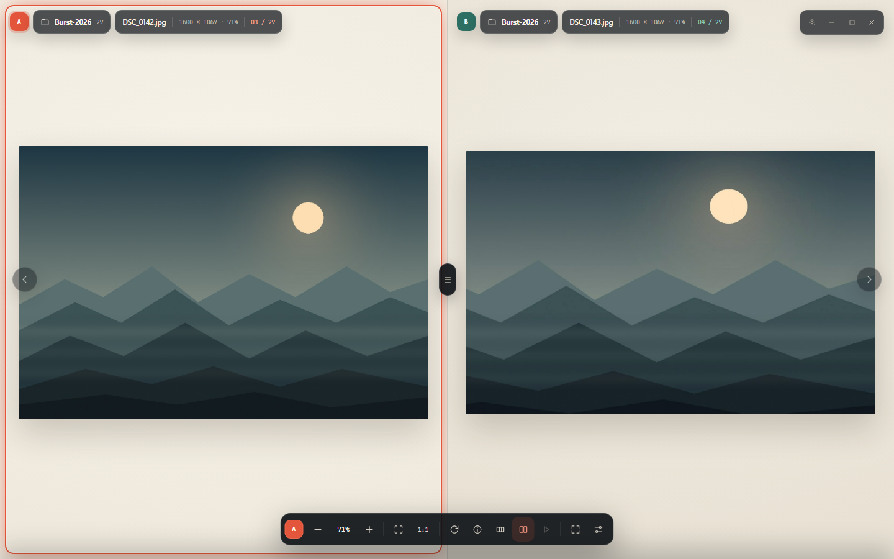
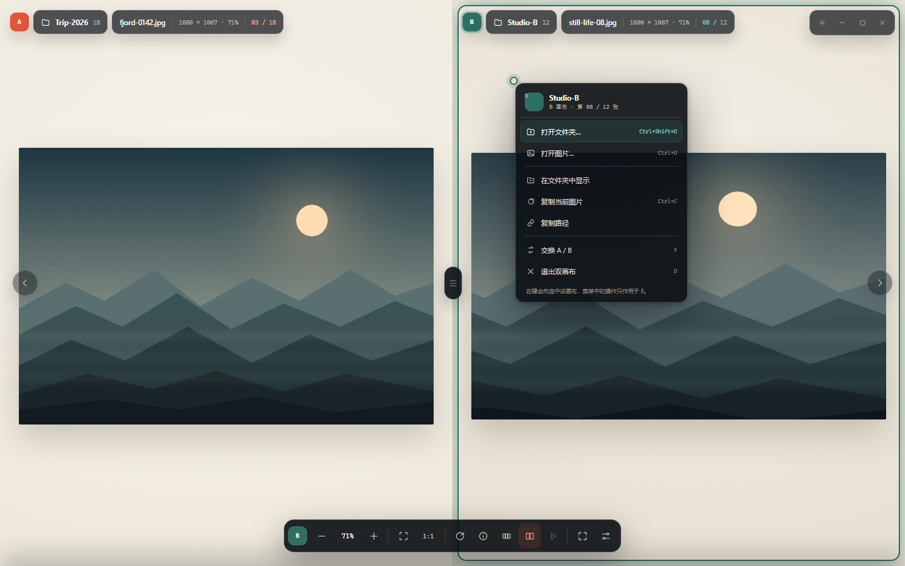
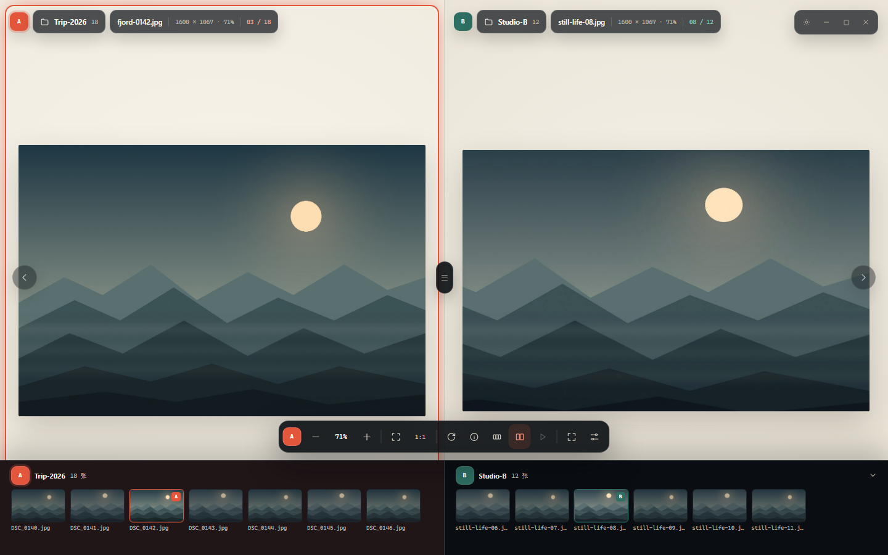
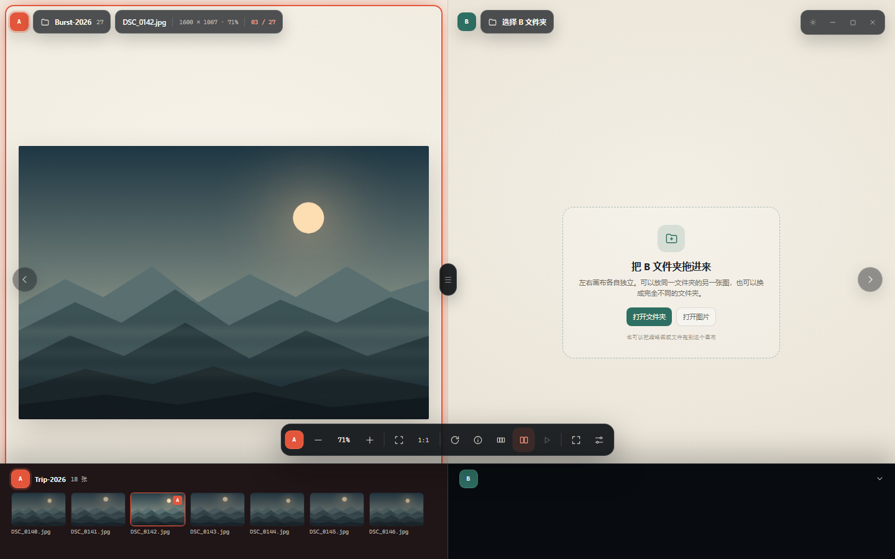

# AirGlance 双画布交互视觉稿 v2

[English](dual-view-v2.en.md) · **简体中文**

> 这是 v1 实现后的交互修订稿。**v2 主体和 3.3 空胶片半区均已在 0.4.0 本地构建中实现。**
>
> 主要修订：当前画布感知、画布右键菜单、左右分割胶片条、A/B 徽标一致性。

## 0. 四个修订目标

| # | v1 的问题 | v2 的解决方式 |
| --- | --- | --- |
| 1 | 选中左侧或右侧后，除了顶部细线，感知很弱 | 当前画布增加完整身份色边框和徽标光环；非当前画布保持原图；dock 和胶片条同步高亮 |
| 2 | 无法通过右键在指定画布打开文件夹 | 在任意画布右键先选中该画布，再打开画布专属菜单；“打开文件夹…”是第一主操作 |
| 3 | 双画布时胶片条只有一条，无法同时看 A/B 文件列表 | 胶片条左右分割，A 半区显示 A 文件夹，B 半区显示 B 文件夹，各自独立滚动和选中 |
| 4 | 画布左上角 A/B 徽标被压成 28×38，和 dock 的 28×30 不一致 | 统一为 **30×30** 方形徽标，圆角、字体、字重、内外边距全部共用 |

## 1. 当前画布感知



### 1.1 三层提示

当前画布只依靠以下提示，**不改变另一侧图像的亮度、饱和度或透明度**：

1. **完整边框**：距画布边缘 8 px 的 2 px 身份色描边，圆角 14 px。A 用 coral，B 用 teal。
2. **徽标光环**：当前画布的 A/B 徽标外圈增加 3 px 同色 26% 光环；非当前徽标没有光环。
3. **同步高亮**：底部 dock 的 A/B 徽标、打开着的胶片条对应半区、信息面板 A/B 标签全部同步为当前画布。

画布**不保留顶部通栏身份色线**。非当前画布**不添加遮罩**，两侧原图始终以原始亮度、饱和度和不透明度显示；当前状态由边框、徽标光环和同步高亮表达，不使用文字标签。

### 1.2 徽标状态

| 状态 | 当前画布 | 非当前画布 |
| --- | --- | --- |
| 徽标底色 | A coral / B teal 实色 | 同色实色 |
| 徽标外圈 | 3 px 同色 26% 透明光环 | 无 |
| 标题 | 100% 不透明，无文字标签 | 100% 不透明，无文字标签 |
| 画布 | 2 px 身份色边框 | 原图保持 100%，无遮罩 |

### 1.3 行为

- 点击画布任意空白处、图片或空状态，立即选中该画布。
- 右键画布同样先选中，再打开菜单。
- `Tab` / `Shift+Tab` 在 A/B 间切换。
- 滚轮在哪个画布上滚动，就把该画布设为当前画布。
- 不采用“鼠标悬停即切换”：避免移动鼠标时边框、胶片条和标题闪烁。
- 当前画布状态只在用户操作时改变，窗口失焦不改变它。

## 2. 画布右键菜单



### 2.1 触发规则

- 在 A 或 B 画布的图片、空白或空状态上右键。
- **先选中该画布**，再在鼠标位置附近打开菜单；菜单头部的 A/B 徽标和文件夹名立即反映被点击的画布。
- 右键非当前画布时，不需要先左键点一次。
- 在 dock、胶片条缩略图、窗口按钮上右键，不打开这个画布菜单。
- `Shift+F10` 为当前画布打开同一菜单，作为键盘入口。
- `Esc` 或点击菜单外关闭；关闭菜单不退出双画布。

### 2.2 菜单结构

| 分组 | 菜单项 | 行为 |
| --- | --- | --- |
| 主操作 | **打开文件夹…** | 在该画布打开文件夹，另一画布保持不变；`Ctrl+Shift+O` |
| 主操作 | 打开图片… | 在该画布打开单张图片；`Ctrl+O` |
| — | 在文件夹中显示 | 定位当前图片 |
| — | 复制当前图片 | 复制该画布的预览；`Ctrl+C` |
| — | 复制路径 | 复制该画布的当前路径 |
| — | 交换 A / B | 与 `X` 相同 |
| — | 退出双画布 | 与 `D` 相同 |

- 菜单第一项使用该画布的身份色浅底，保证“打开文件夹”是第一视觉重点。
- 空画布右键时，“打开文件夹…”仍然可用；“在文件夹中显示”“复制”等禁用。
- 菜单宽度 274 px，深色玻璃底；菜单头高约 48 px。
- 画布菜单取代单图模式的全局右键菜单，避免“打开文件夹到底开在哪一边”的歧义。

### 2.3 菜单定位

- 默认出现在鼠标右下方 8 px；靠近窗口边缘时自动翻转。
- 菜单不遮挡被点击位置；菜单头部与当前画布颜色一致。
- 底部注释明确写出“右键会先选中该画布，菜单中的操作只作用于 B”。

## 3. 左右分割胶片条



### 3.1 布局

胶片条从“全局单条”改为“左右双半区”：

```text
┌───────────────────────────┬───────────────────────────┐
│ A  Burst-2026  27 张  当前 │ B  Studio-B  12 张        │
│ [缩略图][缩略图][缩略图]… │ [缩略图][缩略图][缩略图]… │
└───────────────────────────┴───────────────────────────┘
```

- 左半区只显示 A 画布的文件夹列表，右半区只显示 B 画布的文件夹列表。
- **固定 50/50**，不随主画布分隔条变化。主画布拖到 60/40，胶片条仍是左右各 50%。
- 每半区独立横向滚动，互不影响滚动位置。
- 胶片条高度 154 px；打开时 dock 上移到 166 px。
- 每半区头部高 30 px，包含 30×30 A/B 徽标、文件夹名和图片数量；不使用文字标签。

### 3.2 当前半区

- 当前画布对应的半区：10% 身份色底、徽标外圈光环；不使用顶线或文字标签。
- 非当前半区：正常显示缩略图，头部保持可读，不添加遮罩。
- 两个半区**都保留当前图片的选中边框和 A/B 角标**；当前半区只是更亮，不会隐藏另一边的当前图。
- 点击 A 半区缩略图：A 成为当前画布，并切换到该图。
- 点击 B 半区缩略图：B 成为当前画布，并切换到该图。

### 3.3 空半区




- 当 B 没有打开图片或文件夹时，右半区仍保留固定 50% 宽度，但**只保留 30×30 的 B 徽标**。
- 空半区**不显示**“还没有打开文件夹”、文件夹名、数量、空状态卡、虚线框或“打开文件夹”按钮。
- 空半区没有缩略图、没有 hover、不能点击；打开文件夹/图片的入口只保留在上方主画布的空状态卡里。
- 当 B 之后打开文件夹，右半区原地出现图片列表，不改变左右比例。
- 当 A 为空时同理。
- 一侧为空：胶片条仍可打开，显示有内容的一侧列表 + 另一侧安静的徽标半区。
- 两侧都为空：不打开胶片条；dock 的胶片条按钮和 `C` 都置为不可用，避免出现整条空白胶片条。

### 3.4 与信息面板、dock 的关系

- 胶片条和信息面板仍然互斥；打开信息面板会收起胶片条，反之亦然。
- 胶片条打开时，dock 上移，不覆盖缩略图。
- 胶片条只展示图片列表，不重复显示全局文件 chip；文件夹和数量在各半区头部。
- 缩略图不复制成全局 A/B 双标记；A 的半区只出现 A 标记，B 的半区只出现 B 标记。

### 3.5 胶片条响应式

| 窗口宽度 | 行为 |
| --- | --- |
| ≥ 1120 px | 两侧完整头部、文件夹数量和 A/B 徽标 |
| 1000–1119 px | 隐藏数量；保留 A/B 徽标和文件夹名；缩略图变小 |
| < 1000 px | 双画布不允许继续缩小；最小窗口 1000 px |

## 4. A/B 徽标一致性

### 4.1 统一规格

之前的画布标题徽标是 **28×38**，被纵向拉长；dock 是 **28×30**。v2 统一为一个组件：

| 属性 | 规格 |
| --- | --- |
| 尺寸 | **30 × 30** |
| 圆角 | 9 px |
| 字体 | JetBrains Mono / Cascadia Mono，10 px，700 |
| 字色 | A `#FFF9EF`，B `#F4FFFB` |
| 底色 | A coral，B teal |
| 内阴影 | 1 px 白色 12% |
| 当前画布外圈 | 3 px 同色 26% 光环 |

同一个组件用于：

- 画布左上角 A/B；
- 底部 dock 的当前画布；
- 分割胶片条每一半的 A/B；
- 右键菜单头部的画布徽标。

### 4.2 对齐

- 画布标题行高 38 px，徽标 30 px 垂直居中，**不再用 38 px 高度填满整行**。
- 徽标和文件夹 chip 间距 7 px；徽标后不再添加文字标签。
- 徽标必须为 `flex: 0 0 30px`，不能被标题行压缩。
- 窄窗口下也不改变比例；只隐藏徽标右侧的尺寸、缩放、位置或数量字段。

### 4.3 不使用文字标签

- 当前画布只用身份色边框、徽标光环和同步高亮；**不显示“当前画布”或“当前”文字**。
- 非当前画布也不保留任何占位标签。
- 窄窗口只隐藏徽标右侧的元数据字段，不改变边框和徽标状态。

## 5. 完整交互表（增量）

| 操作 | v2 行为 |
| --- | --- |
| 左键画布 | 选中该画布 |
| 右键画布 | 先选中该画布，再打开画布菜单 |
| 右键菜单“打开文件夹…” | 只在该画布打开文件夹 |
| `Shift+F10` | 当前画布的同一右键菜单 |
| `Tab` / `Shift+Tab` | 切换当前画布，边框、dock、胶片条半区同步 |
| `X` | 交换 A/B，当前画布身份保持 |
| `C` | 打开/关闭左右分割胶片条；两侧都为空时不可用 |
| 胶片条 A 半区缩略图 | 选中 A 并切换 A 的图片 |
| 胶片条 B 半区缩略图 | 选中 B 并切换 B 的图片 |
| 拖动主分隔条 | 只改变画布比例；分割胶片条保持固定 50/50 |
| `Esc` | 先关闭右键菜单，再关闭信息/胶片条，再退出全屏，最后退出双画布 |

## 6. 视觉规格

| 项目 | 规格 |
| --- | --- |
| 当前画布边框 | 2 px，距边缘 8 px，圆角 14 px |
| A/B 徽标 | 30 × 30，圆角 9，10 px mono 700 |
| 右键菜单 | 274 px 宽，深色玻璃，圆角 13 |
| 菜单项 | 34 px 高，图标 15 px，快捷键右对齐 |
| 分割胶片条 | 154 px 高，固定 50/50，中央 1 px 分隔 |
| 胶片条半区头部 | 30 px 高，30 × 30 徽标 |
| 胶片条缩略图 | 88 × 54，圆角 6，当前图 2 px 身份色边框 |
| 空胶片半区 | 只显示 30 × 30 A/B 徽标；无文字、无按钮、无占位框 |
| 双画布最小窗口 | 1000 px |
| 紧凑标题阈值 | 1120 px |

## 7. 不改变的部分

- 同文件夹进入时，左 A 当前图，右 B 下一张。
- A/B 各自维护文件夹、索引、缩放、平移。
- `D` 进入/退出；`Tab` 切换；`X` 交换。
- 双画布全屏、GIF 动画、2.5 秒 chrome 自动隐藏。
- 双画布暂不支持逐画布旋转/翻转、另存副本、幻灯片。
- 两张 100 MP 同时 100% 暂不支持。

## 8. 实现要点（已落地）

0.4.0 本地构建已落地：

1. 增加“画布上下文菜单”控制器，保存被右键的画布索引；所有命令显式接收 pane。
2. 把胶片条视图拆成 A/B 两套缩略图源，分割固定 50/50，不绑定主分隔条。
3. 增加全局共享的 `PaneBadge` 视觉规格，替换画布标题、dock、胶片条、菜单里的 A/B 徽标。
4. 当前画布激活时同步更新：边框、徽标光环、dock、胶片条半区、信息面板；不修改任一侧图片像素。
5. 右键菜单的“打开文件夹…”复用现有文件夹选择器，但目标 pane 必须显式传入。

## 9. 确认结论

- 非当前画布**不添加遮罩**，保持原图原始亮度、饱和度和透明度。
- 分割胶片条**固定 50/50**，不跟随主画布比例。
- 右键菜单保留“交换 A/B”和“退出双画布”。
- 当前画布**不使用“当前画布/当前”文字标签**，只用身份色边框、徽标光环和同步高亮。
- A/B 徽标统一为 **30×30**。

## 10. 原型与截图

实现截图：

- [双画布（当前画布边框、30 px 徽标）](implemented-dual.png)
- [左右分割胶片条](implemented-dual-filmstrip.png)
- [空胶片条半区（实现）](implemented-dual-filmstrip-empty.png)

原型：

| 状态 | 链接 |
| --- | --- |
| 当前画布 A | `docs/design/dual-view-v2.html?state=same` |
| B 画布右键菜单 | `docs/design/dual-view-v2.html?state=menu` |
| 左右分割胶片条 | `docs/design/dual-view-v2.html?state=filmstrip` |
| 不同文件夹 | `docs/design/dual-view-v2.html?state=folders` |
| 暗色 | 加 `&theme=dark` |
| 隐藏状态条 | 加 `&ui=0` |

更多截图：

- [当前画布 A](dual-v2-same.png)
- [B 画布右键菜单](dual-v2-menu.png)
- [左右分割胶片条](dual-v2-filmstrip.png)
- [空胶片条半区设计](dual-v2-filmstrip-empty.png)
- [暗色](dual-v2-dark.png)
