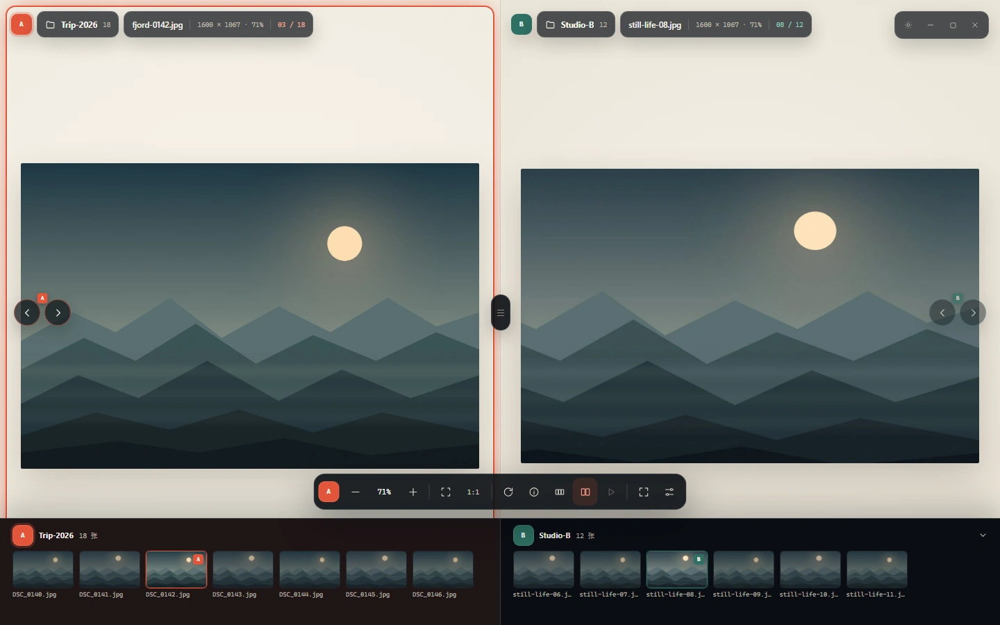
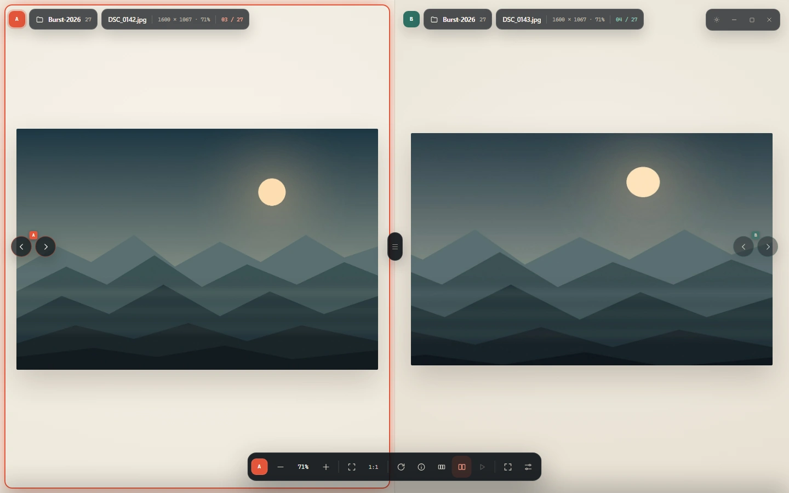
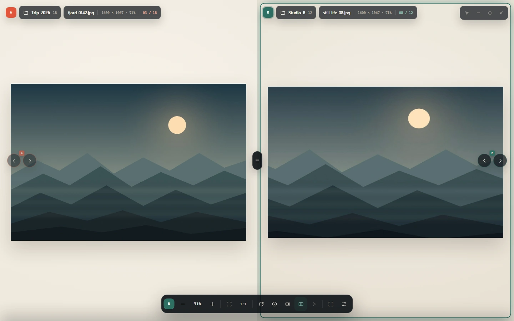

# AirGlance Dual-Canvas Interaction Design v3

**English** · [简体中文](dual-view-v3.md)

> Two follow-up fixes after the v2 implementation: **vertical centring in the filmstrip headers** and **per-canvas previous/next controls**.
>
> **v3’s outer-edge proposal was not adopted; the final design is v4’s top capsule.**

## 0. Goals

| # | Current issue | v3 response |
| --- | --- | --- |
| 1 | The A/B badge, folder name and count in the filmstrip header are not vertically centred | Use a fixed 30 px header row, explicitly centre every item, and set the badge letter to a single-line height |
| 2 | Dual view only has global window-edge arrows; each canvas has no previous/next controls of its own | Give each canvas its own previous/next pair on its **outer edge**; four buttons in two groups, away from the centre divider |

## 1. Filmstrip header centring



### 1.1 Specification

Each filmstrip half header is a fixed **30 px** row:

```text
[ A ]  Trip-2026   18 photos
 30px    centred     centred
```

- A/B badge: 30 × 30, radius 9, 10 px Mono 700.
- Badge letter: `line-height: 1`, centred with grid/place-items; no 38 px row height.
- Folder name and count: `align-self: center`, `line-height: 1.2`.
- They must not use the default stretch alignment that leaves text at the top of a 30 px row.
- Badge-to-folder gap 8 px; folder-to-count gap 8 px.
- The whole header is vertically centred inside the filmstrip half’s top padding; thumbnails start on the next row.
- Narrow windows hide only the count; they do not change the header height or centring.

### 1.2 Fix

The current implementation gives the header StackPanel a 30 px height, but the folder/count TextBlocks align to the top by default. v3 requires:

- explicit 30 px header height;
- explicit `VerticalAlignment=Center` for folder and count;
- explicit `VerticalAlignment=Center` and `LineHeight=1` for the badge letter;
- no use of the 38 px main-pane header height in the filmstrip.

## 2. Per-canvas previous/next controls





### 2.1 Layout

Each canvas gets a two-button group on its **outer edge**:

```text
Canvas A                            Canvas B
┌──────────────────────────┐  ┌──────────────────────────┐
│ [A]                      │  │                      [B] │
│                          │  │                          │
│ ‹  ›                     │  │                     ‹  › │
│                          │  │                          │
│                          │  │                          │
└──────────────────────────┘  └──────────────────────────┘
```

- A group: 20 px from the canvas’s left edge; previous on the left, next on the right.
- B group: 20 px from the canvas’s right edge; previous on the left, next on the right.
- Each group has two 38 px circular buttons with a 6 px gap.
- The group is vertically centred in the visible canvas area.
- A 15 px A/B tag above the group identifies its canvas.
- **No buttons near the centre divider**, avoiding the “A next / divider / B previous” three-circle cluster.

### 2.2 States

| State | Appearance |
| --- | --- |
| Active canvas group | 100% opacity, full identity outline and A/B tag |
| Inactive canvas group | 60% opacity, still clickable |
| Hovering the group | opacity returns to 100%, button background darkens |
| Hovering one button | scales to 1.06 and shows a tooltip |
| Empty canvas | the whole group is hidden |
| Canvas with one image | the whole group is hidden (nothing to page through) |
| Canvas with two or more images | the group is shown |

### 2.3 Behaviour

- Clicking a button on the active canvas pages that canvas directly.
- Clicking a button on the inactive canvas **activates that canvas first and then pages it**; no extra click.
- The A group only changes A’s image; the B group only changes B’s image.
- Paging wraps around at the ends.
- The controls follow the 2.5 s chrome auto-hide and return on pointer movement.
- In fullscreen and with the filmstrip open, the groups stay at the canvas’s vertical centre.
- Keyboard `←` / `→` still targets only the active canvas; it never pages both sides.
- Tooltips:
  - `A · Previous (and select A)`
  - `A · Next (and select A)`
  - `B · Previous (and select B)`
  - `B · Next (and select B)`

### 2.4 Why the outer edge

- The divider should stay clean; its handle is already an interactive control.
- Placing A’s next and B’s previous near the divider would create three circular controls in the middle and invite mis-clicks.
- Grouping each pair on the outer edge makes ownership obvious.
- It is symmetric and does not move when the active canvas changes.

## 3. Relationship with existing behaviour

Unchanged:

- `D` enters/leaves dual view;
- click / `Tab` switches the active canvas;
- `X` swaps;
- divider drag;
- pane context menu;
- fixed 50/50 empty filmstrip half;
- dual fullscreen, GIF, chrome auto-hide.

Added:

- independent previous/next pairs per canvas;
- one A/B identity tag per pair;
- inactive pair reduced to 60% but still clickable.

## 4. Visual specification

| Item | Specification |
| --- | --- |
| Paging button | 38 × 38 circle, dark glass |
| Button gap | 6 px |
| Group inset from canvas edge | 20 px |
| Group vertical position | 50% of visible canvas |
| A identity | coral `#E3563B` |
| B identity | teal `#2E6F63` |
| Button outline | identity colour at 55% |
| A/B tag | 15 × 15, radius 4, 8 px Mono 700 |
| Active group | opacity 100% |
| Inactive group | opacity 60% |
| One image/empty | whole group hidden |
| Compact window | 34 px buttons, 5 px gap |
| Filmstrip header height | 30 px |
| Filmstrip badge | 30 × 30, letter line-height 1 |
| Filmstrip title/count | align-self centre, line-height 1.2 |

## 5. Interaction table (delta)

| Action | v3 behaviour |
| --- | --- |
| Click A previous/next | Activate A and page A |
| Click B previous/next | Activate B and page B |
| Hover inactive group | Group brightens; buttons become actionable |
| A empty | A group hidden |
| A has one image | A group hidden |
| Active canvas changes | Groups stay in place; only highlight changes |
| Open filmstrip | Groups remain at canvas vertical centre |
| Fullscreen | Groups remain, auto-hide with chrome |

## 6. Decisions to confirm

1. Is placing each pair on the **outer edge** better than next to the divider?
2. Is 60% opacity right for the inactive pair?
3. With one image, should the whole pair hide or remain disabled?
4. Is one A/B tag above each pair enough, or should each button carry a tag?
5. Is 38 px the right button size (34 px in compact windows)?

## 7. Prototype and screenshots

| State | Link |
| --- | --- |
| A active, four buttons | `docs/design/dual-view-v3.html?state=same` |
| B active, B pair highlighted | `docs/design/dual-view-v3.html?state=folders` |
| Filmstrip and paging buttons | `docs/design/dual-view-v3.html?state=filmstrip` |
| Empty right canvas, B pair hidden | `docs/design/dual-view-v3.html?state=empty` |
| Dark theme | add `&theme=dark` |
| Hide state bar | add `&ui=0` |

Screenshots:

- [A active](dual-v3-same.webp)
- [B active](dual-v3-folders.webp)
- [Filmstrip and paging buttons](dual-v3-filmstrip.webp)
- [Empty canvas hides B pair](dual-v3-empty.webp)
