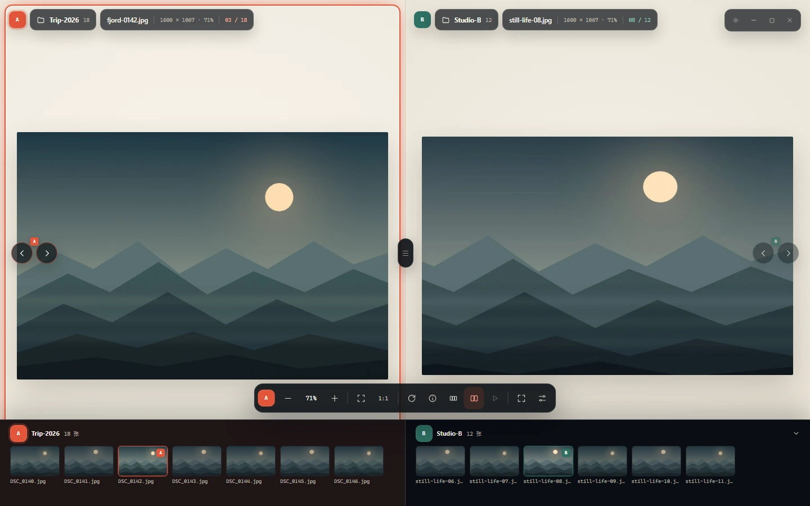
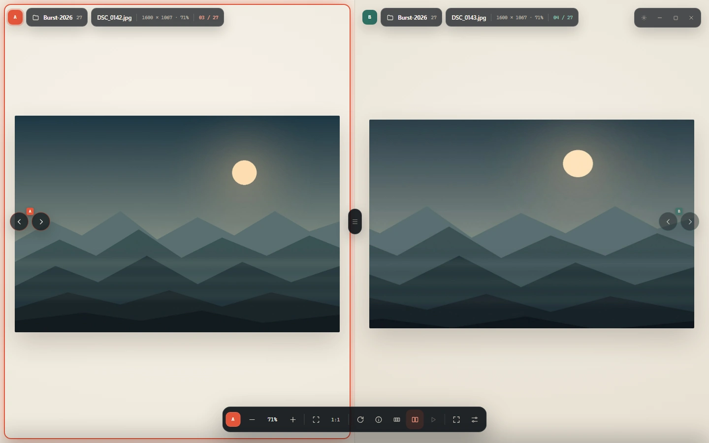
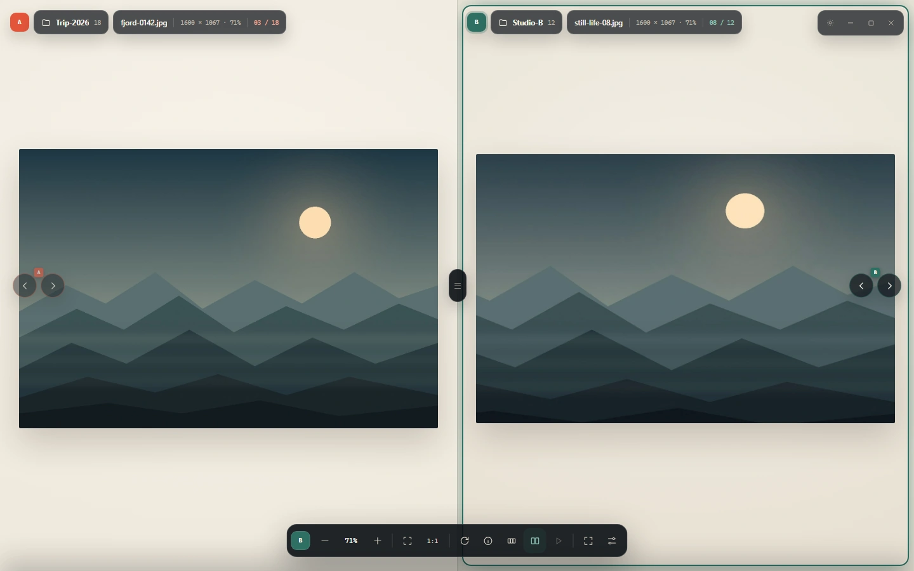

# AirGlance 双画布交互视觉稿 v3

[English](dual-view-v3.en.md) · **简体中文**

> 这是 v2 实现后的两个小修订：**胶片条标题垂直居中**、**左右画布各自的上一张/下一张按钮**。
>
> **v3 的外侧边缘方案未被采用；最终采用 v4 的顶部胶囊方案。**

## 0. 修订目标

| # | 当前问题 | v3 方案 |
| --- | --- | --- |
| 1 | 胶片条半区左上角的 A/B 徽标、文件夹名、数量没有垂直居中 | 固定 30 px 头部行，徽标和文字全部显式垂直居中；徽标内字母使用单行行高 |
| 2 | 双画布只有窗口两侧的全局翻页按钮，没有“每块画布自己的上一张/下一张” | 每块画布在**外边缘**各有一组自己的上一张/下一张按钮，四按钮分两组，不挤在中间分隔条 |

## 1. 胶片条标题垂直居中



### 1.1 规格

每个胶片半区的头部是一个固定 **30 px** 行：

```text
[ A ]  Trip-2026   18 张
 30px     垂直居中   垂直居中
```

- A/B 徽标：30 × 30，圆角 9，字 10 px Mono 700。
- 徽标内字母：`line-height: 1`，使用 grid/place-items 居中，不使用 38 px 行高。
- 文件夹名、数量：`align-self: center`，`line-height: 1.2`。
- 文件夹名和数量不再使用默认 stretch 对齐，避免文字贴着 30 px 行顶部。
- 徽标和文件夹名间距 8 px；文件夹名和数量间距 8 px。
- 头部整体在胶片半区顶部内边距内垂直居中；缩略图从下一行开始。
- 窄窗口只隐藏数量，不改变头部行高和文字垂直居中。

### 1.2 修复方式

当前实现中，胶片头的 `StackPanel` 高度为 30 px，但文件夹名/数量文本框默认按顶部对齐，视觉上比徽标中心高。v3 要求：

- 头部行明确 `height: 30px`；
- 文件夹名、数量显式 `VerticalAlignment=Center`；
- A/B 徽标内部文本显式 `VerticalAlignment=Center` 且 `LineHeight=1`；
- 不为胶片头使用主画布标题的 38 px 高度。

## 2. 每块画布自己的上一张/下一张





### 2.1 布局

每块画布在**外边缘**放一组两个按钮：

```text
A 画布                               B 画布
┌──────────────────────────┐  ┌──────────────────────────┐
│ [A]                      │  │                      [B] │
│                          │  │                          │
│ ‹  ›                     │  │                     ‹  › │
│                          │  │                          │
│                          │  │                          │
└──────────────────────────┘  └──────────────────────────┘
```

- A 组：画布左边缘 20 px，上一张在左、下一张在右。
- B 组：画布右边缘 20 px，上一张在左、下一张在右。
- 每组两个 38 px 圆形按钮，间距 6 px。
- 组整体垂直居中于画布可见区域。
- 组上方有一个 15 px 的 A/B 小标签，表明这一组属于哪块画布。
- 中间分隔条附近**不再放按钮**，避免“A 下一张 / 分隔条 / B 上一张”三个圆形挤在一起。

### 2.2 按钮状态

| 状态 | 表现 |
| --- | --- |
| 当前画布的组 | 不透明度 100%，身份色描边和 A/B 标签完整 |
| 非当前画布的组 | 不透明度 60%，仍可点击 |
| 悬停组 | 不透明度提升到 100%，按钮背景加深 |
| 悬停单个按钮 | 按钮 1.06 倍放大，显示 tooltip |
| 画布为空 | 该侧整组隐藏 |
| 画布只有一张图 | 该侧整组隐藏（没有上一张/下一张可翻） |
| 画布至少两张图 | 显示该侧整组 |

### 2.3 行为

- 点击当前画布的按钮：直接翻当前画布。
- 点击非当前画布的按钮：**先激活被点击的画布，再翻页**，不需要先点一次画布。
- A 组只改变 A 的图片；B 组只改变 B 的图片。
- 翻页仍然循环；到末尾后回到第一张。
- 按钮遵循 2.5 秒 chrome 自动隐藏，鼠标移动后恢复。
- 全屏和打开胶片条时保持同一位置；胶片条出现时按钮仍在画布垂直中心。
- 键盘 `←` / `→` 仍然只作用于当前画布，不改变为“两边同时翻页”。
- hover tooltip：
  - `A · 上一张（并选中 A）`
  - `A · 下一张（并选中 A）`
  - `B · 上一张（并选中 B）`
  - `B · 下一张（并选中 B）`

### 2.4 为什么放在外边缘

- 中间分隔条需要保持干净，分隔条手柄本身已经是一个可拖动控件。
- 如果 A 的下一张和 B 的上一张都贴近分隔条，中间会同时出现三个圆形控件，容易误点。
- 外边缘分组让 A/B 各自成对，视觉上更容易理解“这一组属于这一边”。
- 左右对称，不随当前画布切换而移动按钮。

## 3. 与现有交互的关系

不改变：

- `D` 进入/退出双画布；
- 点击画布 / `Tab` 切换当前画布；
- `X` 交换；
- 分隔条拖动；
- 右键画布菜单；
- 固定 50/50 空胶片半区；
- 双画布全屏、GIF、chrome 自动隐藏。

新增：

- 每块画布的独立上一张/下一张按钮；
- 一组 A/B 身份小标签；
- 非当前画布按钮组降低不透明度，但仍可点击。

## 4. 视觉规格

| 项目 | 规格 |
| --- | --- |
| 翻页按钮 | 38 × 38 圆形，深色玻璃底 |
| 按钮间距 | 6 px |
| 组距画布外边缘 | 20 px |
| 组垂直位置 | 画布可见区域 50% |
| A 身份色 | coral `#E3563B` |
| B 身份色 | teal `#2E6F63` |
| 按钮描边 | 身份色 55% |
| A/B 小标签 | 15 × 15，圆角 4，8 px Mono 700 |
| 当前组 | opacity 100% |
| 非当前组 | opacity 60% |
| 单张图/空画布 | 整组隐藏 |
| 紧凑窗口 | 按钮 34 px，组间距 5 px |
| 胶片头行高 | 30 px |
| 胶片徽标 | 30 × 30，字母 line-height 1 |
| 胶片标题/数量 | align-self center，line-height 1.2 |

## 5. 交互表（增量）

| 操作 | v3 行为 |
| --- | --- |
| 点击 A 组上一张/下一张 | 激活 A，翻 A 的图片 |
| 点击 B 组上一张/下一张 | 激活 B，翻 B 的图片 |
| 悬停非当前组 | 组变亮，按钮可点击 |
| A 为空 | A 组隐藏 |
| A 只有一张图 | A 组隐藏 |
| 当前画布切换 | A/B 两组保持原位，只改变高亮 |
| 打开胶片条 | 按钮保持在画布垂直中心 |
| 全屏 | 两组仍然显示，随 chrome 自动隐藏 |

## 6. 待确认

1. 每组放在画布**外边缘**是否比贴近分隔条更好？
2. 非当前组 60% 不透明度是否合适？
3. 画布只有一张图时，整组隐藏还是显示为禁用？
4. A/B 小标签放在组上方是否足够清楚，还是需要放在每个按钮上？
5. 按钮尺寸 38 px 是否合适（紧凑窗口 34 px）？

## 7. 原型与截图

| 状态 | 链接 |
| --- | --- |
| A 当前，四按钮 | `docs/design/dual-view-v3.html?state=same` |
| B 当前，B 组高亮 | `docs/design/dual-view-v3.html?state=folders` |
| 胶片条与翻页按钮 | `docs/design/dual-view-v3.html?state=filmstrip` |
| 右侧空画布，B 组隐藏 | `docs/design/dual-view-v3.html?state=empty` |
| 暗色 | 加 `&theme=dark` |
| 隐藏状态条 | 加 `&ui=0` |

截图：

- [A 当前](dual-v3-same.webp)
- [B 当前](dual-v3-folders.webp)
- [胶片条与翻页按钮](dual-v3-filmstrip.webp)
- [空画布隐藏 B 组](dual-v3-empty.webp)
