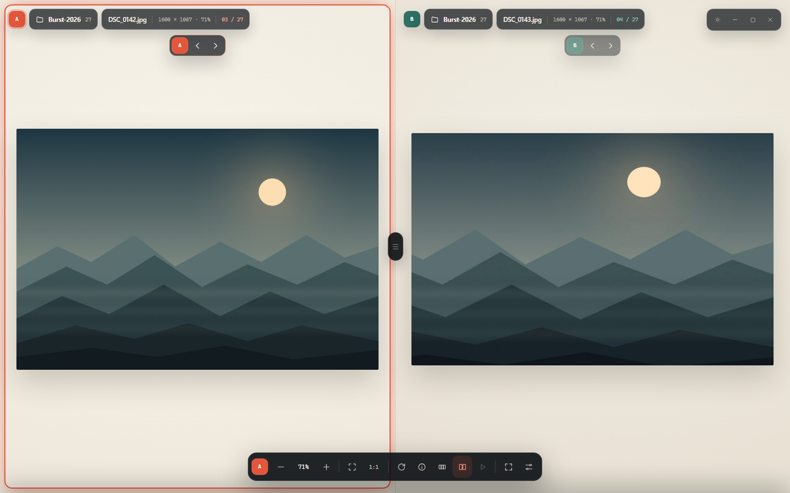
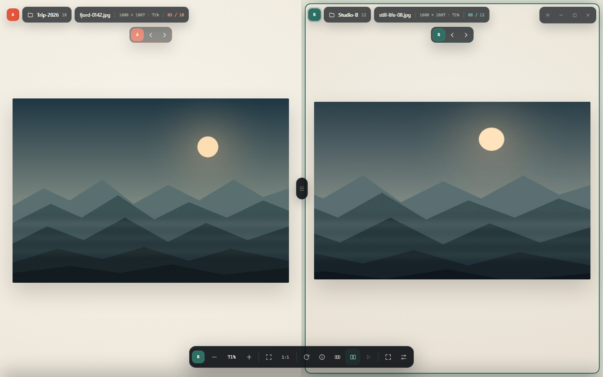
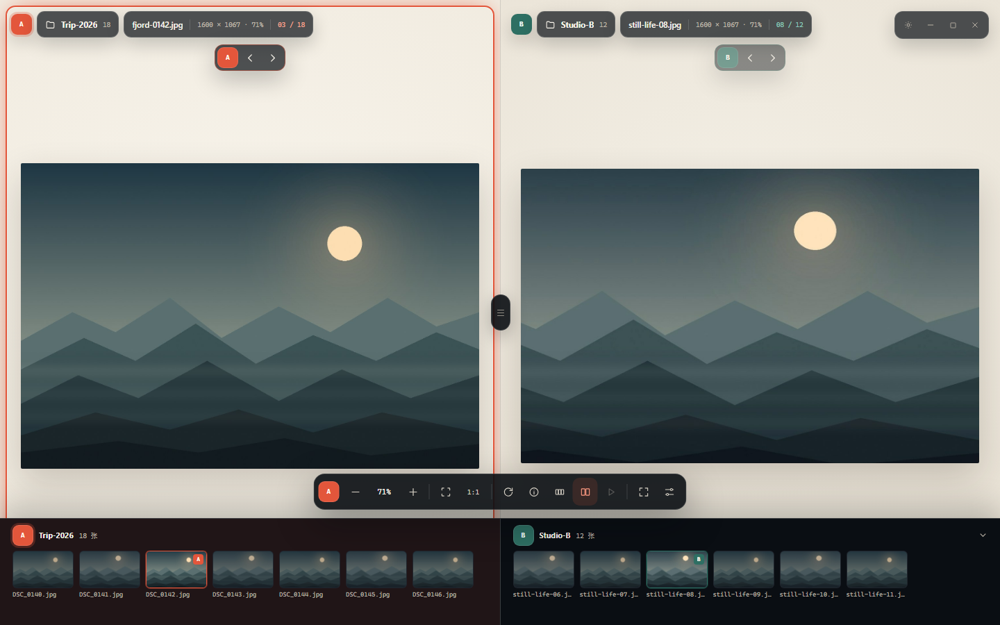
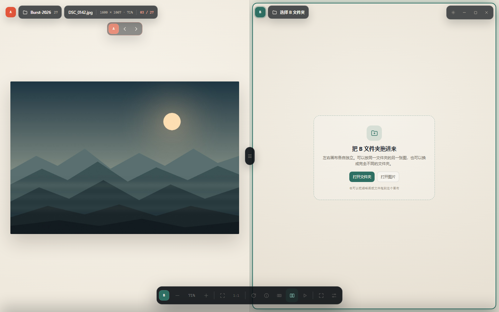

# AirGlance Dual-Canvas Interaction Design v4

**English** · [简体中文](dual-view-v4.md)

> Based on v3, this revision only moves each canvas’s previous/next pair from the outer edge to **above the canvas**.
>
> **This revision is implemented in the local 0.4.0 build.**

## 0. Goals

- Keep the v3 vertical-centring fix for the filmstrip A/B headers.
- Keep an independent previous/next pair for each canvas.
- Move each pair from the side edge to the **top centre of its canvas**.
- Remove the global window-edge arrows.

## 1. Top paging controls





### 1.1 Position

- Each canvas has a **38 px dark capsule** at its top centre.
- The capsule sits **64 px below the canvas top**, under the title chips and above the image.
- Contents, left to right:

```text
[ A ]  ‹  ›
 30px  30 30
```

- A/B badge: 30 × 30; each paging button: 30 × 30.
- Capsule padding 3 px; button gap 2 px.
- Horizontally centred inside its own canvas; it never crosses the divider.
- The divider keeps only its drag handle; no paging buttons near the centre.

### 1.2 Why the top

- It frees the left and right image edges.
- A/B groups are symmetric and easy to identify.
- The divider stays clean, avoiding the “A next / divider / B previous” trio.
- Title and paging become two clear rows: identity/file first, navigation second.
- The pointer naturally passes the top group when moving from the title toward the image.

### 1.3 States

| State | Appearance |
| --- | --- |
| Active canvas | Capsule at 100%, full identity outline and A/B badge |
| Inactive canvas | Capsule at 60%, still clickable |
| Hover capsule | 100%, darker background |
| Hover button | Brighter background and 1.05 scale |
| Empty canvas | Whole group hidden |
| One image | Whole group hidden |
| Two or more images | Group shown |

### 1.4 Behaviour

- Clicking the active canvas’s buttons pages it directly.
- Clicking the inactive canvas’s buttons **activates that canvas first and then pages it**.
- The A group only changes A; the B group only changes B.
- Paging wraps.
- Keyboard `←` / `→` still targets only the active canvas.
- The group follows the 2.5 s chrome auto-hide.
- Fullscreen and the filmstrip do not move the group from the canvas top.

### 1.5 Spacing from the title

- Title chip: top 16 px, height 38 px, ends at 54 px.
- Paging capsule: top 64 px, height 38 px, ends at 102 px.
- A 10 px gap keeps the capsule from touching the title.
- Compact window (<1120 px):
  - capsule top 58 px;
  - badge/buttons shrink to 28 × 28;
  - capsule height 34 px;
  - still horizontally centred.

## 2. Filmstrip header centring



Carried over from v3:

- fixed 30 px half-header;
- 30 × 30 badge; badge letter `line-height: 1` and grid-centred;
- folder name/count `align-self: center`, `line-height: 1.2`;
- no 38 px main-title height;
- text never hugs the top or bottom.

## 3. Empty canvas



- If B is empty, B’s paging group is hidden.
- A’s group remains visible even when A is not active.
- Clicking A’s group activates A first.
- Empty-canvas actions remain in the main empty card.

## 4. Visual specification

| Item | Specification |
| --- | --- |
| Capsule position | Top centre, 64 px from canvas top |
| Capsule height | 38 px |
| Capsule padding | 3 px |
| A/B badge | 30 × 30, radius 9 |
| Button | 30 × 30, radius 8 |
| Button gap | 2 px |
| Capsule radius | 12 px |
| A colour | coral `#E3563B` |
| B colour | teal `#2E6F63` |
| Capsule outline | identity at 48% |
| Active group | opacity 100% |
| Inactive group | opacity 60% |
| Empty/one image | group hidden |
| Compact window | top 58 px; badge/buttons 28 px |
| Filmstrip header height | 30 px |
| Filmstrip badge | 30 × 30, letter line-height 1 |
| Filmstrip title/count | align-self centre, line-height 1.2 |

## 5. v3 vs v4

| Item | v3: outer side | v4: canvas top |
| --- | --- | --- |
| Image side coverage | one pair per side | none |
| Near divider | no | no |
| Relationship with title | separate | two stacked rows |
| Pointer travel | to canvas edge | natural from title toward image |
| Top image coverage | none | capsule covers a small top strip |
| Wide images | good | good |
| Tall images | good | capsule may sit over the image |

The trade-off: **a little top coverage for cleaner sides and a more symmetric A/B layout**.

## 6. Interaction table (delta)

| Action | v4 behaviour |
| --- | --- |
| Click A previous/next | Activate A and page A |
| Click B previous/next | Activate B and page B |
| Hover inactive group | Group brightens; buttons clickable |
| A empty/one image | A group hidden |
| Active canvas changes | Groups stay at the top; only highlight changes |
| Open filmstrip | Groups stay at the canvas top |
| Fullscreen | Groups remain, auto-hide with chrome |

## 7. Confirmed decisions

- The top capsule is better than v3’s outer-edge groups.
- 64 px from the canvas top and a 10 px title gap are right.
- 60% opacity is right for the inactive group.
- The group is hidden when the canvas is empty or has one image.
- A small top overlay on tall images is acceptable.

## 8. Prototype and screenshots

| State | Link |
| --- | --- |
| A active, two top groups | `docs/design/dual-view-v4.html?state=same` |
| B active, B group highlighted | `docs/design/dual-view-v4.html?state=folders` |
| Filmstrip + top paging | `docs/design/dual-view-v4.html?state=filmstrip` |
| Empty canvas hides B group | `docs/design/dual-view-v4.html?state=empty` |
| Dark theme | add `&theme=dark` |
| Hide state bar | add `&ui=0` |

Implementation screenshots:

- [Top paging (implemented)](implemented-dual.png)
- [Filmstrip header and top paging (implemented)](implemented-dual-filmstrip.png)

Design screenshots:

- [A active](dual-v4-same.png)
- [B active](dual-v4-folders.png)
- [Filmstrip and top paging](dual-v4-filmstrip.png)
- [Empty canvas hides B group](dual-v4-empty.png)
