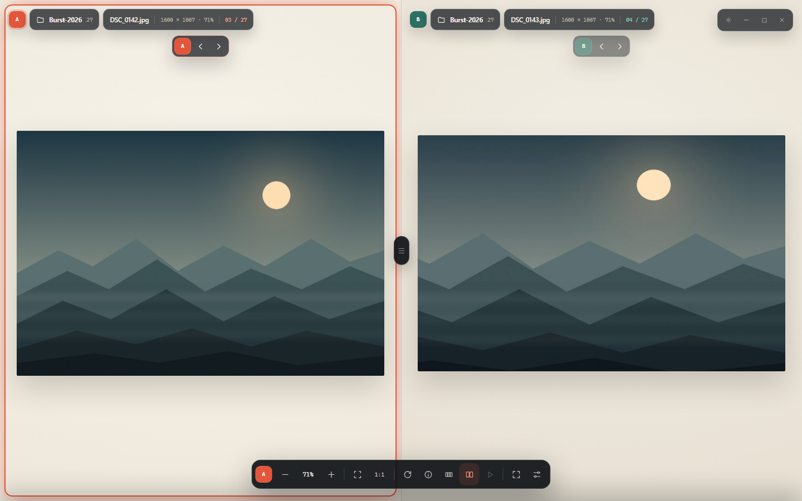
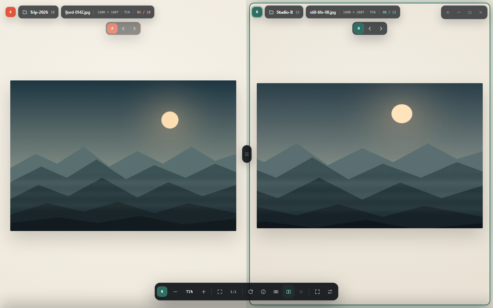
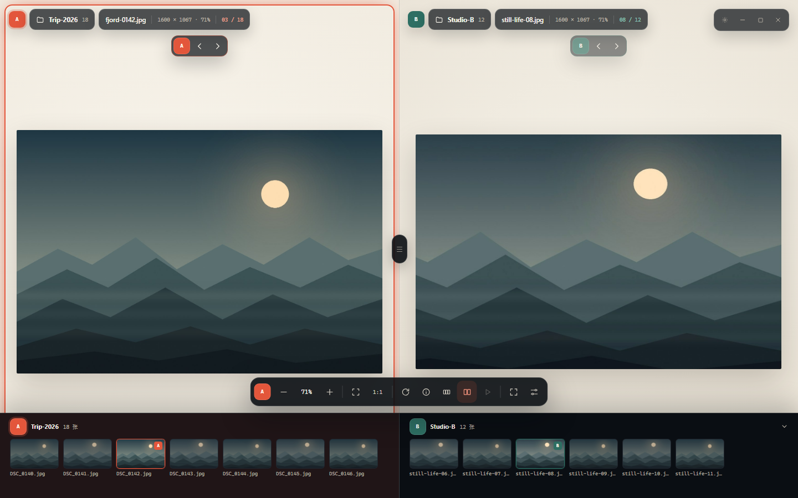
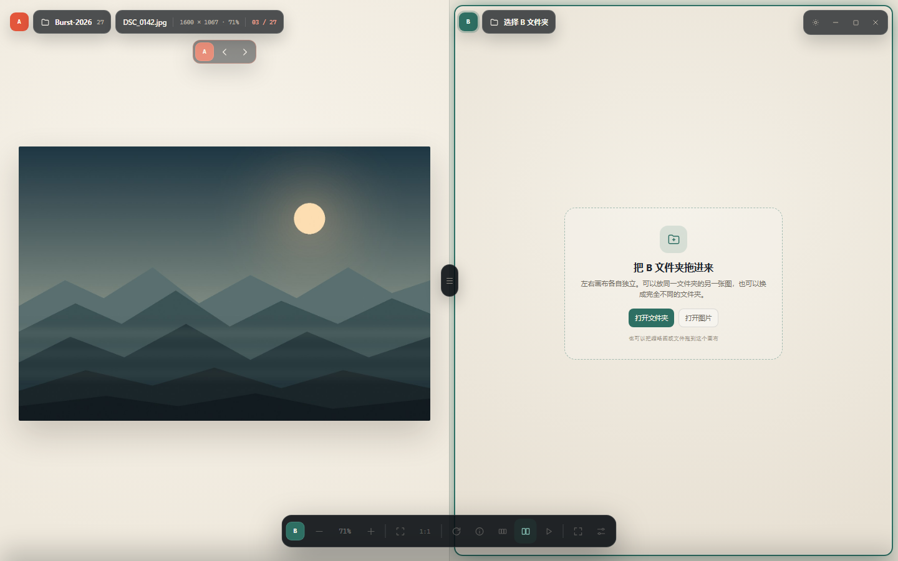

# AirGlance 双画布交互视觉稿 v4

[English](dual-view-v4.en.md) · **简体中文**

> 在 v3 基础上，只调整“每块画布自己的上一张/下一张”的位置：从画布外侧边缘移到**画布上方**。
>
> **已按本稿在 0.4.0 本地构建中实现。**

## 0. 修订目标

- 胶片条 A/B 标题继续使用 v3 的垂直居中修复。
- 双画布左右各自保留上一张/下一张按钮。
- 按钮从左右边缘移到**每块画布顶部中央**，不再占用画布两侧。
- 不再使用窗口两侧的全局翻页按钮。

## 1. 顶部翻页按钮





### 1.1 位置

- 每块画布顶部中央各有一个 **38 px 高的深色胶囊**。
- 胶囊距离画布顶部 **64 px**，位于标题 chip 下方、图片上方。
- 胶囊内容从左到右：

```text
[ A ]  ‹  ›
 30px  30 30
```

- A/B 徽标 30×30，翻页按钮各 30×30。
- 胶囊内边距 3 px，按钮间距 2 px。
- 横向居中于各自画布，不跨过分隔条。
- 中间分隔条只保留拖动柄，不再出现翻页按钮。

### 1.2 为什么放在上方

- 不占用画布左右边缘，减少对图片的遮挡。
- A/B 两组的水平位置对称，身份清楚。
- 中间分隔条保持干净，不会出现“A 下一张 / 分隔条 / B 上一张”三连圆按钮。
- 标题 chip 和翻页组形成上下两层：第一层说明“这是哪块画布、什么文件”，第二层说明“怎么翻”。
- 翻页组贴在画布上方，鼠标从标题区移动到图片时自然经过，不需要先移到窗口边缘。

### 1.3 状态

| 状态 | 表现 |
| --- | --- |
| 当前画布 | 胶囊不透明度 100%，身份色描边和 A/B 徽标完整 |
| 非当前画布 | 胶囊不透明度 60%，仍可点击 |
| 悬停胶囊 | 不透明度 100%，背景加深 |
| 悬停按钮 | 按钮背景变亮并放大 1.05 |
| 画布为空 | 该侧整组隐藏 |
| 画布只有一张图 | 该侧整组隐藏 |
| 至少两张图 | 该侧显示 |

### 1.4 行为

- 点击当前画布的按钮：直接翻页。
- 点击非当前画布的按钮：**先激活该画布，再翻页**，不需要先点画布。
- A 组只翻 A，B 组只翻 B。
- 翻页循环。
- 键盘 `←` / `→` 仍然只翻当前画布。
- 翻页组跟随 2.5 秒 chrome 自动隐藏。
- 全屏和打开胶片条时保持在画布顶部中央。

### 1.5 与标题的间距

- 标题 chip 顶部 16 px，高 38 px，底部到 54 px。
- 翻页胶囊顶部 64 px，高 38 px，底部到 102 px。
- 两者之间留 10 px，避免和标题 chip 粘连。
- 在紧凑窗口（<1120 px）：
  - 胶囊顶部 58 px；
  - A/B 徽标和按钮缩到 28×28；
  - 胶囊高度 34 px；
  - 仍保持水平居中。

## 2. 胶片条标题垂直居中



延续 v3 的规格：

- 胶片半区头部固定 30 px 高；
- A/B 徽标 30×30，字母 `line-height: 1`，使用 grid 居中；
- 文件夹名、数量 `align-self: center`，`line-height: 1.2`；
- 不使用 38 px 主标题行高；
- 字符不贴顶、不贴底。

## 3. 空画布



- B 为空时，B 的翻页组整体隐藏。
- A 的翻页组仍保留，即使 A 不是当前画布也可见。
- 点击 A 的翻页组会先激活 A，再翻页。
- 空画布的操作入口仍在主画布空状态卡中。

## 4. 视觉规格

| 项目 | 规格 |
| --- | --- |
| 翻页胶囊位置 | 顶部中央，距画布顶部 64 px |
| 胶囊高度 | 38 px |
| 胶囊内边距 | 3 px |
| A/B 徽标 | 30 × 30，圆角 9 |
| 按钮 | 30 × 30，圆角 8 |
| 按钮间距 | 2 px |
| 胶囊圆角 | 12 px |
| A 色 | coral `#E3563B` |
| B 色 | teal `#2E6F63` |
| 胶囊描边 | 身份色 48% |
| 当前组 | opacity 100% |
| 非当前组 | opacity 60% |
| 空/单图 | 整组隐藏 |
| 紧凑窗口 | 胶囊顶部 58 px，徽标/按钮 28 px |
| 胶片头行高 | 30 px |
| 胶片徽标 | 30×30，字母 line-height 1 |
| 胶片标题/数量 | align-self center，line-height 1.2 |

## 5. 与 v3 的对比

| 项目 | v3：外侧边缘 | v4：画布上方 |
| --- | --- | --- |
| 对图片侧边的遮挡 | 有，左右各一组 | 无，移到顶部 |
| 是否靠近分隔条 | 否，外侧 | 否，画布中央 |
| 与标题的关系 | 分离 | 上下两层，关系更清楚 |
| 鼠标移动距离 | 需要到画布边缘 | 从标题向下自然经过 |
| 对图片顶部遮挡 | 无 | 胶囊会覆盖图片上沿少量区域 |
| 适合宽图 | 是 | 是 |
| 适合竖图 | 是 | 顶部胶囊可能压在图片上 |

v4 的主要取舍是：**用一点顶部覆盖，换取两侧更干净、A/B 组更对称**。

## 6. 交互表（增量）

| 操作 | v4 行为 |
| --- | --- |
| 点击 A 组上一张/下一张 | 激活 A，翻 A 的图片 |
| 点击 B 组上一张/下一张 | 激活 B，翻 B 的图片 |
| 悬停非当前组 | 组变亮，按钮可点击 |
| A 为空/只有一张图 | A 组隐藏 |
| 当前画布切换 | 两组保持顶部位置，只改变高亮 |
| 打开胶片条 | 两组仍在画布顶部 |
| 全屏 | 两组仍显示，随 chrome 自动隐藏 |

## 7. 确认结论

- 顶部胶囊优于 v3 的外侧边缘方案。
- 距画布顶部 64 px、距标题 10 px 合适。
- 非当前组 60% 不透明度合适。
- 只有一张图/空画布时整组隐藏。
- 接受竖图时顶部胶囊覆盖图片上沿少量区域。

## 8. 原型与截图

| 状态 | 链接 |
| --- | --- |
| A 当前，顶部两组 | `docs/design/dual-view-v4.html?state=same` |
| B 当前，B 组高亮 | `docs/design/dual-view-v4.html?state=folders` |
| 胶片条 + 顶部翻页 | `docs/design/dual-view-v4.html?state=filmstrip` |
| 空画布隐藏 B 组 | `docs/design/dual-view-v4.html?state=empty` |
| 暗色 | 加 `&theme=dark` |
| 隐藏状态条 | 加 `&ui=0` |

实现截图：

- [双画布顶部翻页（实现）](implemented-dual.png)
- [胶片条标题与顶部翻页（实现）](implemented-dual-filmstrip.png)

设计截图：

- [A 当前](dual-v4-same.png)
- [B 当前](dual-v4-folders.png)
- [胶片条与顶部翻页](dual-v4-filmstrip.png)
- [空画布隐藏 B 组](dual-v4-empty.png)
