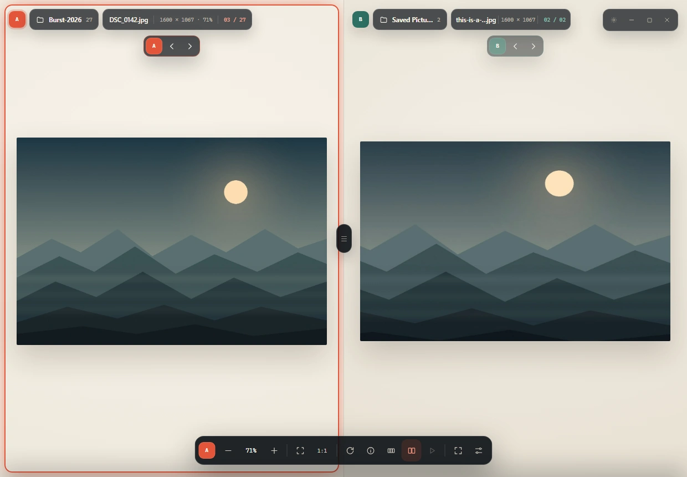

# AirGlance Dual-Canvas Interaction Design v5

**English** · [简体中文](dual-view-v5.md)

> This revision only rebalances the **right-pane file-information header**: constrain folder/file names, keep the page counter visible, and stay clear of the Maximize/window-control box.
>
> **Implemented in the local 0.4.0 build.**

## 0. Current problem

At the 1240 px default width, the right header reserves 166 px for window controls, leaving about 438 px. The old implementation put the page counter last, so it disappeared when space ran out:

```text
B  [📁 Saved Pictures 2]  [beta.jpg  1600 × 1067 · 35%]
                                                ↑ page counter hidden
```

The new layout reserves the page slot first, then shares the remaining width:

```text
B  [📁 Saved Pictu… 2]  [this-is-a-…jpg  1600 × 1067  02 / 02]
                                                       ↑ always visible
```

> **Note:** With a strict **12-character** folder limit, the original `Saved Pictures` (14 characters) becomes `Saved Pictu…`. If that folder name must stay complete, restore the folder limit to 14 characters or switch to a width-based limit. This draft follows the confirmed 12-character limit.

## 1. Principles

Priority order for the right header:

| Priority | Item | Rule |
| --- | --- | --- |
| 1 | A/B badge | fixed 30 × 30, never compressed |
| 2 | Page counter | fixed **46 px**, never hidden or clipped |
| 3 | Folder name | max **12 characters / 82 px**, then ellipsis |
| 4 | File name | max **14 characters / 96 px**, then ellipsis with extension retention |
| 5 | Image dimensions | shown when space remains |
| 6 | Zoom percentage | last; hidden first when space is tight |

Rules:

- The page counter is a **fixed slot**, not the last optional item.
- Folder name has priority over file name.
- File name has priority over dimensions/zoom.
- Every text element ellipsizes inside its own maximum width; the whole header is not the primary clipping mechanism.
- The right header keeps the 166 px window-control reserve and never enters the Maximize area.

## 2. Default 1240 px



Width budget:

```text
available  438 px
├─ A/B badge             30
├─ gap                    7
├─ folder chip          ~132
│  ├─ folder icon        15
│  ├─ folder name (≤82)  82
│  └─ count               8
├─ gap                    7
└─ file chip            ~242
   ├─ file name (≤96)    96
   ├─ separator           5
   ├─ 1600 × 1067        70
   ├─ separator           5
   └─ page (fixed 46)    46
```

Rendered:

```text
B  [📁 Saved Pictu…  2]  [this-is-a-…jpg  1600 × 1067  02 / 02]
```

- `Saved Pictures` is limited to 12 characters and becomes `Saved Pictu…`.
- The file name keeps its extension: `this-is-a-…jpg`.
- Image dimensions stay visible.
- Zoom is hidden at 1240 px.
- Page counter `02 / 02` is always visible.
- A safe gap remains before the window-control box.

## 3. Width tiers

| Window width | Folder limit | File-name limit | Dimensions | Zoom | Page |
| --- | --- | --- | --- | --- | --- |
| ≥ 1440 px | 190 px | 150 px | shown | shown | fixed |
| 1240 px (default) | 82 px / 12 chars | 96 px / 14 chars | shown | hidden | fixed |
| 1120–1239 px | 72 px / 10 chars | 84 px / 12 chars | shown | hidden | fixed |
| 1000–1119 px (compact) | 60 px / 8 chars | 72 px / 10 chars | hidden | hidden | fixed |

- The page slot is always 46 px.
- In compact width the folder count hides but the folder name keeps 8 characters.
- The file name keeps at least 10 characters under the extension rule.
- Dimensions and zoom are never allowed to displace the page counter.

## 4. Name limits

### Folder name

- Default: **82 px / 12 characters**.
- Examples:
  - `Saved Pictures` → `Saved Pictu…`;
  - `Photos` → full.
- The folder count sits to the right of the name and does not ellipsize; it hides in compact width.

### File name

- Default: **96 px / 14 characters**.
- Examples:
  - `beta.jpg` → full;
  - `this-is-a-long-file-name.jpg` → `this-is-a-…jpg`.
- **Keep the extension:**
  - take the extension after the last `.`;
  - extension plus ellipsis consumes part of the character budget;
  - the ellipsis replaces the dot before the extension, so `this-is-a-…jpg` rather than a double dot;
  - if there is no extension, or the extension is too long, fall back to end ellipsis.
- End ellipsis, not middle ellipsis.

### Page counter

- Fixed 46 px.
- Format `02 / 02`.
- Never ellipsized, wrapped or hidden.
- 8 px end padding so it does not touch the chip edge.

## 5. Window-control relationship

- The right header still reserves 166 px for window controls.
- Folder and file chips each have their own maximum width.
- The page slot is fixed inside the file chip; the chip never exceeds the header width.
- `ClipToBounds` remains as a final safety net.
- Because names ellipsize inside their own limits, the safety clip should not normally be needed.

## 6. Interaction

- No click behaviour changes.
- Folder name and file name are not clickable.
- Page counter is read-only.
- Context menu, paging, zoom and filmstrip are unchanged.
- Hover does not change header widths, so there is no layout jitter.
- Resizing only reallocates name widths; the page counter never disappears.

## 7. Visual specification

| Item | Specification |
| --- | --- |
| Right window-control reserve | 166 px |
| Default header width | about 438 px |
| A/B badge | 30 × 30 |
| Folder chip maximum | 150 px |
| Folder-name default limit | 82 px / 12 chars |
| File-name default limit | 96 px / 14 chars |
| Page slot | 46 px, fixed |
| Page format | `02 / 02` |
| Image dimensions | about 70 px, flexible |
| Zoom | hidden by default; shown wide |
| Header-end clearance | ≥ 8 px |
| Truncation | end ellipsis; file extension retained |

## 8. Confirmed decisions

- Folder names are strictly capped at 12 characters; `Saved Pictures` becomes `Saved Pictu…`.
- File names are capped at 14 characters / 96 px and keep their extension.
- The page slot is fixed at 46 px in the `02 / 02` format.
- Zoom hides before dimensions when space is tight.
- File names keep the extension, for example `this-is-a-…jpg`.

## 9. Prototype and screenshot

- [HTML prototype](dual-view-v5.html) (default `?state=same&ui=0`)
- [1240 px screenshot](dual-v5-header-1240-v2.webp)
- [Implementation screenshot](implemented-dual-pagecount.webp)

State parameters:

- `?state=same`
- `?state=folders`
- `?state=empty`
- `&theme=dark`
- `&ui=0`
