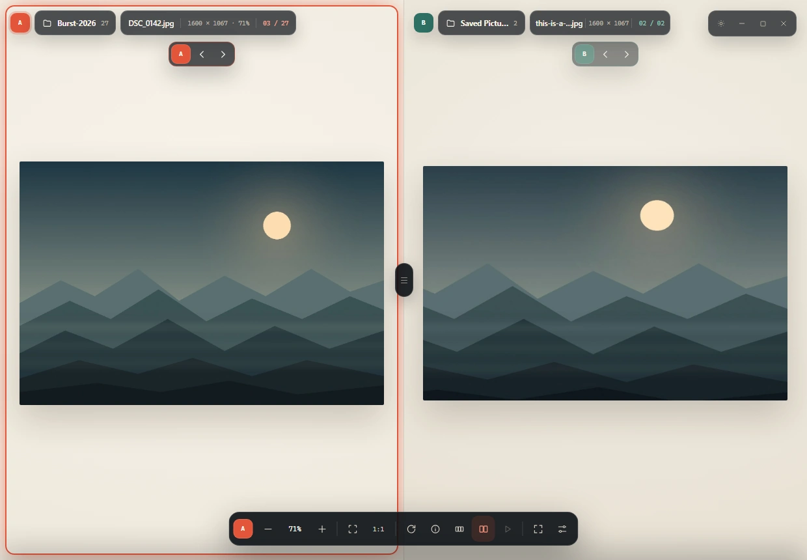

# AirGlance 双画布交互视觉稿 v5

[English](dual-view-v5.en.md) · **简体中文**

> 只调整双画布**右屏文件信息框**的宽度分配：限制文件夹名和文件名长度，**始终保留页数显示**，同时保持与最大化按钮所在的窗口控制框不重叠。
>
> **已按本稿在 0.4.0 本地构建中实现。**

## 0. 当前问题

当前 1240 px 默认窗口下，右屏标题为窗口控制区预留 166 px，可用宽度约 438 px。旧实现把页数排在最后，空间不足时先被挤掉：

```text
B  [📁 Saved Pictures 2]  [beta.jpg  1600 × 1067 · 35%]
                                                ↑ 页数被隐藏
```

新方案先给页数固定槽位，再分配名称：

```text
B  [📁 Saved Pictu… 2]  [this-is-a-…jpg  1600 × 1067  02 / 02]
                                                       ↑ 始终保留
```

> **注意：** 按严格 **12 字符**限制，原来的 `Saved Pictures`（14 字符）会显示为 `Saved Pictu…`。如果必须完整显示这个目录名，需要把文件夹上限恢复为 14 字符，或改成按宽度限制。当前稿严格按你确认的 12 字符生成。

## 1. 设计原则

右屏标题的宽度分配按以下优先级：

| 优先级 | 内容 | 规则 |
| --- | --- | --- |
| 1 | A/B 徽标 | 固定 30 × 30，不压缩 |
| 2 | 页数 | 固定 **46 px**，永不隐藏、永不裁切 |
| 3 | 文件夹名 | 最多 **12 个字符 / 82 px**，超出省略号 |
| 4 | 文件名 | 最多 **14 个字符 / 96 px**，超出省略号并保留扩展名 |
| 5 | 图片尺寸 | 有剩余空间时显示 |
| 6 | 缩放比例 | 最后显示，空间不足时先隐藏 |

原则：

- **页数不是最后一个“可省略项”**，而是固定槽位；
- 文件夹名优先于文件名；
- 文件名优先于尺寸/缩放；
- 所有文本都在自己的最大宽度内省略，不靠整体裁剪兜底；
- 窗口控制区始终预留 166 px，信息框不会进入最大化按钮下方。

## 2. 默认 1240 px



宽度预算：

```text
可用宽度  438 px
├─ A/B 徽标              30
├─ 间距                    7
├─ 文件夹 chip           ~132
│  ├─ 文件夹图标          15
│  ├─ 文件夹名（≤82）     82
│  └─ 数量                 8
├─ 间距                    7
└─ 文件 chip             ~242
   ├─ 文件名（≤96）       96
   ├─ 分隔                 5
   ├─ 1600 × 1067        70
   ├─ 分隔                 5
   └─ 页数（固定 46）     46
```

实际显示：

```text
B  [📁 Saved Pictu…  2]  [this-is-a-…jpg  1600 × 1067  02 / 02]
```

- `Saved Pictures` 按 12 字符上限显示为 `Saved Pictu…`；
- 文件名保留扩展名，显示为 `this-is-a-…jpg`；
- 图片尺寸保留；
- 缩放比例在 1240 px 下隐藏；
- 页数 `02 / 02` 固定显示；
- 标题右端与窗口控制框之间仍有安全间距。

## 3. 不同宽度下的策略

| 窗口宽度 | 文件夹名上限 | 文件名上限 | 尺寸 | 缩放 | 页数 |
| --- | --- | --- | --- | --- | --- |
| ≥ 1440 px | 190 px | 150 px | 显示 | 显示 | 固定显示 |
| 1240 px（默认） | 82 px / 12 字符 | 96 px / 14 字符 | 显示 | 隐藏 | 固定显示 |
| 1120–1239 px | 72 px / 10 字符 | 84 px / 12 字符 | 显示 | 隐藏 | 固定显示 |
| 1000–1119 px（紧凑） | 60 px / 8 字符 | 72 px / 10 字符 | 隐藏 | 隐藏 | 固定显示 |

- 页数槽位在所有宽度下固定 46 px；
- 文件夹数量在紧凑宽度下隐藏，但文件夹名保留到 8 字符；
- 文件名在紧凑宽度下至少保留 10 字符（含扩展名规则）；
- 不会为了塞入尺寸或缩放而移除页数。

## 4. 名称长度限制

### 文件夹名

- 默认上限：**82 px / 12 字符**；
- 例：
  - `Saved Pictures` → `Saved Pictu…`；
  - `Photos` → 完整显示；
- 文件夹数量固定显示在名称右侧，不参与省略；紧凑宽度下隐藏数量。

### 文件名

- 默认上限：**96 px / 14 字符**；
- 例：
  - `beta.jpg` → 完整显示；
  - `this-is-a-long-file-name.jpg` → `this-is-a-…jpg`；
- **保留扩展名**：
  - 取最后一个 `.` 后的扩展名；
  - 扩展名 + 省略号占用固定字符预算；
  - 省略号替代扩展名前的点，例如 `this-is-a-…jpg`，不显示成双点；
  - 没有扩展名或扩展名过长时，退化为末尾省略号。
- 使用末尾省略号，不做中间省略。

### 页数

- 固定 46 px；
- 格式 `02 / 02`；
- 不参与省略、不换行、不隐藏；
- 页数右侧保留 8 px 内边距，避免贴住 chip 边缘。

## 5. 与窗口控制区的关系

- 右屏标题仍预留右侧 166 px 给窗口控制框；
- 文件夹 chip 和文件 chip 都有独立的最大宽度；
- 页数槽位在文件 chip 内部固定，文件 chip 不越过标题可用宽度；
- 标题整体继续保留 `ClipToBounds` 作为最后一道保护；
- 由于名称已经按宽度省略，正常情况下不需要触发整体裁剪。

## 6. 交互

- 不改变任何点击行为；
- 文件夹名、文件名不可点击；
- 页数只读；
- 右键菜单、翻页、缩放、胶片条都不变；
- hover 不改变标题宽度，不会因 hover 导致布局抖动；
- 窗口缩放时只重新分配名称宽度，页数始终在场。

## 7. 视觉规格

| 项目 | 规格 |
| --- | --- |
| 右屏窗口控制预留 | 166 px |
| 默认标题可用宽度 | 约 438 px |
| A/B 徽标 | 30 × 30 |
| 文件夹 chip 最大宽度 | 150 px |
| 文件夹名默认上限 | 82 px / 12 字符 |
| 文件名默认上限 | 96 px / 14 字符 |
| 页数槽位 | 46 px，固定 |
| 页数格式 | `02 / 02` |
| 图片尺寸 | 70 px 左右，弹性 |
| 缩放比例 | 默认隐藏，宽屏显示 |
| 标题右端安全间距 | ≥ 8 px |
| 省略方式 | 末尾省略号；文件名保留扩展名 |

## 8. 确认结果

- 文件夹名严格限制 12 字符；`Saved Pictures` 显示为 `Saved Pictu…`。
- 文件名限制 14 字符 / 96 px，并保留扩展名。
- 页数固定 46 px，格式 `02 / 02`。
- 空间不足时先隐藏缩放，再隐藏尺寸。
- 文件名保留扩展名，例如 `this-is-a-…jpg`。

## 9. 原型与截图

- [HTML 原型](dual-view-v5.html)（默认 `?state=same&ui=0`）
- [1240 px 设计截图](dual-v5-header-1240-v2.webp)
- [实现截图](implemented-dual-pagecount.webp)

状态参数：

- `?state=same`
- `?state=folders`
- `?state=empty`
- `&theme=dark`
- `&ui=0`
