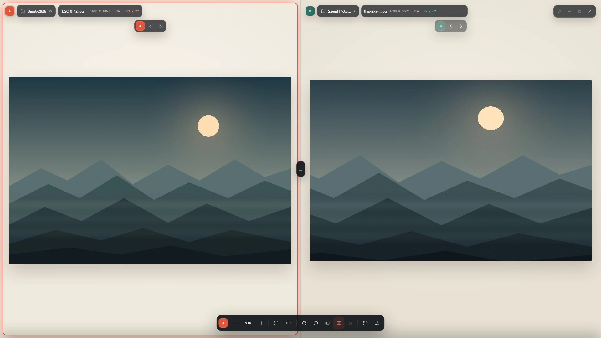
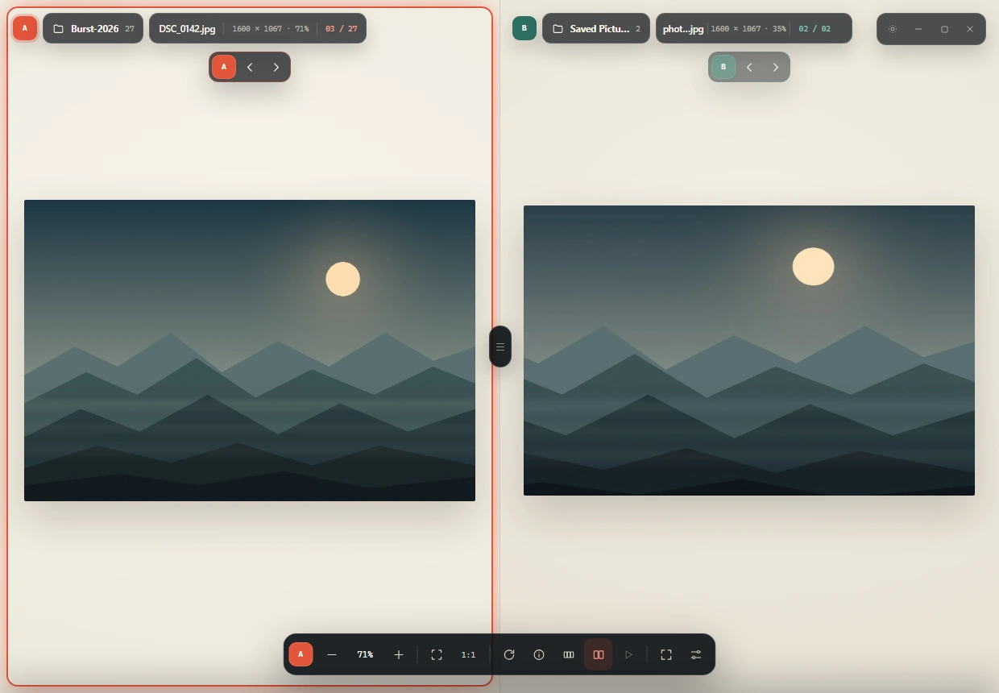

# AirGlance Dual-Canvas Interaction Design v6

**English** · [简体中文](dual-view-v6.md)

> Two adjustments: cap the file-information chip so it stops growing with the window, and keep **both dimensions and zoom** at 1240 px by limiting the file name to **8 characters**.
>
> **Implemented in the local 0.4.0 build.**

## 0. Current issues

### The file chip keeps growing

The current chip width follows available space, so wider windows make it longer:

```text
1440 px  [ file name  dimensions · zoom  page ]
1920 px  [ file name  dimensions · zoom  page             ]  ← keeps growing
```

### Dimensions, zoom and page compete at 1240 px

v5 hid zoom at 1240 px. The new requirement is to keep **both dimensions and zoom**, while also keeping the page counter, so the file name must shrink.

## 1. Maximum file-information width

- File chip maximum: **340 px** on both A and B.
- It stops at 340 px and no longer grows with the window.
- File name, dimensions, zoom and page counter share that budget.
- Wider windows leave empty space to the right instead of stretching the chip.
- The page counter remains fixed at 46 px.



## 2. 1240 px: keep dimensions + zoom



### Recommended: 8-character file name

Width budget:

```text
file chip 244 px
├─ file name (≤52)      52
├─ 1600 × 1067          70
├─ zoom · 35%           35
├─ page (fixed 46)      46
├─ separators/padding   ~34
└─ total               ~237, with a little headroom
```

Rendered:

```text
B  [📁 Saved Pictu…  2]  [phot…jpg  1600 × 1067 · 35%  02 / 02]
```

- File name: **8 characters / 52 px**;
- extension retained: `phot…jpg`;
- dimensions shown;
- zoom shown;
- page counter `02 / 02` always visible;
- folder name 12 characters;
- no overlap with the Maximize button.

### Why 8 characters

At 1240 px the file chip is about 244 px and must hold:

- page counter 46 px;
- dimensions about 70 px;
- zoom about 35 px;
- separators and padding about 34 px.

That leaves about 52 px for the file name, so **8 characters**, including the ellipsis and extension, is recommended.

### The cost of 14 characters

Keeping a 14-character name would require hiding dimensions (the previous v6 draft):

```text
B  [📁 Saved Pictu…  2]  [this-is-a-…jpg  · 35%  02 / 02]
```

This version follows your confirmation: **show dimensions, keep zoom, cap the file name at 8 characters.**

## 3. Width allocation

| Window width | File chip | File name | Dimensions | Zoom | Page |
| --- | --- | --- | --- | --- | --- |
| ≥ 1600 px | max 340 px | 14 chars | shown | shown | fixed |
| 1240–1599 px | 244 px | **8 chars** | shown | shown | fixed |
| 1120–1239 px | about 220 px | 10 chars | hidden | shown | fixed |
| 1000–1119 px (compact) | about 170 px | 8 chars | hidden | hidden | fixed |

- File chip max 340 px.
- Page counter fixed at 46 px at every width.
- Dimensions and zoom both stay at 1240 px.
- At 1120–1239 px dimensions hide, allowing a 10-character file name; zoom stays visible.
- Wider windows restore dimensions and lengthen the name; the chip caps at 340 px.

## 4. Priority

v6 right-header priority:

```text
A/B badge → page counter → folder name → file name → zoom → dimensions
```

- Page counter always fixed.
- Folder name fixed at 12 characters.
- At 1240 px the file name is 8 characters.
- At 1120–1239 px dimensions hide first, allowing a 10-character file name.
- Wide windows restore dimensions and extend the file name.

## 5. Visual specification

| Item | Specification |
| --- | --- |
| File chip maximum | 340 px |
| File chip at 1240 px | 244 px |
| Folder name | 12 characters / 82 px |
| File name (1240 px) | 8 characters / 52 px |
| File name (1120–1239 px) | 10 characters |
| File name (≥1600 px) | 14 characters |
| Page counter | 46 px, fixed |
| Dimensions | shown at 1240 px; hidden at 1120–1239 px |
| Zoom | shown at 1240 px; shown at 1120–1239 px |
| Page format | `02 / 02` |
| Header-end clearance | ≥ 8 px |
| File extension | retained |

## 6. v5 vs v6

| Item | v5 | v6 |
| --- | --- | --- |
| File chip maximum | none | **capped at 340 px** |
| Zoom at 1240 px | hidden | **shown** |
| Dimensions at 1240 px | shown | **shown** |
| File name at 1240 px | 14 chars | **8 chars** |
| Page counter | fixed 46 px | fixed 46 px |
| 1120–1239 px | dimensions/zoom hidden | dimensions hidden, zoom shown, 10-char name |

## 7. Full names on hover

- When the folder or file name is truncated, hovering the chip reveals the full name.
- The folder chip tooltip shows the complete folder name.
- The file chip tooltip shows the complete file name, including the extension.
- This works even when the name is not truncated; the full value is always available.
- Tooltips do not change layout or cause jitter.

## 8. Confirmed decisions

- File chip maximum **340 px**.
- At 1240 px **show dimensions and keep zoom**.
- Accept an **8-character file name**.
- At 1120–1239 px accept a **10-character file name** with dimensions hidden.
- Page counter fixed at 46 px.
- File name keeps its extension.
- File chip is capped at 340 px.
- Folder/file chips show full names on hover.

## 9. Prototype and screenshots

- [HTML prototype](dual-view-v6.html) (default `?state=same&ui=0`)
- [1240 px: dimensions + zoom + 8-character file name](dual-v6-1240.webp)
- [Implementation screenshot](implemented-dual-v6.webp)
- [1920 px: file chip capped at 340 px](dual-v6-1920.webp)

State parameters:

- `?state=same`
- `?state=folders`
- `?state=empty`
- `&theme=dark`
- `&ui=0`
