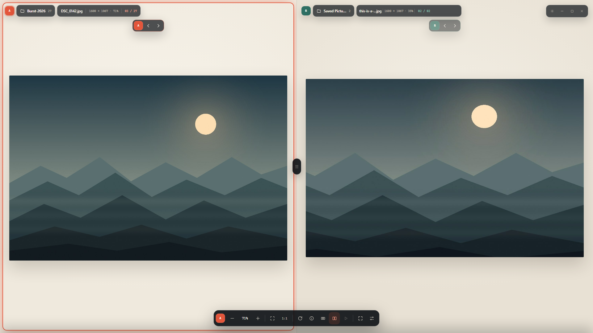
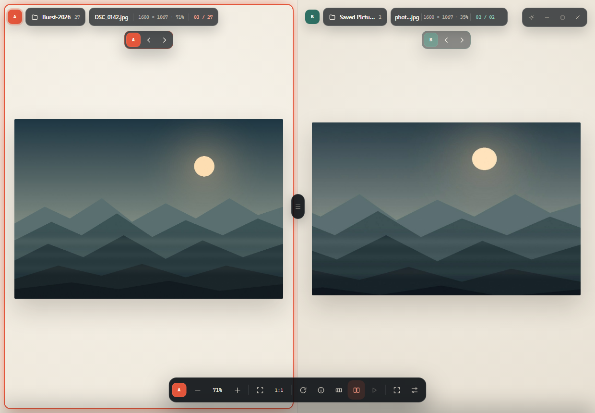

# AirGlance 双画布交互视觉稿 v6

[English](dual-view-v6.en.md) · **简体中文**

> 两个新调整：文件信息框加**最大宽度**，窗口继续变宽时不再无限拉长；1240 px 下**尺寸和缩放都保留**，文件名限制为 **8 字符**。
>
> **已按本稿在 0.4.0 本地构建中实现。**

## 0. 当前问题

### 文件信息框会一直变长

当前文件 chip 宽度按可用宽度计算，窗口越宽它越长：

```text
1440 px  [ 文件名  尺寸 · 缩放  页数 ]
1920 px  [ 文件名  尺寸 · 缩放  页数             ]  ← 继续变长
```

### 1240 px 下尺寸/缩放/页数竞争

v5 在 1240 px 下隐藏缩放。现在要求**尺寸和缩放都保留**，同时保留页数，因此文件名需要缩短。

## 1. 文件信息框最大长度

- 文件 chip 最大宽度：**340 px**（A/B 两侧一致）；
- 达到 340 px 后不再随窗口变宽；
- 页数、文件名、尺寸、缩放都在 340 px 内部分配；
- 宽窗口右侧留白，而不是继续拉长信息框；
- 页数仍固定 46 px。



## 2. 1240 px：保留尺寸 + 缩放



### 推荐：8 字符文件名

宽度预算：

```text
文件 chip 244 px
├─ 文件名（≤52）       52
├─ 尺寸 1600 × 1067    70
├─ 缩放 · 35%          35
├─ 页数（固定 46）     46
├─ 分隔/内边距        约 34
└─ 合计              约 237，仍有少量余量
```

显示：

```text
B  [📁 Saved Pictu…  2]  [phot…jpg  1600 × 1067 · 35%  02 / 02]
```

- 文件名：**8 字符 / 52 px**；
- 文件名保留扩展名：`phot…jpg`；
- 尺寸：显示；
- 缩放：显示；
- 页数：`02 / 02` 固定显示；
- 文件夹名：12 字符；
- 不与最大化按钮重叠。

### 为什么是 8 字符

1240 px 下文件 chip 只有约 244 px，同时要放：

- 页数 46 px；
- 尺寸约 70 px；
- 缩放约 35 px；
- 分隔和内边距约 34 px。

留给文件名的宽度约 52 px，因此推荐 **8 字符**，包含省略号和扩展名。

### 14 字符的代价

如果坚持文件名 14 字符，就必须隐藏尺寸（v6 的上一版设计）：

```text
B  [📁 Saved Pictu…  2]  [this-is-a-…jpg  · 35%  02 / 02]
```

本版按你的确认选择：**显示尺寸、保留缩放、文件名 8 字符。**

## 3. 宽度分配

| 窗口宽度 | 文件 chip | 文件名 | 尺寸 | 缩放 | 页数 |
| --- | --- | --- | --- | --- | --- |
| ≥ 1600 px | 最大 340 px | 14 字符 | 显示 | 显示 | 固定 |
| 1240–1599 px | 244 px | **8 字符** | 显示 | 显示 | 固定 |
| 1120–1239 px | 约 220 px | 10 字符 | 隐藏 | 显示 | 固定 |
| 1000–1119 px（紧凑） | 约 170 px | 8 字符 | 隐藏 | 隐藏 | 固定 |

- 文件 chip 最大 340 px；
- 页数在所有宽度下固定 46 px；
- 1240 px 下尺寸和缩放都保留；
- 1120–1239 px 下隐藏尺寸，给文件名留到 10 字符，缩放仍保留；
- 窗口继续变宽时，先恢复尺寸，再扩展文件名，文件 chip 到 340 px 封顶。

## 4. 优先级

v6 右屏标题优先级：

```text
A/B 徽标 → 页数 → 文件夹名 → 文件名 → 缩放 → 尺寸
```

- 页数始终固定；
- 文件夹名固定 12 字符；
- 1240 px 文件名 8 字符；
- 1120–1239 px 尺寸先隐藏，文件名可到 10 字符；
- 宽屏恢复尺寸并扩展文件名。

## 5. 视觉规格

| 项目 | 规格 |
| --- | --- |
| 文件 chip 最大宽度 | 340 px |
| 1240 px 文件 chip | 244 px |
| 文件夹名 | 12 字符 / 82 px |
| 文件名（1240 px） | 8 字符 / 52 px |
| 文件名（1120–1239 px） | 10 字符 |
| 文件名（≥1600 px） | 14 字符 |
| 页数 | 46 px，固定 |
| 尺寸 | 1240 px 显示；1120–1239 px 隐藏 |
| 缩放 | 1240 px 显示；1120–1239 px 显示 |
| 页数格式 | `02 / 02` |
| 标题右端安全间距 | ≥ 8 px |
| 文件名扩展名 | 保留 |

## 6. 与 v5 的对比

| 项目 | v5 | v6 |
| --- | --- | --- |
| 文件 chip 最大长度 | 无上限 | **340 px 封顶** |
| 1240 px 缩放 | 隐藏 | **显示** |
| 1240 px 尺寸 | 显示 | **显示** |
| 1240 px 文件名 | 14 字符 | **8 字符** |
| 页数 | 固定 46 px | 固定 46 px |
| 1120–1239 px | 尺寸/缩放隐藏 | 尺寸隐藏、缩放显示、文件名 10 |

## 7. 悬停显示完整名称

- 文件夹名、文件名被截断后，hover 到对应 chip 上会显示完整名称；
- 文件夹 chip 的 tooltip 显示完整文件夹名；
- 文件 chip 的 tooltip 显示完整文件名（含扩展名）；
- 不要求名称未被截断；完整名称始终可查看；
- tooltip 不改变布局，不引起跳动。

## 8. 确认结果

- 文件信息框最大 **340 px**；
- 1240 px 下**显示尺寸、保留缩放**；
- 文件名降到 **8 字符**，接受；
- 1120–1239 px 下文件名 **10 字符**、尺寸隐藏，同意；
- 页数固定 46 px；
- 文件名保留扩展名；
- 文件 chip 最大 340 px；
- 文件夹/文件 hover 显示完整名称。

## 9. 原型与截图

- [HTML 原型](dual-view-v6.html)（默认 `?state=same&ui=0`）
- [1240 px：尺寸 + 缩放 + 8 字符文件名](dual-v6-1240.png)
- [实现截图](implemented-dual-v6.png)
- [1920 px：文件信息框封顶 340 px](dual-v6-1920.png)

状态参数：

- `?state=same`
- `?state=folders`
- `?state=empty`
- `&theme=dark`
- `&ui=0`
