# AirGlance Interaction Mockups v2

**English** · [简体中文](interaction-v2.md)

> This review draft led to the 0.1.3 implementation; see section 8 for the implemented state and known gaps.

## 1. Current Problems

Vertical space allocation in the current window (1240 × 860):

```text
44 px   Custom title bar
108 px  Persistent filmstrip
28 px   Status bar
----------------
180 px  Fixed chrome, about 21% of the window height
```

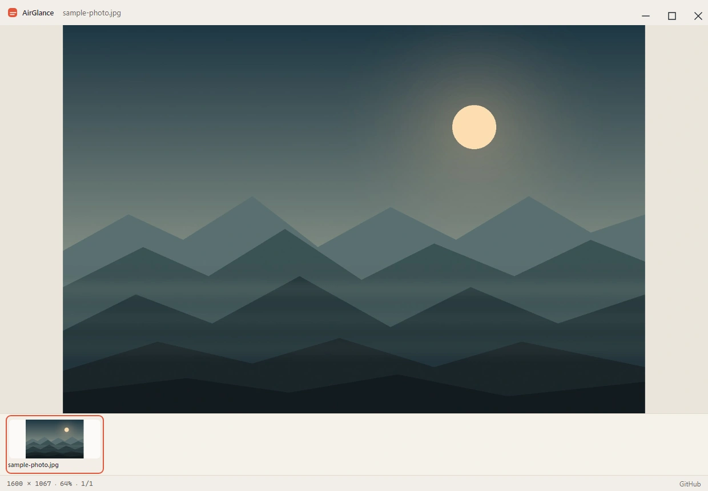

Main problems:

1. **The image is not the protagonist.** The title bar, filmstrip, and status bar always take up space; even with a single image, the filmstrip still occupies 108 px.
2. **Primary actions are invisible.** Zoom, rotate, info, slideshow, fullscreen, and settings are all hidden in the context menu or behind F1, so new users can only guess.
3. **The info panel squeezes the image.** The current Info panel participates in layout, so opening it narrows the canvas instead of overlaying the image.
4. **Arrow keys have conflicting semantics.** When the image is wider than the window, `←/→` become panning; otherwise they go to the previous/next image. One key doing two things does not match what users expect of an image viewer.
5. **Browsing is inefficient.** There are no left/right navigation buttons, and the wheel can only zoom; the filmstrip has no clear selected/collapsed state.
6. **The status bar's information hierarchy is wrong.** Dimensions, zoom, and position are all tiny, while the GitHub link sits in one of the most prominent positions.

## 2. Design Direction

**The image fills the canvas, controls float above the image, and retire when idle.**

- The canvas is no longer carved up by fixed chrome; the title, file information, and toolbar are all overlays.
- The filmstrip is collapsed by default; when expanded it overlays the bottom of the image without changing the image's size.
- The info panel becomes a right-side overlay, and the image size stays the same.
- Primary actions go into a floating dock at the bottom; the context menu keeps only secondary actions.
- "Browse mode" pages with the large left/right buttons and the arrow keys; the wheel zooms around the pointer and dragging pans.
- Icons + tooltips, with keyboard shortcuts retained; no interaction requires learning the context menu first.

## 3. Mockups

### 3.1 Default / hover: image + floating controls

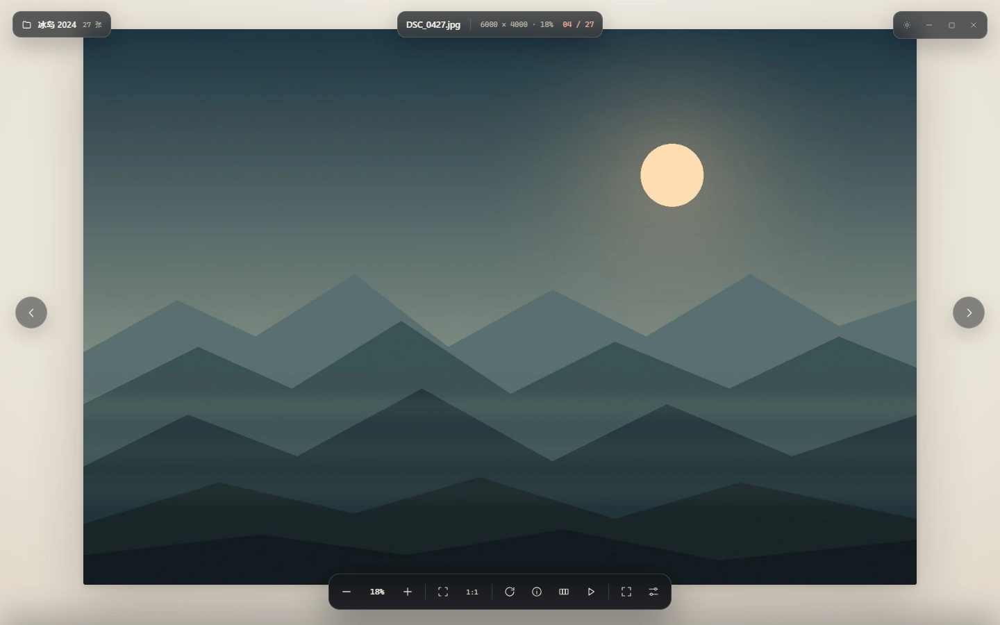

- Top left: current folder + count; center: file name, dimensions/zoom, `04 / 27`; right: light/dark toggle and window buttons.
- Bottom center: zoom −/percentage/+, fit to window, 1:1, rotate, info, filmstrip, slideshow, fullscreen, settings.
- Left and right edges: previous/next image, darkened on hover.
- The image fills the window, leaving only 42–58 px of breathing room around it.
- Controls are "visible on hover" by default; after 2.5 s of inactivity they fade out, and they reappear when the mouse moves to the top/bottom edge.

### 3.2 Filmstrip expanded

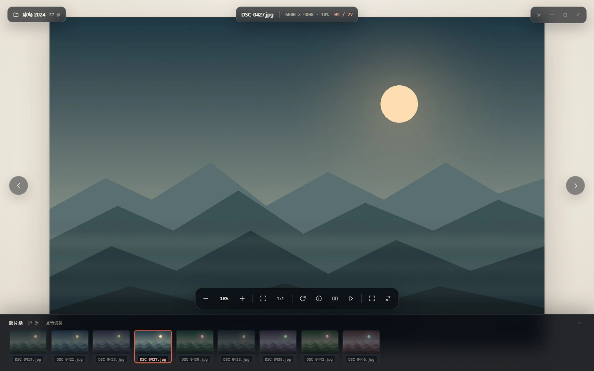

- The filmstrip slides out from the bottom, 138 px high, on a semi-transparent dark background, covering the image rather than squeezing it.
- Thumbnails are 92 × 56; the selected item gets a coral outline; hovering lifts it by 2 px.
- The dock automatically moves up above the filmstrip and stays within thumb reach.
- Toggle with `C` or the filmstrip icon in the dock; `Esc` dismisses the overlays first and does not close the window.

### 3.3 Info panel

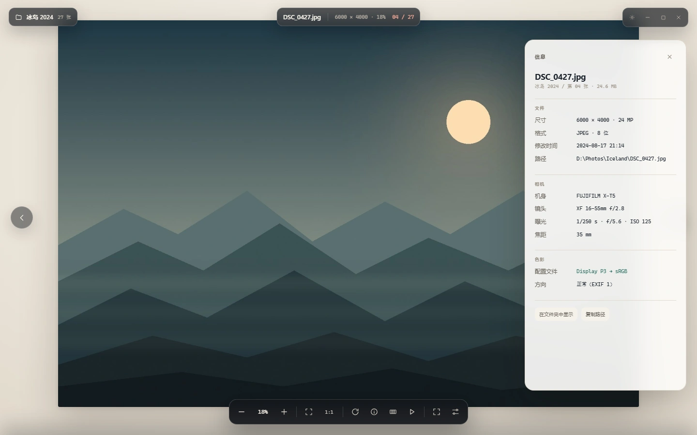

- A 334 px overlay on the right; toggle with `I`, close by clicking or with `I`.
- Three sections: file, camera, color; values use a monospace font, and long paths can wrap.
- The image size does not change, and the image beneath the panel can still be viewed.
- At the bottom, two secondary actions: "Show in Folder" (在文件夹中显示) and "Copy Path" (复制路径).

### 3.4 Empty state


- The empty state keeps only the brand, the window buttons, and one clear entry card.
- Primary button "Open Folder" (打开文件夹), secondary button "Open Image" (打开图片); drag-and-drop and keyboard shortcut hints at the bottom.
- Users no longer have to hunt for a way to open something in the context menu or behind F1.

### 3.5 Fullscreen

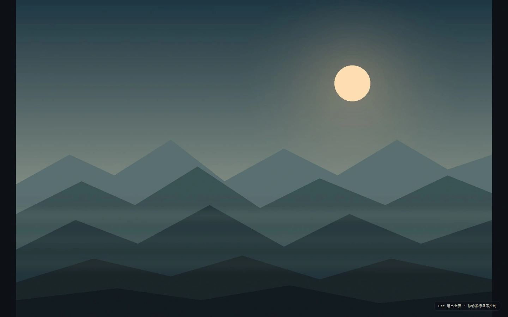

- The canvas turns pure black and the image fills it; apart from the `Esc` hint in the bottom-right corner, there is no persistent chrome.
- The dock rises from the bottom again when the mouse moves; after 2.5 s of inactivity it is gone entirely.

### 3.6 Dark theme

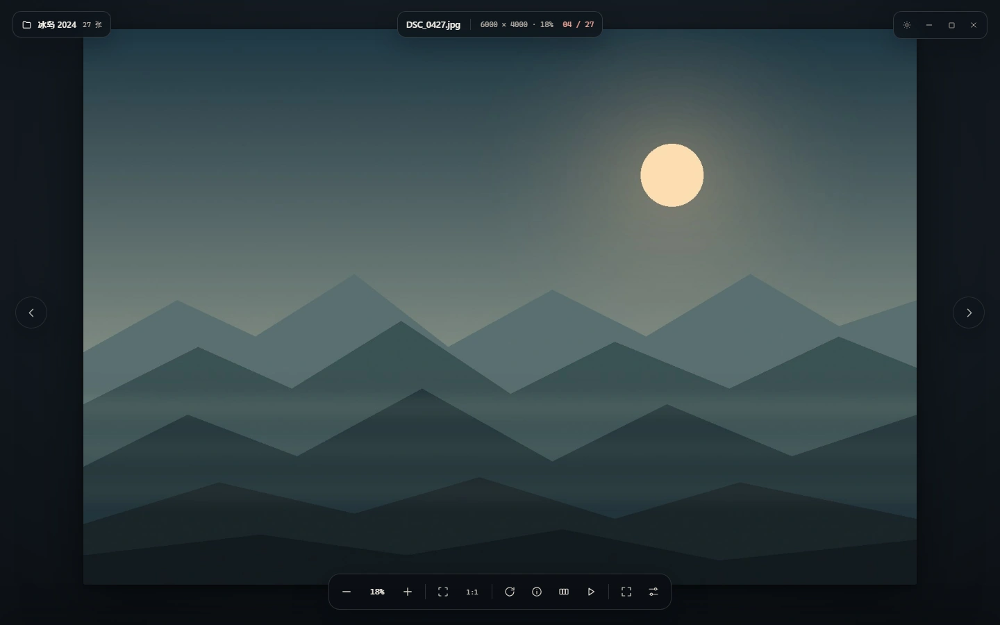

- Reuse the existing warm + coral brand colors; only the canvas and surfaces switch to dark.
- Overlays use dark semi-transparent surfaces, avoiding an abruptly light dock on a black background.

### 3.7 Idle state

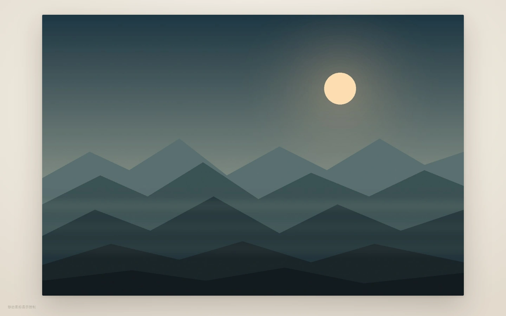

- Once the mouse stops moving, only the image remains; a very faint hint in the bottom-left says that moving the mouse restores the controls.
- This is "viewing mode", not another page.

> Interaction prototype: `docs/design/interaction-v2.html`. Open it in a browser to click the dock buttons, toggle the filmstrip/info, and press `I`, `C`, `F`, and `Esc`. The query parameters `?state=browse`, `?state=info`, `?state=empty`, `?state=fullscreen`, and `?theme=dark` open the corresponding states directly.

## 4. Interaction Design

### 4.1 Mouse / trackpad

| Operation | Suggested behavior |
| --- | --- |
| Wheel | Zoom centered on the pointer (current implementation) |
| `Shift + wheel` | Pan sideways |
| Drag | Pan when the image is larger than the viewport |
| Double-click the image | Toggle between fit-to-window and 100% |
| Click the empty edge of the canvas | Show / hide the overlays |
| Click the left/right edge buttons | Previous / next image |
| Click a filmstrip thumbnail | Switch to that image; the filmstrip stays expanded |
| Click the info button / press `I` | Open/close the info overlay |
| Right-click | Secondary actions such as open, show in folder, open with another app, and settings |

Wheel zoom is the current default: when inspecting an image, the direct action is to magnify the detail under the pointer rather than skip several images in one gesture. Paging stays on the arrow keys, `PgUp` / `PgDn`, `Space` / `Backspace` and the edge buttons. `Ctrl/Cmd + wheel` still zooms, so the muscle memory keeps working.

### 4.2 Keyboard

| Key | Behavior |
| --- | --- |
| `←` `→` | Always previous / next image; no longer does double duty for panning |
| `PgUp` `PgDn` | Always previous / next image |
| `Space` / `Backspace` | Next / previous image |
| `+` `-` | Zoom in / out centered on the pointer |
| `0` `1` `2` | Fit to window / 100% / fit to width |
| `R` / `Shift+R` | Rotate clockwise / counterclockwise |
| `H` / `V` | Flip horizontally / vertically |
| `I` | Info overlay |
| `C` | Filmstrip |
| `S` | Slideshow |
| `F` / `F11` | Fullscreen |
| `Ctrl+O` / `Ctrl+Shift+O` | Open image / folder |
| `Ctrl+Shift+S` | Save a copy |
| `Ctrl+Shift+L` | Switch between Chinese and English |
| `Esc` | Close info/filmstrip; exit fullscreen when fullscreen; does not close the window directly |
| `?` / `F1` | Keyboard shortcut help |

Changing the arrow keys to "always page" is the interaction most worth changing this round. Panning is left to dragging, two-finger trackpad gestures, and `Shift + wheel`; one arrow key no longer carries two semantics at once.

### 4.3 Auto-hide

- First time an image is entered: the top and bottom controls are shown for 4 seconds.
- Mouse movement: show; after 2.5 s of no movement: fade out.
- Moving the mouse into the top 56 px or bottom 72 px: show only the corresponding area; the whole screen does not need to light up.
- While the info panel and filmstrip are open, they are not closed automatically on idle; only the dock/top fades out.
- Provide "Always show controls" and "Reduce motion" in settings.

## 5. Specifications

### 5.1 Layout

| Element | Specification |
| --- | --- |
| Canvas insets | Top 42 / sides 56 / bottom 58 px |
| Top chip | 38 px high, corner radius 12, gap 12 |
| Bottom dock | 52 px high, corner radius 16, 22 px from the bottom |
| Dock button | 38 × 40, corner radius 10, 18 px icon |
| Filmstrip | 138 px high, thumbnails 92 × 56 |
| Info overlay | 334 px wide, right 22 / top 82 / bottom 92 |
| Empty-state card | 570 px wide, padding 38–44 |

### 5.2 Colors

Reuse the existing design tokens:

- Paper `#F1EEE7`, canvas `#EAE5DC`, ink `#1D232C`
- Coral `#E3563B`, teal `#2E6F63`
- Overlay dark `rgba(13,18,24,.66)`, strong surface `rgba(10,14,19,.88)`
- Dark canvas `#0D1116`, dark surface `#1C222A`

**On frosted glass**: the prototype uses `backdrop-filter` to express the glass texture, but AirGlance uses software composition by default on Windows. During implementation, start by simulating it with a high-opacity solid color + a 1 px border, to avoid the startup/scroll cost of per-frame blur; enable real blur only after the GPU path and the performance budget are confirmed.

### 5.3 Motion

- Top/bottom overlays: 180–220 ms fade + 4 px shift.
- Filmstrip: 240 ms slide-in from the bottom.
- Info overlay: 240 ms slide-in from the right.
- Hover: 120–160 ms.
- Respect the system "Reduce motion"; when motion is off, keep only the opacity transition.

### 5.4 Accessibility

- Every icon button has an `AutomationProperties.Name` and a tooltip, so users do not have to guess from the icon.
- Hit targets at least 38 × 38; 44 × 44 for the dock's primary buttons is better.
- Focus ring 2 px coral, offset 2 px; the dock, filmstrip, and info close button are all keyboard-reachable.
- In high-contrast mode, disable semi-transparent backgrounds and use solid strokes and solid buttons.
- State information never relies on color alone; a selected thumbnail changes both its border and its text color.

## 6. Trade-offs and Open Questions

It is suggested to settle these four things first, then move on to implementation:

| Decision | Recommendation | Alternative |
| --- | --- | --- |
| Wheel default | **Zoom; page with the arrow keys/buttons** (implemented) | Page; Ctrl+wheel zooms |
| Control dismissal | **Auto-fade after 2.5 s, recalled at the edges** | Always visible, but with lower opacity |
| Filmstrip | **Collapsed by default, expands as an overlay** | Persistently at the bottom, but shrunk to 72 px |
| Info panel | **Right-side overlay that does not squeeze the image** | The current docked sidebar |

Two other small points need confirmation:

- Window buttons: keep the custom top-right on Windows; keep using the system title bar on macOS/Linux to avoid duplication.
- GitHub link: move it from the status bar to Settings/About; the status bar keeps only image metadata.

## 7. Implementation Breakdown (after review approval)

1. **Shell**: take the title bar, filmstrip, and status bar out of the layout and turn them into overlays on the canvas; build the dock and top chip in code and mount them after the first frame.
2. **Navigation**: add left/right buttons and zoom at the pointer; change the arrow keys to always page.
3. **Panels**: change Info into a right-side overlay; change the filmstrip into a bottom drawer; unify the behavior of `C`/`I`/`Esc`.
4. **Empty state and settings**: empty-state card, dock settings popover, About/GitHub migration.
5. **Accessibility and tests**: focusable buttons, tooltips, shortcut table, expanded window keyboard tests; confirm that overlays do not break 100 MP tiled rendering or the first-frame budget.

This is expected to be 2–3 UI iterations and does not touch the decoder. The first step changes only overlays and navigation, which is the lowest risk; the info panel and empty state come after confirmation.

## 8. Current Implementation Status

0.1.3 shipped the recommended combination. This round aligned the overlay geometry and the icon system with section 5, item by item:

- Full-window image canvas, with the top folder/file chip and the bottom dock floating above the image.
- 2.5 s auto-fade; mouse movement or a PostMessage pointer move brings the controls back.
- Wheel zooms around the pointer; the arrow keys always page.
- The filmstrip is a bottom overlay drawer, collapsed by default; the info panel is a right-side overlay drawer.
- The info panel and filmstrip are mutually exclusive: opening one collapses the other, so they do not cover each other in a small window.
- Empty-state card, left/right navigation buttons, chrome-free fullscreen, `Esc` closes overlays/exits fullscreen.
- The selected thumbnail uses an explicit `IsCurrent` state instead of relying on the selected border of the ListBox template.

This round:

- Icons now live on one 24 × 24 design grid. `IconPath` scales the grid to the requested box and centres it, which fixes the old drift to the bottom-right and the clipping at small sizes.
- Top chips: 18 px side margin, 16 px top offset, 38 px tall, 12 px radius, 12 px padding; 9 px and 14 px inner gaps; the file chip is centred on the window, not on the middle grid column.
- Window controls are four buttons again (theme, minimise, maximise, close), 30 × 30 with a 2 px gap; the top-right theme toggle is new.
- Dock: 52 px tall, 16 px radius, 6 px padding, 1 px gap; 38 × 40 buttons, 10 px radius, 18 px icons.
- Navigation buttons: 46 px circles, 22 px margins, 72% opacity at rest, 100% on hover.
- The filmstrip gained its heading row ("Filmstrip / N images · click to switch" plus a collapse button), 92 × 56 thumbnails with an inset filename, and 22/10/22/14 padding.
- Fullscreen regained the bottom-right `Esc` hint; overlays gained their shadows, and the canvas gained the 42/56/58 breathing space and the radial backdrop.
- The empty card is 570 px with 38/44/30 padding and a 26 px radius; both actions carry 15 px icons.
- Below 900 px the folder chip hides and the file chip narrows, so the top row never overlaps.
- Wheel zooms around the pointer; paging stays on the arrow keys, `PgUp` / `PgDn`, Space and the edge buttons.
- Settings, Save a copy, Shortcuts and message dialogs now use the shell's borderless header; primary and secondary button labels are vertically centred.

Known differences from the mockups:

- Settings is still a separate dialog (now with the same borderless header as the shell); there is no in-dock popover.
- Overlays use a semi-transparent solid colour, with no real `backdrop-filter` blur (for software-composition performance reasons).
- The filmstrip currently has no slide-in animation; a 200–240 ms shift transition can be added later.
- The info panel has no large filename heading and no "Show in folder / Copy path" footer yet; both actions still live in the context menu.

Implementation screenshots (1240 × 860; fullscreen 1240 × 698):

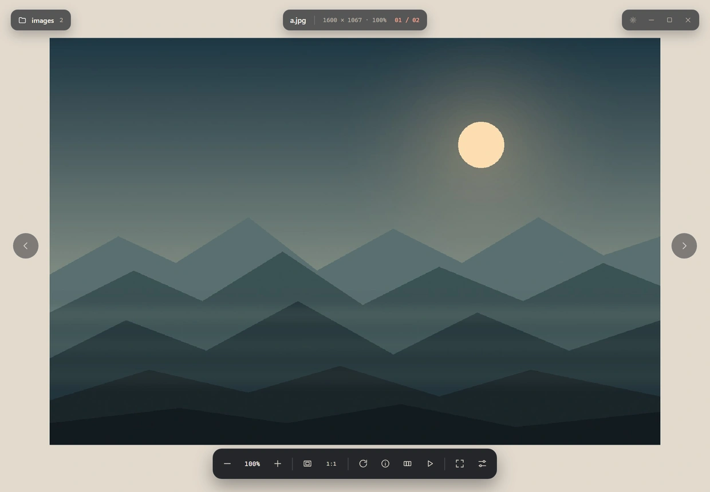

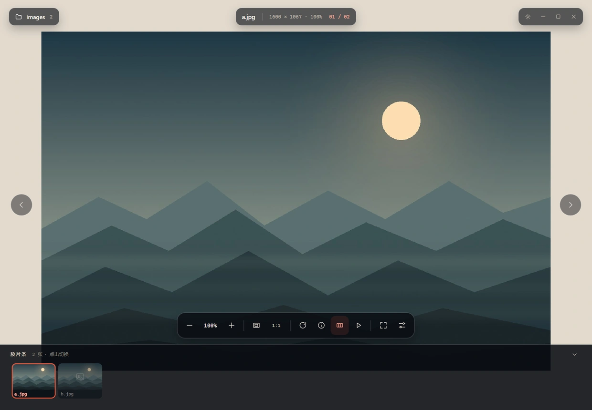

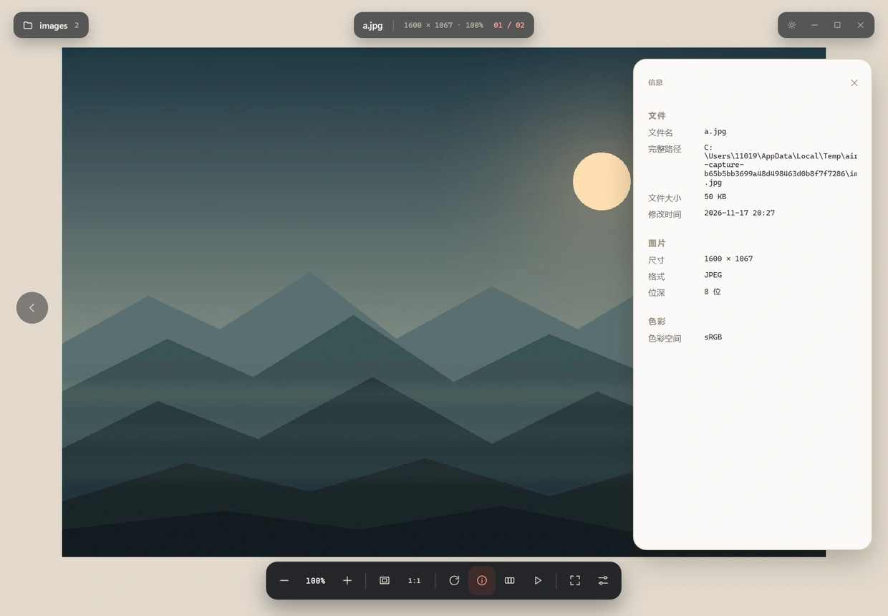


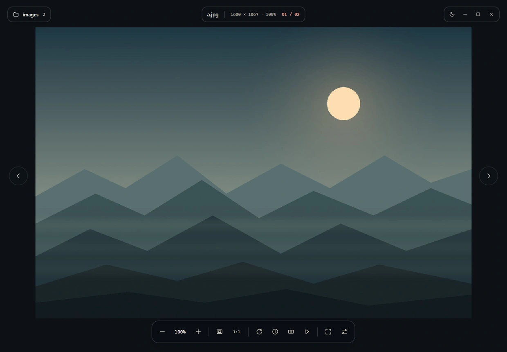

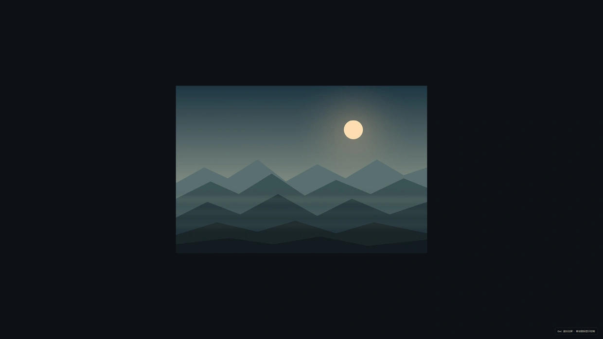

