# AirGlance 交互视觉稿 v2

[English](interaction-v2.en.md) · **简体中文**

> 这是评审稿；推荐组合已在 0.1.3 实现，当前实现状态和差异见第 8 节。

## 1. 现状问题

当前窗口（1240 × 860）的垂直空间分配：

```text
44 px   自定义标题栏
108 px  常驻胶片条
28 px   状态栏
----------------
180 px  固定 chrome，约占窗口高度的 21%
```

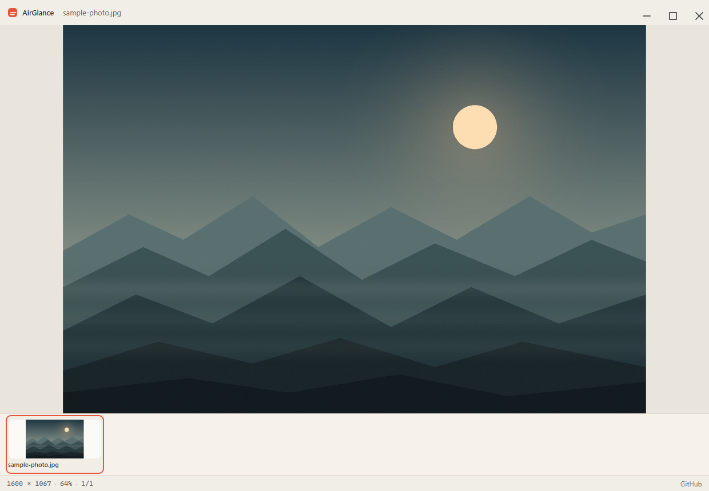

主要问题：

1. **图片不是主角。** 标题栏、胶片条和状态栏始终占位；只有一张图时，胶片条仍然占 108 px。
2. **主要操作不可见。** 缩放、旋转、信息、幻灯片、全屏、设置都藏在右键菜单或 F1 里，新用户只能猜。
3. **信息面板挤压图片。** 当前 Info 面板参与布局，打开后画布变窄，而不是覆盖在图片上。
4. **方向键语义冲突。** 图片比窗口宽时 `←/→` 变成平移，其他时候是上一张/下一张；同一个键做两件事，不符合看图工具预期。
5. **浏览效率低。** 没有左右导航按钮，滚轮只能缩放；胶片条没有明确的选中/收起状态。
6. **状态栏信息层级不对。** 尺寸、缩放、位置都很小，GitHub 链接却放在最显眼的位置之一。

## 2. 设计方向

**图片铺满画布，控件浮在图片上，空闲时退场。**

- 画布不再被固定 chrome 切割；标题、文件信息、工具栏都是浮层。
- 胶片条默认收起，展开时覆盖在图片底部，不改变图片尺寸。
- 信息面板改为右侧浮层，图片尺寸不变。
- 主操作放进底部浮动 dock；右键菜单只保留次要操作。
- 进入“浏览模式”时，左右大按钮和方向键翻页；滚轮以指针为中心缩放，拖动平移。
- 图标 + tooltip，保留键盘快捷键；所有交互都不要求先学右键菜单。

## 3. 视觉稿

### 3.1 默认 / hover：图片 + 浮动控制

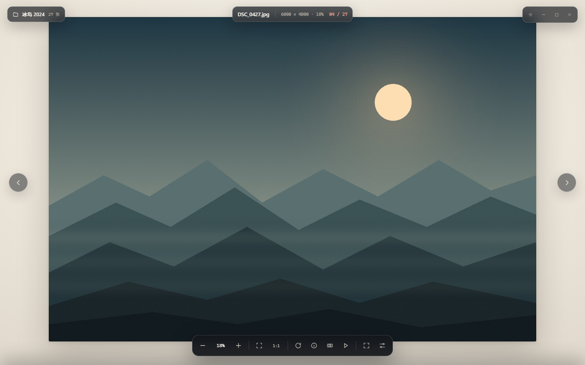

- 顶部左侧：当前文件夹 + 数量；中间：文件名、尺寸/缩放、`04 / 27`；右侧：明暗切换和窗口按钮。
- 底部中央：缩放 −/百分比/+、适应窗口、1:1、旋转、信息、胶片条、幻灯片、全屏、设置。
- 左右边缘：上一张/下一张，hover 时加深。
- 图片占满窗口，四周只留 42–58 px 呼吸空间。
- 控件默认是“hover 可见”；空闲 2.5 秒后淡出，鼠标移动到顶部/底部边缘重新出现。

### 3.2 胶片条展开

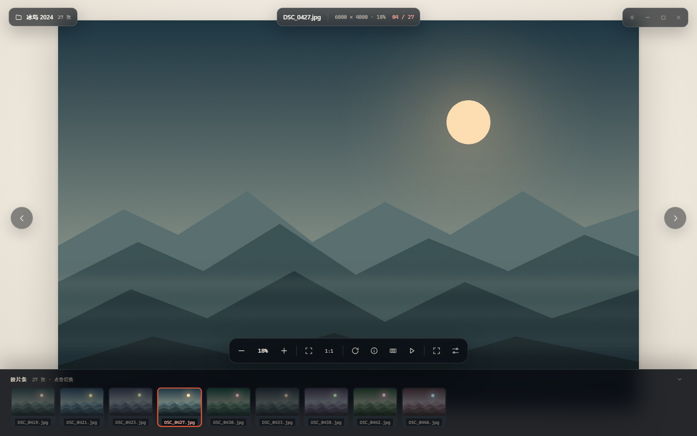

- 胶片条从底部滑出，高 138 px，半透明深色底，覆盖图片而不是挤压图片。
- 缩略图 92 × 56，选中项用 coral 描边；hover 上浮 2 px。
- dock 自动上移到胶片条上方，仍在拇指可及的位置。
- `C` 或 dock 的胶片图标切换；`Esc` 先收起浮层，不关闭窗口。

### 3.3 信息面板

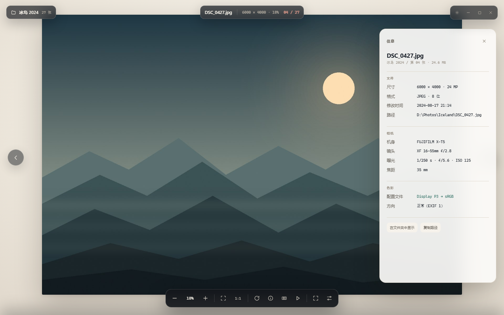

- 右侧浮层 334 px；`I` 切换，点击关闭或 `I` 关闭。
- 文件、相机、色彩三段；值使用等宽字体，长路径可换行。
- 图片尺寸不变，面板下面是可继续查看的图片。
- 底部提供“在文件夹中显示”和“复制路径”两个次要动作。

### 3.4 空状态

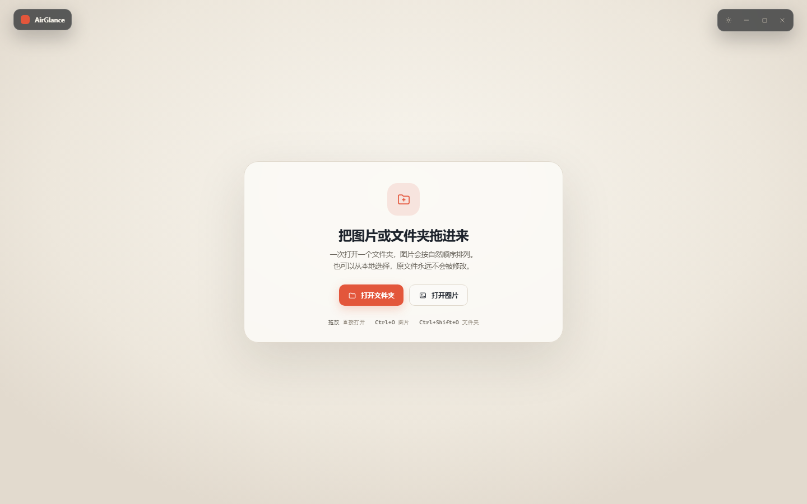

- 空状态只保留品牌、窗口按钮和一张明确的入口卡片。
- 主按钮“打开文件夹”，次按钮“打开图片”，底部给出拖放和快捷键提示。
- 不再让用户从右键菜单或 F1 里寻找打开方式。

### 3.5 全屏

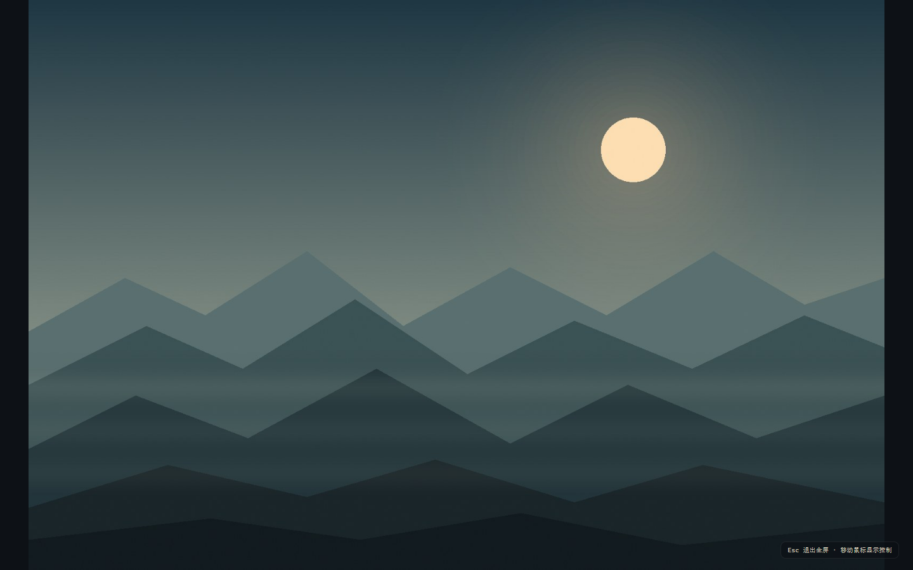

- 画布变为纯黑，图片铺满；除了右下角的 `Esc` 提示，没有常驻 chrome。
- 鼠标移动时再从底部浮现 dock；离开 2.5 秒后完全退场。

### 3.6 暗色主题

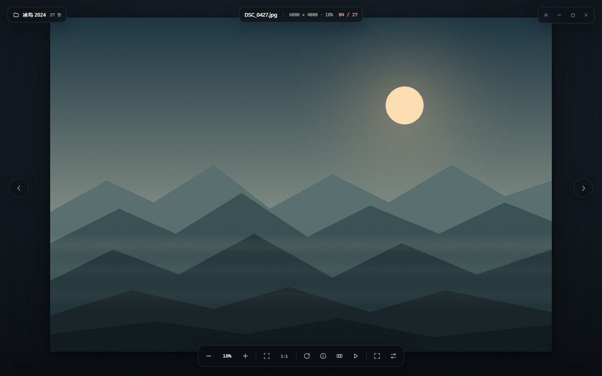

- 沿用现有暖色 + coral 的品牌色，只把画布和表面切到深色。
- 浮层使用深色半透明表面，避免在黑底上出现一块突兀的浅色 dock。

### 3.7 空闲状态

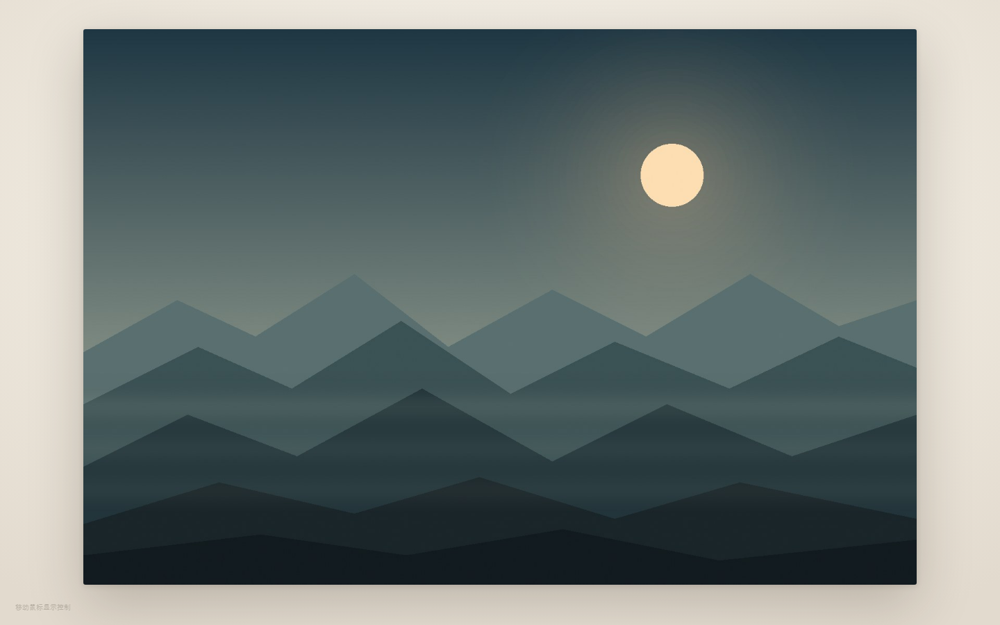

- 鼠标停止移动后只留下图片；左下角有非常淡的提示，移动鼠标即可恢复控制。
- 这是“看图模式”，不是另一个页面。

> 交互原型：`docs/design/interaction-v2.html`。浏览器打开后，可以点击 dock 按钮、切换胶片条/信息、按 `I` `C` `F` 和 `Esc`。查询参数 `?state=browse`、`?state=info`、`?state=empty`、`?state=fullscreen`、`?theme=dark` 可直接打开对应状态。

## 4. 交互方案

### 4.1 鼠标 / 触控板

| 操作 | 建议行为 |
| --- | --- |
| 滚轮 | 以指针为中心缩放（当前实现） |
| `Shift + 滚轮` | 横向平移 |
| 拖动 | 图片大于视口时平移 |
| 双击图片 | 在适应窗口和 100% 之间切换 |
| 点击画布空白边缘 | 显示 / 隐藏浮层 |
| 点击左右边缘按钮 | 上一张 / 下一张 |
| 点击胶片缩略图 | 切换到该图片，胶片条保持展开 |
| 点击信息按钮 / 按 `I` | 打开/关闭信息浮层 |
| 右键 | 打开、在文件夹中显示、用其他应用打开、设置等次要操作 |

滚轮缩放是当前实现的默认：查看图片时最直接的动作是在指针位置放大细节，而不是一次滚轮跳过好几张。翻页交给方向键、`PgUp` / `PgDn`、`Space` / `Backspace` 和左右边缘按钮。`Ctrl/Cmd + 滚轮` 仍然是缩放，保持习惯一致。

### 4.2 键盘

| 按键 | 行为 |
| --- | --- |
| `←` `→` | 始终上一张 / 下一张，不再兼做平移 |
| `PgUp` `PgDn` | 始终上一张 / 下一张 |
| `Space` / `Backspace` | 下一张 / 上一张 |
| `+` `-` | 以指针为中心放大 / 缩小 |
| `0` `1` `2` | 适应窗口 / 100% / 适应宽度 |
| `R` / `Shift+R` | 顺时针 / 逆时针旋转 |
| `H` / `V` | 水平 / 垂直翻转 |
| `I` | 信息浮层 |
| `C` | 胶片条 |
| `S` | 幻灯片 |
| `F` / `F11` | 全屏 |
| `Ctrl+O` / `Ctrl+Shift+O` | 打开图片 / 文件夹 |
| `Ctrl+Shift+S` | 另存副本 |
| `Ctrl+Shift+L` | 中英文切换 |
| `Esc` | 关闭信息/胶片条；全屏时退出全屏；不直接关闭窗口 |
| `?` / `F1` | 快捷键帮助 |

方向键改为“始终翻页”是本次最值得改的交互。平移交给拖动、触控板双指和 `Shift + 滚轮`；不再用同一个方向键同时承担两种语义。

### 4.3 自动退场

- 首次进入图片：顶部和底部控件显示 4 秒。
- 鼠标移动：显示；停止 2.5 秒：淡出。
- 鼠标移动到顶部 56 px 或底部 72 px：只显示对应区域，不必整屏亮起。
- 信息面板和胶片条打开时，不因空闲而自动关闭；只淡出 dock/顶部。
- 设置里提供“控件常显”和“减少动态效果”。

## 5. 规格

### 5.1 布局

| 元素 | 规格 |
| --- | --- |
| 画布留白 | 上 42 / 左右 56 / 下 58 px |
| 顶部 chip | 高 38 px，圆角 12，间距 12 |
| 底部 dock | 高 52 px，圆角 16，底部 22 px |
| dock 按钮 | 38 × 40，圆角 10，图标 18 px |
| 胶片条 | 高 138 px，缩略图 92 × 56 |
| 信息浮层 | 宽 334 px，右 22 / 上 82 / 下 92 |
| 空状态卡片 | 宽 570 px，内边距 38–44 |

### 5.2 颜色

沿用现有设计 token：

- 纸色 `#F1EEE7`，画布 `#EAE5DC`，墨色 `#1D232C`
- coral `#E3563B`，teal `#2E6F63`
- 浮层深色 `rgba(13,18,24,.66)`，强底 `rgba(10,14,19,.88)`
- 暗色画布 `#0D1116`，暗色表面 `#1C222A`

**关于毛玻璃**：原型用 `backdrop-filter` 表达玻璃质感，但 AirGlance 在 Windows 上默认走软件合成。实现时建议先用高不透明度纯色 + 1 px 边框模拟，避免每帧模糊带来启动/滚动开销；只有确认 GPU 路径和性能预算后才启用真实 blur。

### 5.3 动效

- 顶部/底部浮层：180–220 ms 淡入淡出 + 4 px 位移。
- 胶片条：240 ms 从底部滑入。
- 信息浮层：240 ms 从右侧滑入。
- hover：120–160 ms。
- 遵循系统“减少动态效果”；关闭动效时只保留透明度切换。

### 5.4 可访问性

- 所有图标按钮有 `AutomationProperties.Name` 和 tooltip，不依赖图标猜测。
- 点击目标至少 38 × 38，dock 主按钮 44 × 44 更佳。
- 焦点环 2 px coral，offset 2 px；键盘可到达 dock、胶片条、信息关闭按钮。
- 高对比度模式禁用半透明底，使用实色描边和实色按钮。
- 状态信息不只靠颜色区分；选中缩略图同时有边框和文字颜色变化。

## 6. 取舍与待确认

建议先定这四件事，再进入实现：

| 决策 | 推荐 | 备选 |
| --- | --- | --- |
| 滚轮默认 | **缩放；翻页靠方向键/按钮**（已按此实现） | 翻页；Ctrl+滚轮缩放 |
| 控件退场 | **2.5 秒自动淡出，边缘唤回** | 常显，但降低不透明度 |
| 胶片条 | **默认收起，覆盖展开** | 常驻底部，但缩到 72 px |
| 信息面板 | **右侧浮层，不挤压图片** | 当前 docked 侧栏 |

另外两个需要确认的小点：

- 窗口按钮：Windows 保留自定义右上角；macOS/Linux 继续用系统标题栏，避免重复。
- GitHub 链接：从状态栏移到设置/关于，状态栏只保留图片元数据。

## 7. 实现拆分（评审通过后）

1. **Shell**：把标题栏、胶片条、状态栏从布局中移出，改为画布上的 overlay；dock 和顶部 chip 用代码构建，首帧后再挂载。
2. **导航**：增加左右按钮和滚轮缩放；方向键改为始终翻页。
3. **面板**：Info 改为右侧浮层；胶片条改为底部抽屉；`C`/`I`/`Esc` 行为统一。
4. **空状态与设置**：空状态卡片、dock 设置 popover、About/GitHub 迁移。
5. **可访问性与测试**：按钮可聚焦、tooltip、快捷键表、窗口键盘测试扩展；确认 overlay 不破坏 100 MP 分块渲染和首帧预算。

预计这是 2–3 个 UI 迭代，不涉及解码器。第一步只改 overlay 和导航，风险最低；确认后再改信息面板和空状态。

## 8. 当前实现状态

0.1.3 已按推荐组合落地；本轮又按第 5 节的规格把浮层几何和图标系统逐项对齐了一遍：

- 图片全窗口画布，顶部文件夹/文件 chip 和底部 dock 浮在图片上。
- 2.5 秒自动淡出；鼠标移动或 PostMessage 的 pointer move 会重新显示。
- 滚轮以指针为中心缩放；方向键始终翻页。
- 胶片条改为底部覆盖抽屉，默认收起；信息面板改为右侧覆盖抽屉。
- 信息面板和胶片条互斥，打开一个会收起另一个，避免小窗口下互相遮挡。
- 空状态卡片、左右导航按钮、全屏无 chrome、`Esc` 关闭浮层/退出全屏。
- 选中缩略图使用 `IsCurrent` 显式状态，不依赖 ListBox 模板的选中边框。

本轮对齐：

- 图标统一改为 24 × 24 设计网格，由 `IconPath` 等比缩放并居中，修复旧实现里图标偏右下、小尺寸被裁切的问题。
- 顶部 chip：左右 18 px、顶距 16 px、高 38 px、圆角 12、内边距 12；文件夹/文件 chip 间距 9 / 14 px；文件 chip 相对窗口居中。
- 窗口按钮回到 4 个（明暗、最小化、最大化、关闭），30 × 30、2 px 间距；新增右上角明暗切换。
- dock：高 52 px、圆角 16、内边距 6、间隙 1；按钮 38 × 40、圆角 10、图标 18 px。
- 导航按钮 46 px 圆形、22 px 边距、静止 72% 不透明度、hover 100%。
- 胶片条补齐标题行（“胶片条 / N 张 · 点击切换” + 收起按钮）、92 × 56 缩略图与内嵌文件名，内边距 22/10/22/14。
- 全屏补回右下角 `Esc` 提示；浮层补齐阴影，画布补上 42/56/58 留白和径向渐变。
- 空状态卡片 570 px、38/44/30 内边距、26 px 圆角，主/次按钮带 15 px 图标。
- 窄窗口（< 900 px）隐藏文件夹 chip 并收窄文件 chip，避免顶部重叠。
- 滚轮改为以指针为中心缩放；翻页仍由方向键、`PgUp` / `PgDn`、空格和左右按钮承担。
- 设置、另存副本、快捷键和消息对话框改用与主窗口一致的无边框标题栏；主/次按钮文字改为垂直居中。

与视觉稿的已知差异：

- 设置仍是独立对话框（现已与主窗口一致，使用无边框自定义标题栏），没有做 dock 内的 popover。
- 浮层使用半透明纯色，没有真实 `backdrop-filter` 模糊（软件合成性能考虑）。
- 胶片条暂时没有滑入动画；后续可以加 200–240 ms 位移过渡。
- 信息面板暂无文件名大标题和底部“在文件夹中显示 / 复制路径”按钮，这两个动作仍在右键菜单里。

实现截图（1240 × 860；全屏为 1240 × 698）：

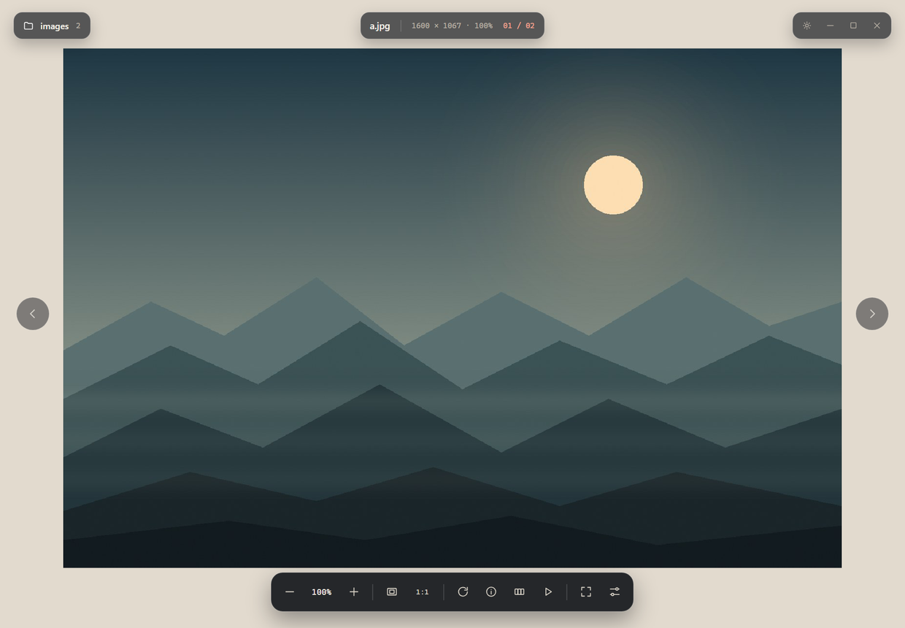

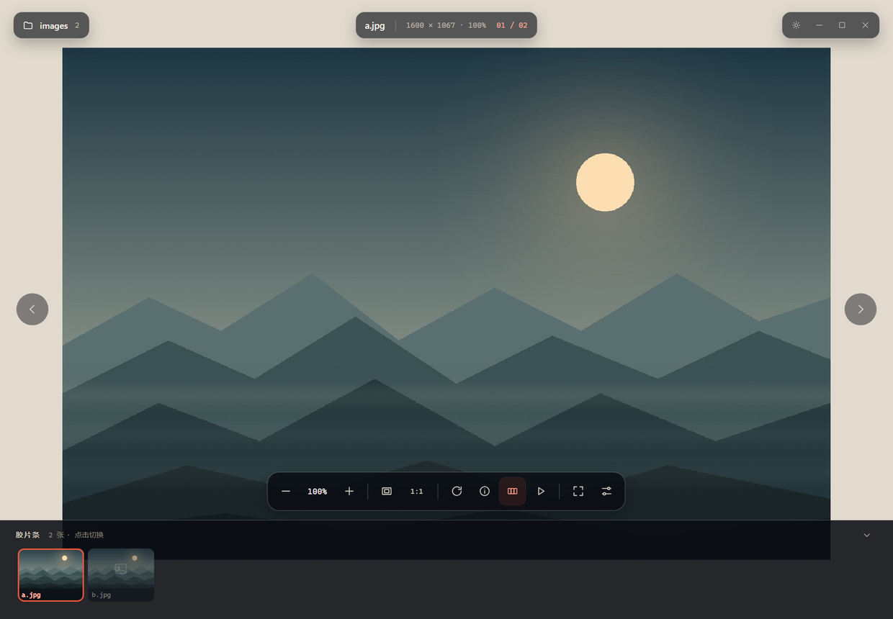

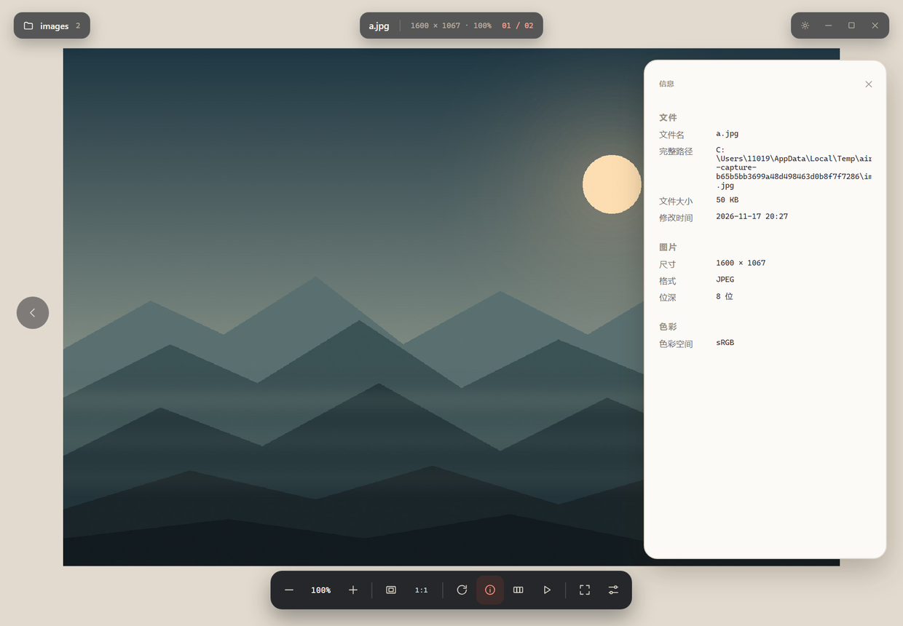

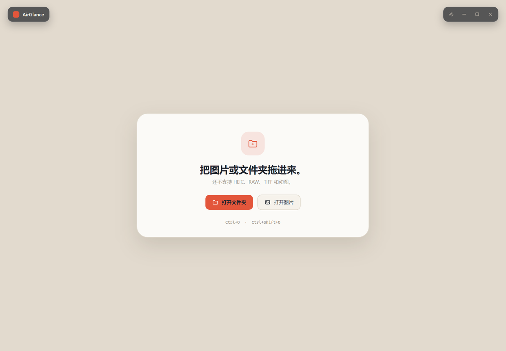

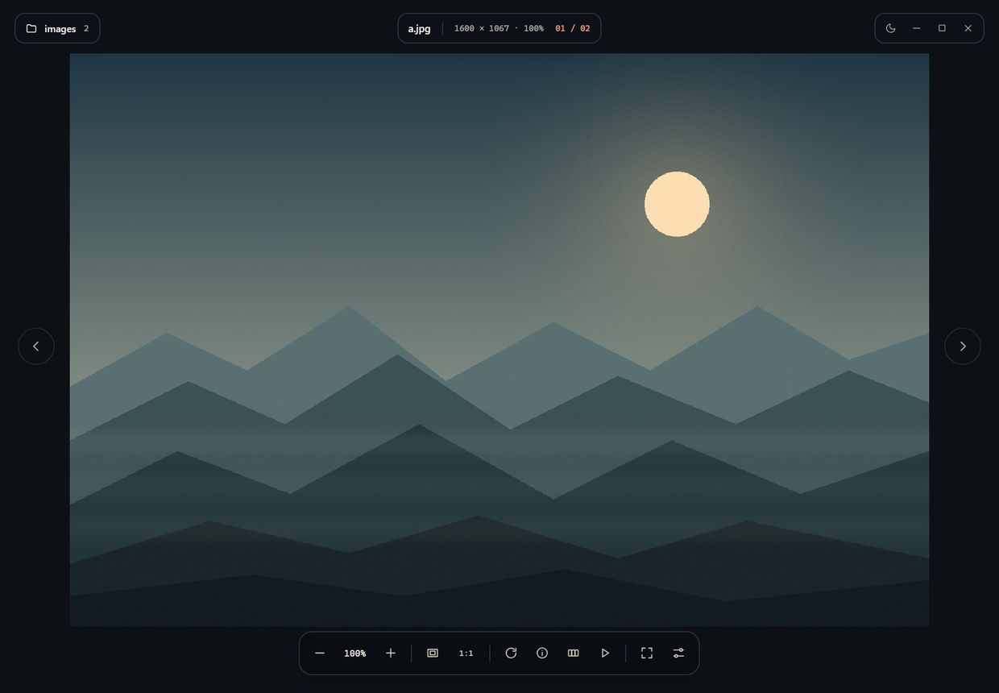

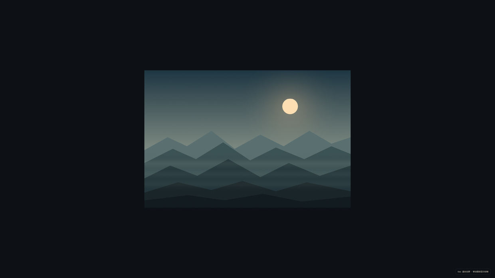

