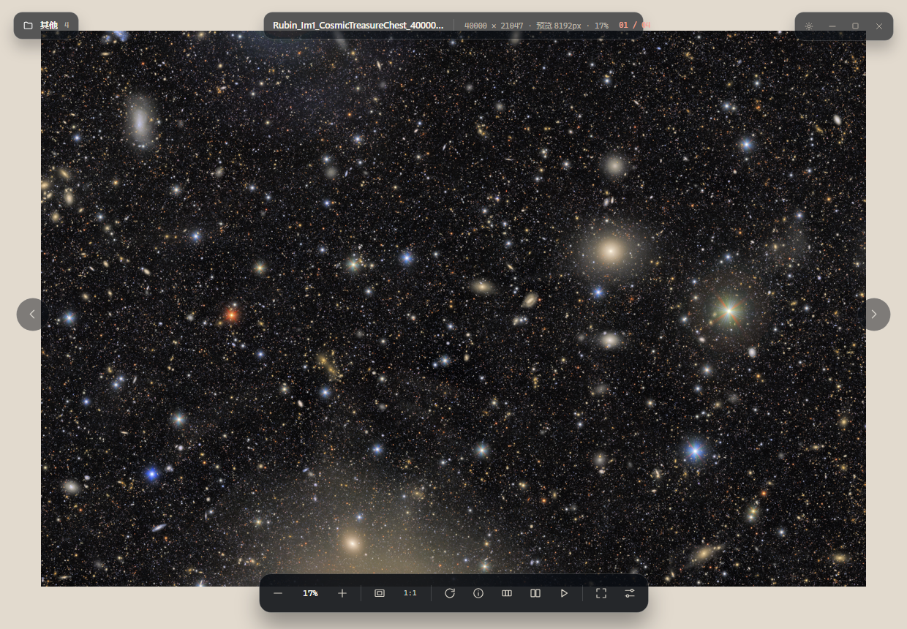
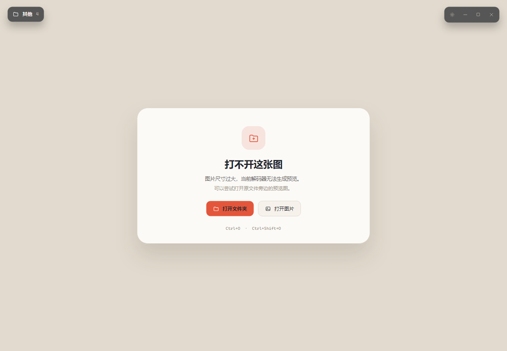

# 大 TIFF 方案 A：NetVips 预览分支

> 分支：`spike/netvips-large-tiff`  
> 状态：实验性本地验证，不合并 `main`，不推送远程。

## 目标

为超过 LibTiff.NET 全尺寸解码能力的大 TIFF 增加**屏幕级预览**路径，避免直接分配数 GB 的完整光栅。

普通 TIFF 仍走原有 LibTiff.NET 路径，不使用 NetVips。

## 实现

- 引入 `NetVips 3.2.0` 和 `NetVips.Native.win-x64 8.18.7`。
- 阈值：`250,000,000` 像素；打开失败的大 TIFF 也进入预览路径。
- 预览最大边：`8192 px`，实际目标不超过调用方请求的视口尺寸。
- 预览结果标记为 `DecodedBitmap.IsProxy`。
- 渐进式代理：
  - 初始按视口生成；
  - 放大超过当前代理分辨率时，后台按 2K → 4K → 8K 生成更大的代理；
  - 完成后保持当前缩放/位置替换图像；
  - 最大 8192 px；
  - 状态栏显示当前代理宽度，例如 `预览 8192px`。
- 大 TIFF 不执行全分辨率解码：
  - `DecodeFull` / `DecodeFullRaw` 返回明确错误；
  - 单画布缩放超过代理分辨率时不再触发全图解码；
  - 状态栏显示源尺寸 + “预览”。
- 预览失败返回 `TooLarge`，界面提示尝试原文件旁的 preview 图。

## 本地验证

### Cosmic Treasure Chest

```text
40000 × 21047
```

- 可以打开；
- 初始状态栏显示 `40000 × 21047 · 预览 1600px · 3%`；
- 放大到 17% 后自动升级到 `预览 8192px`，细节明显增加；
- 预览正常显示；
- AOT 包启动正常。



### Trifid & Lagoon

```text
40000 × 24524
单 strip LZW
```

- NetVips 能读取元数据；
- 但预览渲染仍失败；
- 应用不再崩溃，显示“图片尺寸过大，当前解码器无法生成预览”；
- 可打开同目录的 preview JPG。



## 包

- `artifacts/local-0.4.0-plan-a/AirGlance-0.4.0-plan-a-win-x64.zip`
- 约 **27.56 MB**（28,893,516 bytes；增加约 7.7 MB 压缩包体）
- SHA256：`93f378e7b6a5c6563d4a09617f67675913c77953a5734e203cc08a7e5b263622`
- 包含 `libvips-42.dll`

## 已知限制

- 仅集成了 Windows x64 原生包；macOS/Linux 需要各自 native 包。
- 预览不是原图 1:1；当前没有完整金字塔的 100% 区域浏览。
- Trifid 的单 strip LZW 仍需专用流式解码或转换。
- 本次没有把 AVIF/HEIC 加入文件格式列表；NetVips 原生包具备 AVIF 能力，需要单独验证和接入。
- ICC/EXIF 方向目前按大图常见情况处理，尚未覆盖所有方向/色彩配置组合。

## 验证结果

- Core 测试：93 passed
- App 测试：34 passed
- AOT：成功
- 普通 TIFF/JPEG/PNG 无回归
