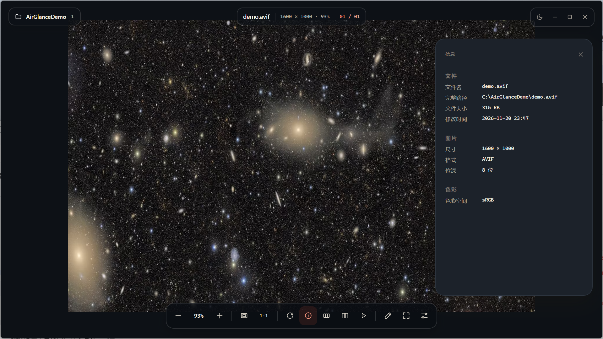
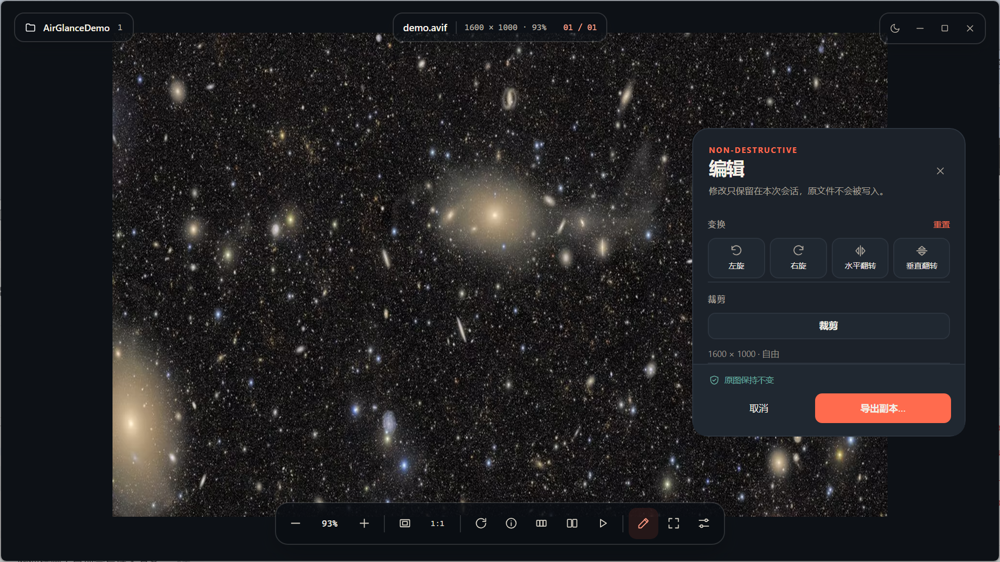
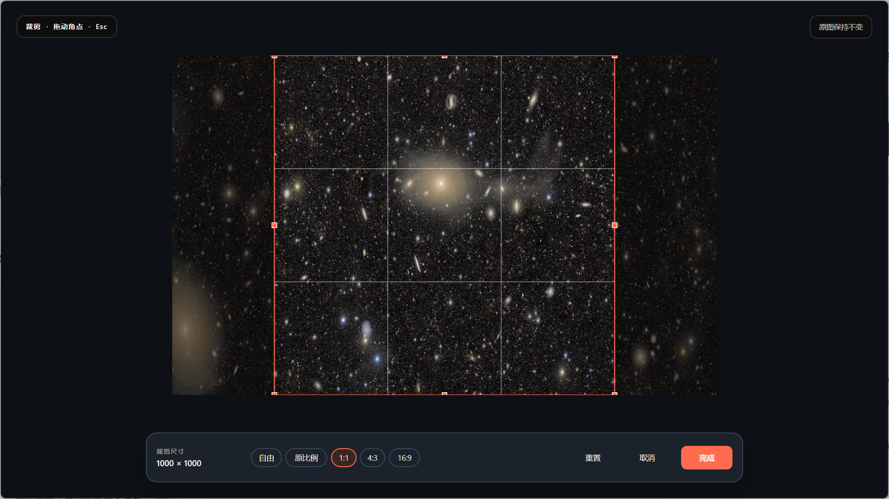
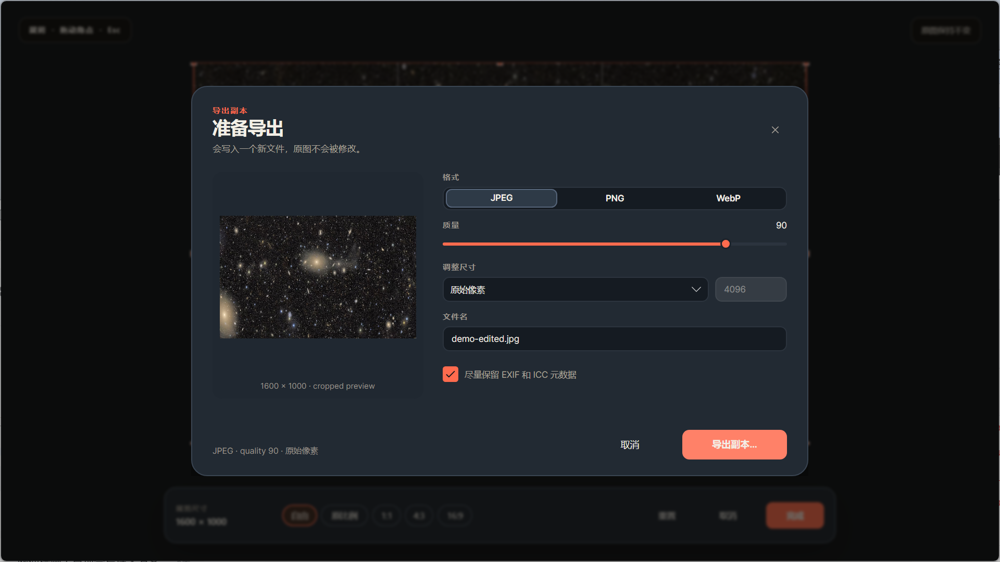

# AirGlance Microsoft Store 更新包说明：0.6.0

## 包信息

| 项目 | 值 |
| --- | --- |
| 应用版本 | `0.6.0` |
| Store 包版本 | `1.0.1.0`（上次 Store 包为 `1.0.0.0`，应用 0.4.1） |
| 架构 | `x64` |
| 文件 | `artifacts/msix-store/AirGlance_1.0.1.0_x64.msix` |
| 大小 | 21.41 MB |
| SHA-256 | `38FB9FDFFD09362130F2AD78A3752E53BC2CB34FF0578AB4D2ABE256FBF627EB` |
| 签名 | **未签名**；Microsoft Store 认证通过后由 Store 重新签名 |

包内已确认包含：

- `AirGlance.exe`（0.6.0 NativeAOT）
- `airglance_avif.dll`（libavif 1.4.2 + dav1d 1.5.5）
- `.avif` 文件关联
- 许可证和第三方声明
- `AppxManifest` 版本 `1.0.1.0`、架构 `x64`、Store publisher identity 未变

## 距离上次 Store 版本更新了什么

上次 Store 包：**`1.0.0.0`，对应应用 0.4.1**。  
本次 Store 包：**`1.0.1.0`，对应应用 0.6.0**。

因此本次是 **0.4.1 → 0.6.0** 的累积更新，包含 0.5.0 和 0.6.0 两个版本的用户可见变化。

### 1. 非破坏性编辑 / 裁剪 / 导出副本（0.5.0 新增，Store 用户首次获得）

- 新增右侧编辑抽屉：旋转、水平/垂直翻转、裁剪
- 新增交互式裁剪：八个手柄、自由/原比例/1:1/4:3/16:9、三分网格
- 新增导出副本：JPEG/PNG/WebP、质量、原始尺寸/长边/适应尺寸、文件名
- 编辑只保留在本次会话，原文件不会被修改

### 2. 大 TIFF 和更多 TIFF 格式（0.5.0 新增，Store 用户首次获得）

- 大型 TIFF 的托管代理预览和 100% 区域读取
- 支持 planar RGB/CMYK/RGBA、float16/float32、signed 16-bit、16-bit palette、tiled planar、压缩 subsampled YCbCr 等 TIFF 变体
- 0.5.0 移除了 libvips 原生负载，减少包体和原生依赖

### 3. AVIF 继续支持，解码引擎更换

0.4.1 Store 版本通过 libvips 支持 AVIF；0.5.0 移除 libvips 后 AVIF 暂时不可用；0.6.0 用内置 **libavif 1.4.2 + dav1d 1.5.5** 恢复：

- 打开 `.avif` 静态图片，显示第一帧
- 支持透明通道、10/12-bit 源、`irot`/`imir` 方向、clean aperture
- 读取 ICC/EXIF 元数据
- Store x64 包内包含 `airglance_avif.dll`，不需要额外安装解码器

限制：动画 AVIF 只显示第一帧；不支持 AVIF 导出。

### 4. 深色模式交互修复

编辑抽屉、裁剪模式、导出副本三个浮层重新适配深色主题：

- 编辑工具卡、裁剪入口、取消/导出按钮的 hover / pressed 状态
- 裁剪比例 chip 的默认、hover、选中状态
- 导出模态的深色面板、格式分段、输入框、质量滑块、复选框
- 修复深色下残留浅色块、主按钮 hover 变暗、分隔线透底等问题

### 5. 裁剪/导出取消状态修复

在裁剪模式点「完成」打开导出窗口后，如果点「取消」，现在会回到原来的裁剪模式，保留：

- 裁剪选区
- 裁剪比例
- 裁剪尺寸
- 工具栏状态

只有真正导出成功后才会退出裁剪/编辑模式。

### 6. 其他

- 0.6.0 的 Windows x64 版本仍然没有网络、遥测或新增权限；manifest 只保留 `runFullTrust`。
- 本次上传仍是 x64 单架构；Windows ARM64 便携包已在 GitHub Release 提供，但不包含在本次 Store 提交中。

## Store 截图（1920 × 1080）

截图来自发布的 0.6.0 Windows x64 AOT 包，不是设计稿。

### 1. AVIF 继续支持

信息面板显示 `格式：AVIF`、`1600 × 1000`，暗色查看界面。

### 2. 深色编辑抽屉

深色工具卡、裁剪入口、取消/导出主按钮。

### 3. 深色裁剪模式

1:1 裁剪、比例 chip、深色工具栏和选区手柄。

### 4. 深色导出副本

深色模态、JPEG/PNG/WebP 分段、质量滑块和文件名输入。

## Partner Center 上传步骤

1. 打开 Partner Center → AirGlance → **Packages**。
2. 上传 `AirGlance_1.0.1.0_x64.msix`。
3. 确认包版本高于已发布的 `1.0.0.0`；不要上传 `1.0.0.0` 旧包。
4. 在 Store listing 的 **What's new** 中使用下面文案。
5. 提交认证。包无需开发者证书；Store 认证会重新签名。
6. 本次只提交 x64；如果以后要加 ARM64，需要单独构建 ARM64 MSIX 并在 Partner Center 增加架构包。

## Store listing 文案

### 中文

**本次更新**

- 新增非破坏性编辑、裁剪和导出副本：旋转/翻转、1:1/4:3/16:9 裁剪、JPEG/PNG/WebP 导出。
- 新增大型 TIFF 的代理预览和 100% 区域读取，并支持更多 TIFF 像素格式。
- AVIF 继续支持，改用内置 libavif + dav1d 解码器，支持透明、10/12-bit、方向和 ICC/EXIF 元数据。
- 深色模式全面适配编辑、裁剪和导出窗口，按钮、选中状态和面板层级更清晰。
- 修复裁剪后取消导出会丢失裁剪状态的问题。

### English

**What's new**

- Added non-destructive edit, crop and export copy: rotate/flip, 1:1/4:3/16:9 crops and JPEG/PNG/WebP export.
- Added managed large-TIFF previews and 100% region reading, plus more TIFF pixel formats.
- AVIF remains supported with the bundled libavif + dav1d decoder, including alpha, 10/12-bit sources, orientation and ICC/EXIF metadata.
- The edit drawer, crop mode and export dialog now have a complete dark-mode treatment, including hover and selected states.
- Cancelling the export dialog now returns to the crop state instead of dropping it.

## 验证记录

- Store workflow setup: `APP_VERSION=0.6.0`, `STORE_VERSION=1.0.1`
- MSIX manifest: `Version=1.0.1.0`, `ProcessorArchitecture=x64`
- Package contains `airglance_avif.dll` and `.avif` file association
- Release 0.6.0 Windows x64 binary smoke test: `--bench=startup` exit 0
- Screenshots: 1920 × 1080 PNG, captured from the released 0.6.0 AOT build
