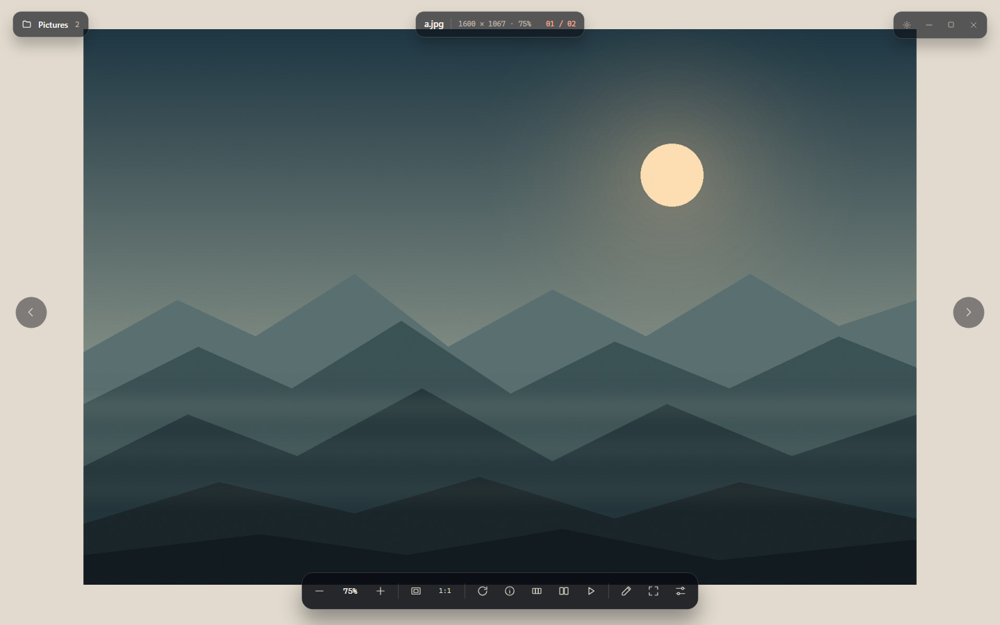
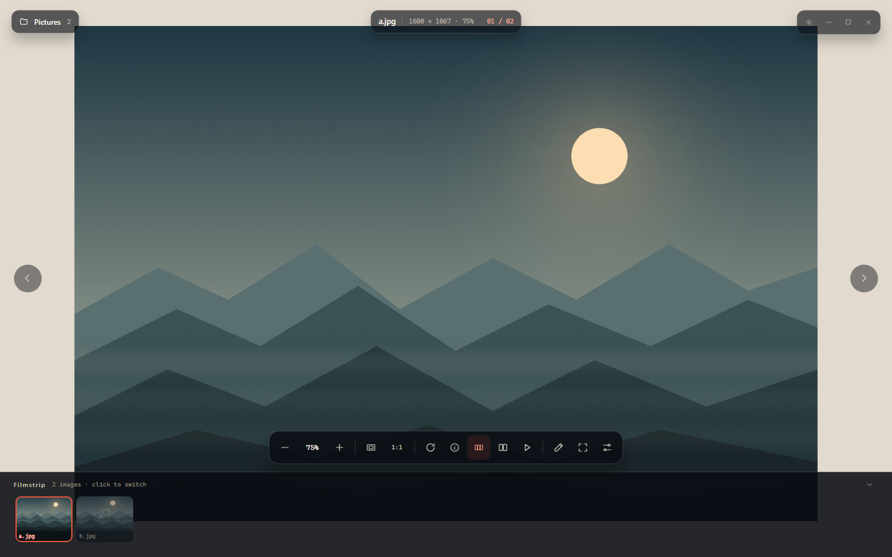
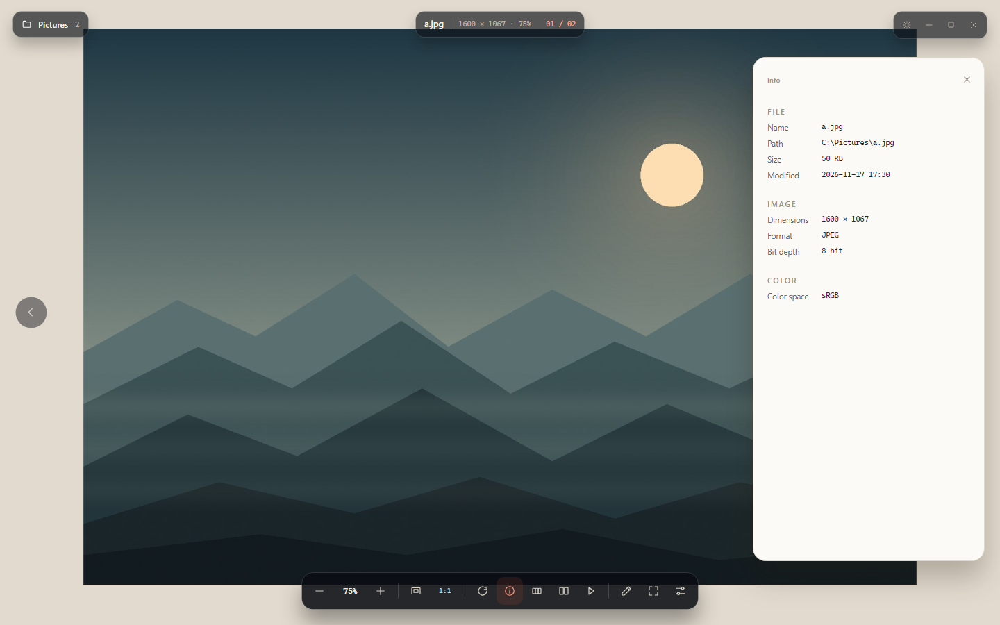
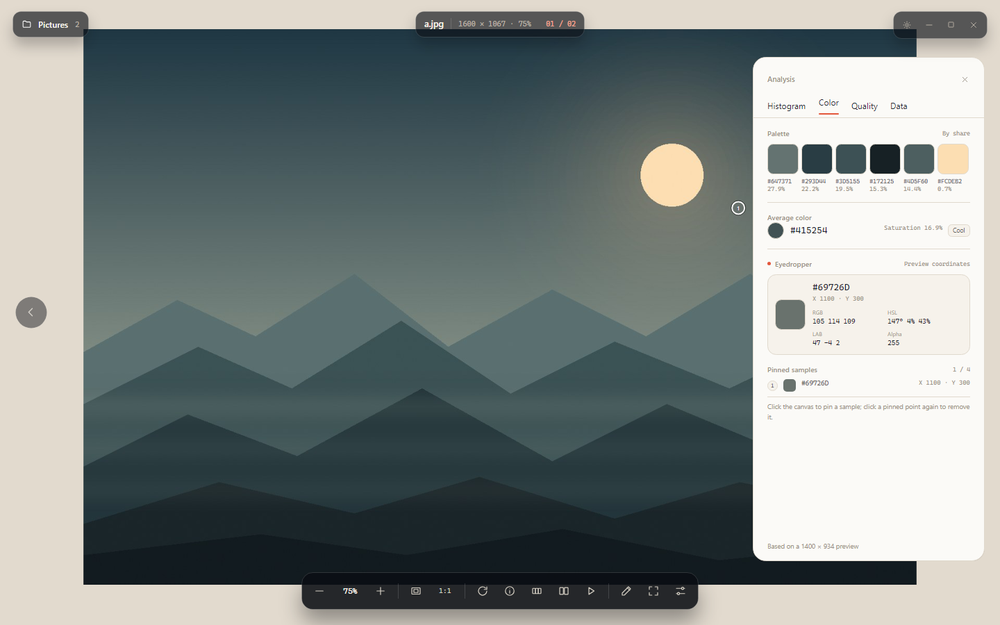
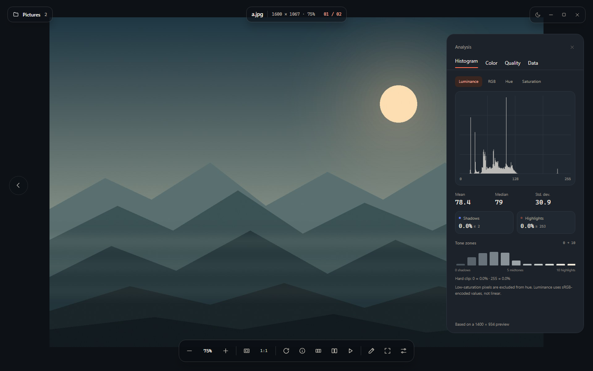
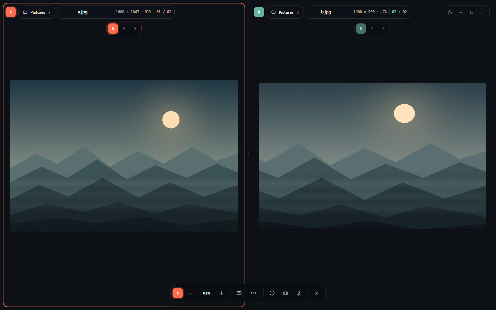

# AirGlance Microsoft Store 更新包说明：0.7.0

## 包信息

| 项目 | 值 |
| --- | --- |
| 应用版本 | `0.7.0` |
| Store 包版本 | `1.0.2.0`（上次 Store 包为 `1.0.1.0`，应用 0.6.0） |
| 架构 | `x64` |
| 文件 | `artifacts/msix-store/AirGlance_1.0.2.0_x64.msix` |
| 大小 | 21.65 MiB（22,699,392 字节） |
| SHA-256 | `A0EA2B089380B7E03C745698D2D7832FD4F56C2D7A1D1127E046B9B9760B5883` |
| 签名 | **未签名**；Microsoft Store 认证通过后由 Store 重新签名 |

包内确认包含：

- `AirGlance.exe`（0.7.0 NativeAOT）
- `airglance_avif.dll`（libavif + dav1d Windows x64 解码器）
- `.avif` 文件关联
- 许可证和第三方声明
- `AppxManifest` 版本 `1.0.2.0`、架构 `x64`、Store publisher identity 未变

## 距离上次 Store 版本更新了什么

上次 Store 包：**`1.0.1.0`，对应应用 0.6.0**。
本次 Store 包：**`1.0.2.0`，对应应用 0.7.0**。

本次是 **0.6.0 → 0.7.0** 的更新，核心是只读图像分析抽屉。0.6.0 已有的编辑、裁剪、导出副本、大 TIFF 和 AVIF 支持保持不变。

### 1. 右键「分析」子菜单

- 画布右键菜单新增「分析」，包含「直方图…」「色彩分析…」「画质分析…」「图像数据…」和可勾选的「取色器」
- 子菜单沿用默认 Fluent 菜单样式，没有新增快捷键或 dock 入口
- 无图、加载中、编辑和全屏时禁用；进入双画布或编辑时抽屉关闭

### 2. 直方图页

- 亮度、RGB、色相、饱和度四种视图
- 亮度图鼠标悬停显示该 bin 的级别和占比
- 均值、中位数、标准差、阴影/高光裁切卡、11 段影调分区
- 硬裁切提示和 sRGB 编码口径说明

### 3. 色彩页

- 6 色 OKLab 主色板和占比
- 平均色、饱和度、冷暖倾向
- 取色器实时显示 HEX/RGB/HSL/Lab/Alpha 和坐标
- 最多 4 个钉住样本，画布上有编号标记

### 4. 画质页

- 清晰度评分与模糊/柔和/清晰分档
- 亮度噪声 σ 与低/中/高分段
- JPEG 估算质量、子采样、基线/渐进和重启间隔（仅 JPEG）
- 曝光影调条和阴影/高光裁切

### 5. 数据页

- 尺寸、格式、位深、色彩空间、文件大小、B/px
- Alpha 覆盖、唯一色数、熵
- 分析分辨率与「预览/原图」标注
- 动图帧数、时长、循环次数

### 6. 边界

- 分析是只读、单图；不复制、不导出、不标记、不修改原文件
- 没有 A/B 对比、文件夹级分析或 ROI/全分辨率分析
- 动图只分析第一帧；SVG 分析当前视口栅格
- 不新增网络能力、遥测或权限；manifest 仍只有 `runFullTrust`

## Store 截图（1440 × 900，16:10）

截图来自 0.7.0 源码的 Windows AOT 构建，使用 `docs/design/assets/sample-photo.jpg` 和 `sample-photo-b.jpg`，与 README 截图同一组示例照片。Microsoft Store 的桌面截图下限是 1366 × 768；本组为 1440 × 900（16:10），远高于下限且文件均小于 1 MB。

### 1. 查看界面

浮动缩放、导航和工具按钮，浅色主题。

### 2. 胶片条

底部胶片条，2 张示例照片，点击切换。

### 3. 信息面板

文件、图片和色彩信息，右侧抽屉。

### 4. 分析 · 直方图

亮度直方图、统计、裁切卡、影调分区和分析分辨率说明。

### 5. 分析 · 色彩

6 色主色板、平均色、取色器读数和画布上的钉住样本。

### 6. 暗色分析

深色主题下的完整分析抽屉。

### 7. 双画布

A/B 双画布，两个示例文件夹视图。

## Partner Center 上传步骤

1. 打开 Partner Center → AirGlance → **Packages**。
2. 上传 `AirGlance_1.0.2.0_x64.msix`。
3. 确认包版本高于已发布的 `1.0.1.0`；不要上传 `1.0.1.0` 旧包。
4. 在 Store listing 的 **Screenshots** 中按顺序上传 `screenshots/1.0.2.0/01-viewer.png` 到 `07-dual-canvas.png`。
5. 在 **What's new** 中使用下面文案。
6. 提交认证。包无需开发者证书；Store 认证会重新签名。
7. 本次只提交 x64；ARM64 仍不在此次 Store 提交中。

## Store listing 文案

### 中文

**本次更新**

- 新增只读「分析」抽屉：亮度/RGB/色相/饱和度直方图、裁切与影调分区、主色板、取色器样本、清晰度/噪声/JPEG 估算和图像数据。
- 分析为单图只读，不复制、不导出、不修改原文件；进入编辑或双画布时自动关闭。
- 更新 Store 截图，统一使用示例照片。

### English

**What's new**

- Added a read-only Analyze drawer with luminance/RGB/hue/saturation histograms, clipping and tone zones, a palette, eyedropper samples, sharpness/noise/JPEG estimates and image data.
- Analysis is single-image and read-only: it does not copy, export or modify files, and closes when editing or dual view starts.
- Refreshed the Store screenshots around the same sample photo used by the README.

## 验证记录

- Store workflow run：https://github.com/RyzenWang/AirGlance/actions/runs/45305824619（success）
- MSIX manifest: `Version=1.0.2.0`, `ProcessorArchitecture=x64`, publisher identity `CN=D87D6846-5A2B-4D82-BDB7-8E739EB3F35B`
- 包内确认包含 `AirGlance.exe`（33,781,248 字节）、`airglance_avif.dll`（2,153,472 字节）和 `.avif` 文件关联
- 包内 payload 解压后 `--bench=startup C:\Pictures\a.jpg`：首次窗口 602 ms，首帧 766 ms，退出码 0
- WACK：`OVERALL_RESULT="PASS"`（未签名包的签名相关项按 Store 预检口径记录）
- Store screenshots：7 张 PNG，1440 × 900（16:10），来自 0.7.0 源码的 Windows AOT 构建，使用与 README 相同的示例照片
